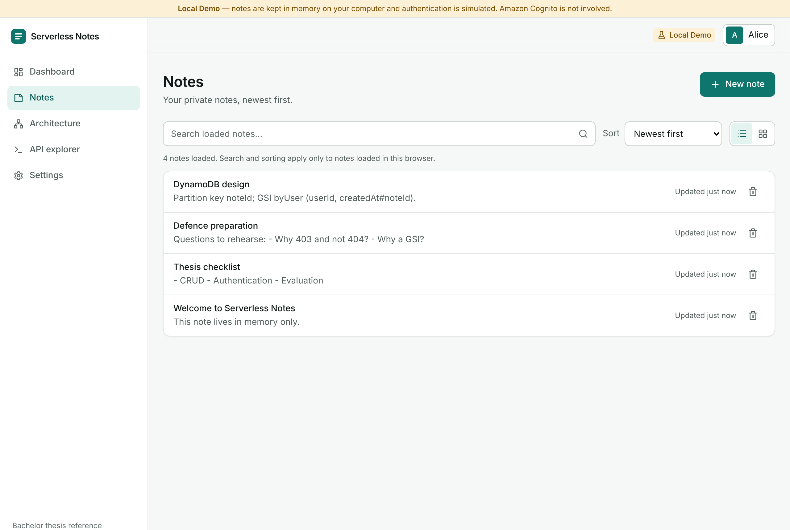
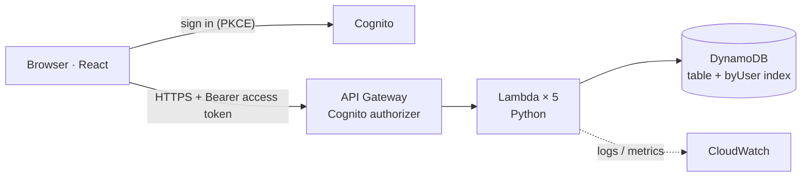
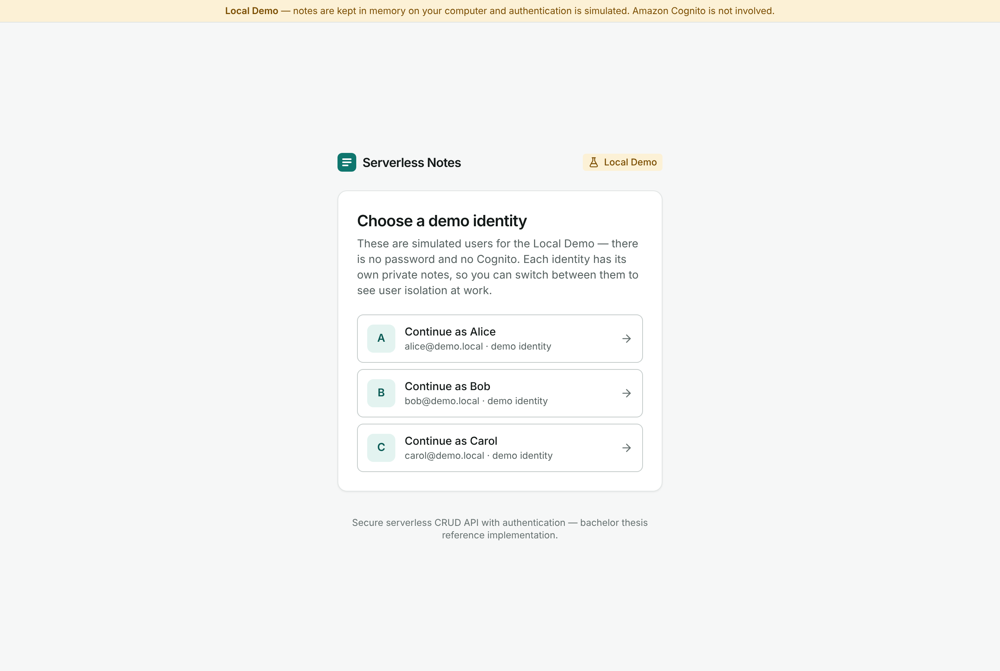
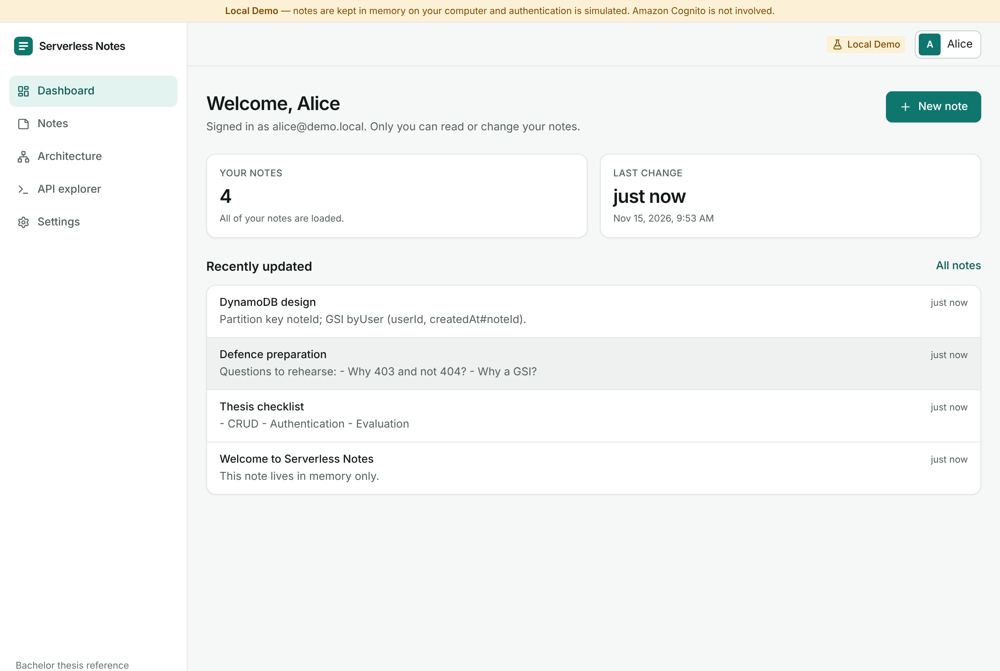
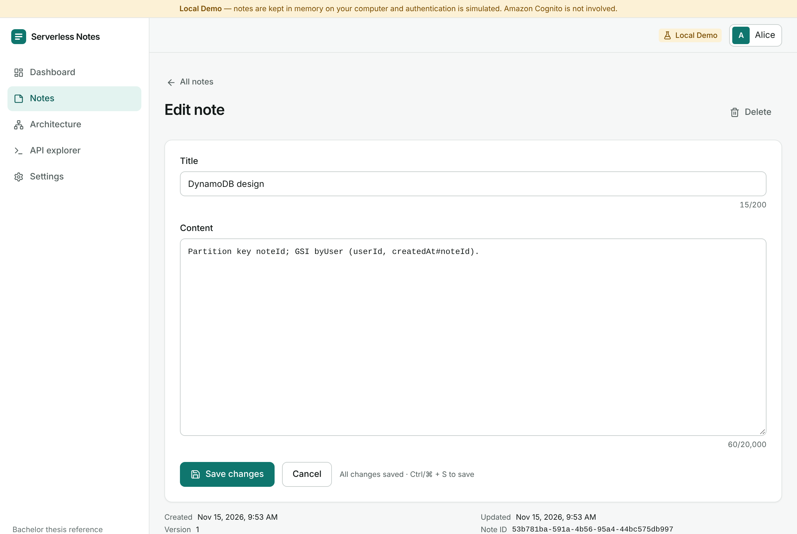
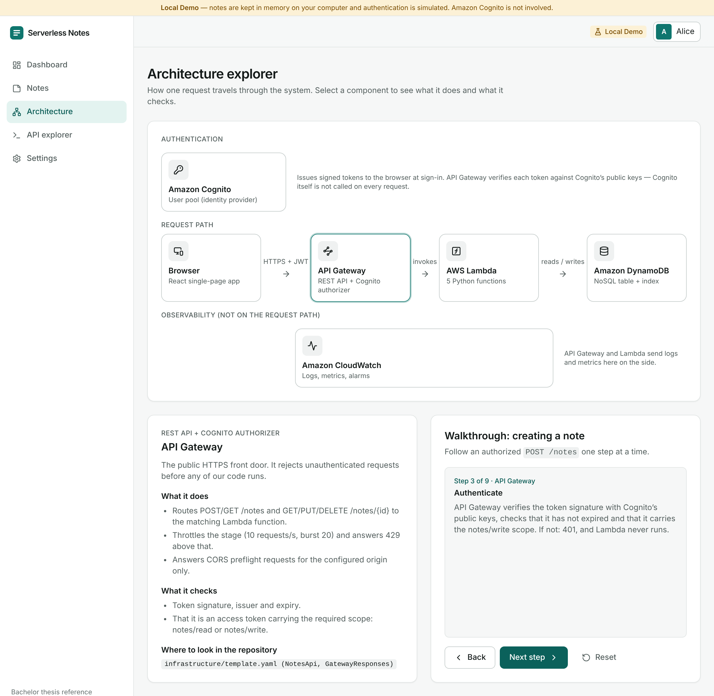
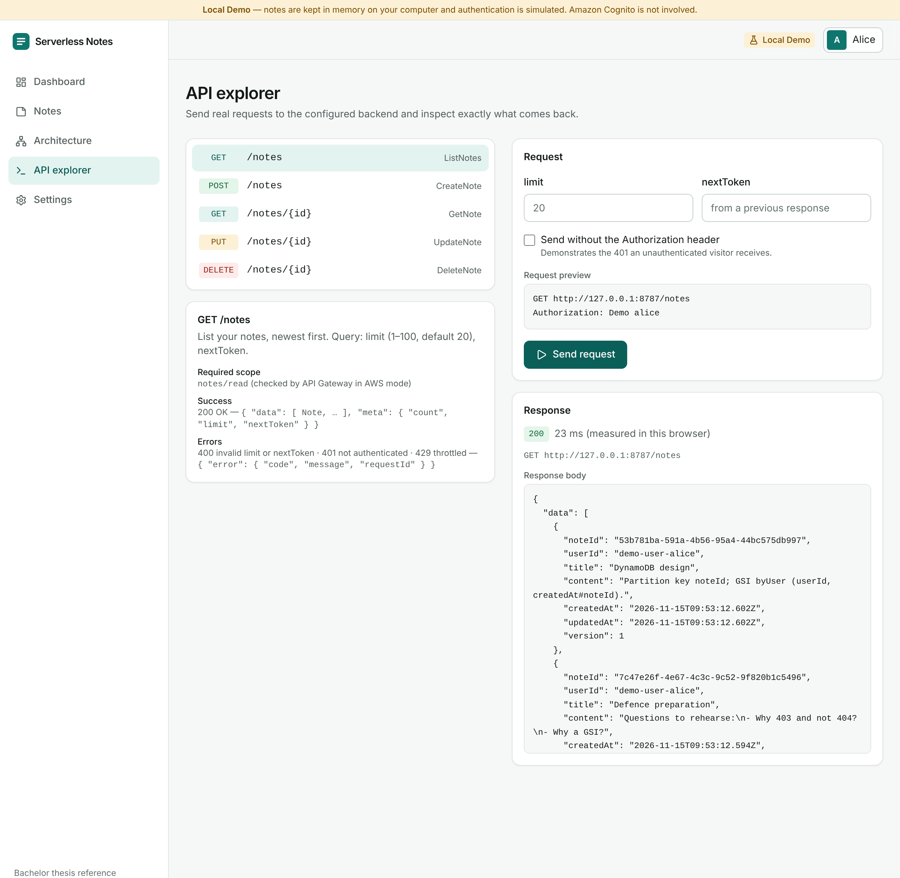
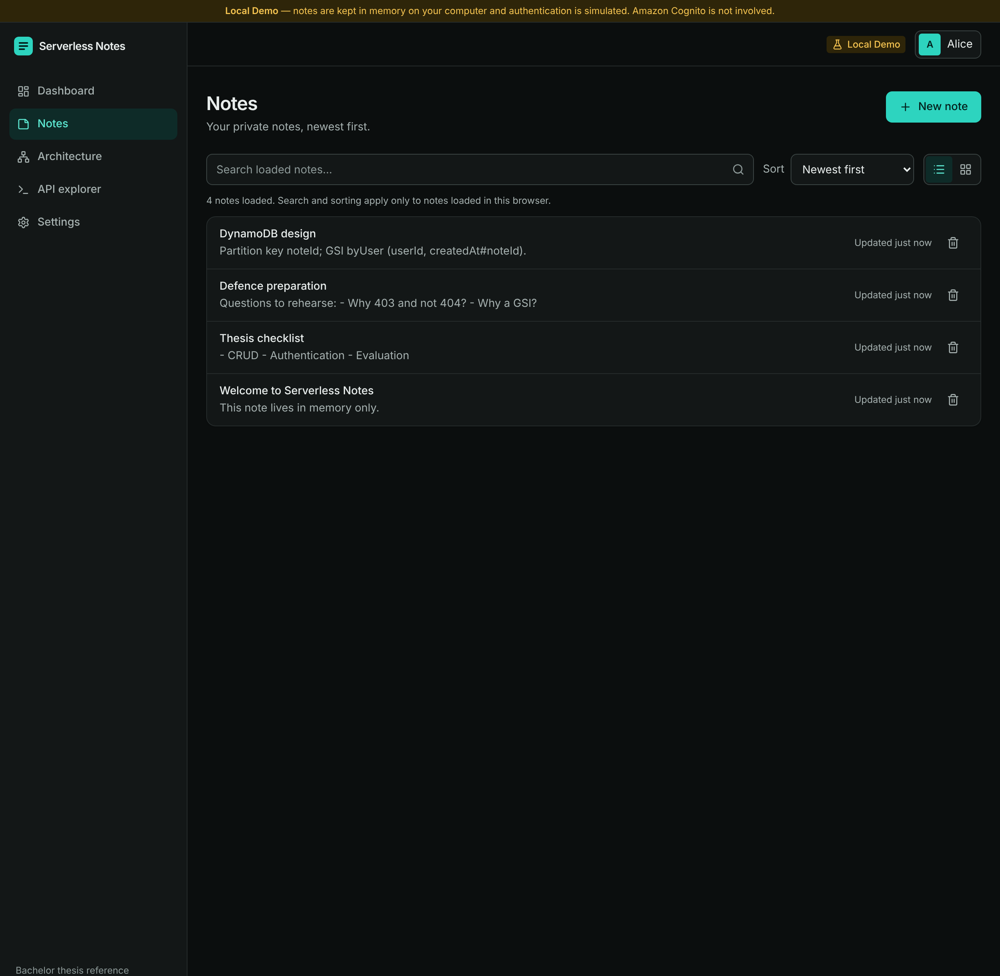

# Serverless Notes

**Secure serverless CRUD API with authentication** — a reference implementation for the bachelor thesis *Serverless CRUD API with Authentication* (Brno University of Technology, FEEC, Department of Telecommunications).

A multi-user private notes application: users register and sign in with Amazon Cognito, and create, read, update and delete notes through a REST API on API Gateway backed by Python Lambda functions and DynamoDB. Each note belongs to one user; nobody else can read or change it.

> **Status.** Everything that can be verified without AWS is implemented and verified: 166 backend tests (99 % coverage), 63 frontend tests, 12 browser tests, static analysis, template validation, CI green. **The stack has not been deployed to AWS** — no usable credentials were available — so real Cognito, API Gateway token validation, IAM and performance are unverified. Details: [`PROJECT_COMPLETION_REPORT.md`](PROJECT_COMPLETION_REPORT.md).

New here? Read [`START_HERE.md`](START_HERE.md).



## Features

- The five endpoints required by the thesis: `POST /notes`, `GET /notes`, `GET /notes/{id}`, `PUT /notes/{id}`, `DELETE /notes/{id}`, with the specified status codes (201/200/400/401/403/404) plus 409, 413, 415, 429, 503
- JWT authentication at API Gateway (Cognito authorizer, access tokens with OAuth scopes `notes/read` / `notes/write`)
- Per-user ownership enforced atomically with DynamoDB conditional writes; optimistic locking; cursor pagination; strict input validation; uniform error envelope with request ids
- Efficient listing through a global secondary index (no table scans)
- Least-privilege IAM: one DynamoDB action per Lambda function
- Structured JSON logging, CloudWatch alarms, throttling
- Infrastructure as code (AWS SAM), CI on GitHub Actions, manual OIDC-based deploy workflow
- React web client: dashboard, notes, editor, interactive architecture explorer, API explorer, settings; light/dark theme; responsive; keyboard accessible
- **Local Demo mode**: the real backend code against an in-memory database with clearly labelled simulated users — runs without an AWS account

## Technology

| Layer | Technology |
|---|---|
| Compute | AWS Lambda, Python 3.13, arm64, no third-party runtime dependencies |
| API | Amazon API Gateway (REST API), Cognito user-pool authorizer |
| Data | Amazon DynamoDB (on-demand), GSI `byUser` |
| Identity | Amazon Cognito user pool, OAuth 2.0 Authorization Code + PKCE |
| Observability | Amazon CloudWatch Logs, metrics, alarms |
| Infrastructure | AWS SAM / CloudFormation, region `eu-central-1` |
| Frontend | React 19, TypeScript, Vite, Tailwind CSS |
| Quality | pytest, moto, ruff, mypy (strict), Vitest, Testing Library, Playwright, ESLint, cfn-lint |
| CI/CD | GitHub Actions |

## Architecture


Backend layering: `handlers` → `http.api_handler` → `operations` → `services` → `repositories` → DynamoDB. Full diagrams: [`docs/architecture/ARCHITECTURE.md`](docs/architecture/ARCHITECTURE.md).

## Quick start (no AWS needed)

Requirements: Python 3.13, Node.js 22, make.

```bash
make setup            # backend virtualenv + frontend npm ci
make demo-backend     # terminal 1: Local Demo backend on http://127.0.0.1:8787
make demo-frontend    # terminal 2: app on http://localhost:5173
```
Choose a demo identity (Alice, Bob or Carol). Data lives in memory and resets when the backend stops.

Talk to the API directly:
```bash
curl -s http://127.0.0.1:8787/notes -H 'Authorization: Demo alice'
```

## Tests and checks

```bash
make test             # backend (pytest + coverage) and frontend (vitest)
make test-e2e         # Playwright browser tests against the Local Demo
make lint typecheck   # ruff, eslint, mypy, tsc
make build            # production build of the frontend
make validate         # cfn-lint + sam validate   (pip install cfn-lint aws-sam-cli)
make audit            # pip-audit + npm audit
```
Latest results and what they do and do not prove: [`docs/testing/TESTING.md`](docs/testing/TESTING.md). Raw outputs: [`evidence/`](evidence).

## Deploying to AWS

```bash
cd infrastructure && cp samconfig.example.toml samconfig.toml && cd ..
make deploy           # sam validate + build + deploy (asks before changing anything)
make frontend-env     # writes frontend/.env.aws from the stack outputs
cd frontend && npm run dev:aws
make live-test        # real acceptance + security tests against the stack
make destroy          # delete everything
```
Step-by-step guide, parameters, costs and cleanup: [`docs/deployment/DEPLOYMENT.md`](docs/deployment/DEPLOYMENT.md). These commands have not yet been executed against a real account.

## Repository layout

```
backend/            Python package notes_api (handlers, operations, services, repositories, validation, security)
  local_demo/       Local Demo HTTP server (real handlers + in-memory DynamoDB)
  tests/            unit · integration · security
frontend/           React application, unit tests, Playwright tests
infrastructure/     SAM template, example config, parameters
scripts/            setup · deployment · cleanup · testing (benchmark, live API tests)
docs/               architecture · api (+ OpenAPI) · database · security · testing · deployment · performance · decisions · learning
evidence/           test outputs, build logs, benchmark, screenshots
.github/workflows/  ci.yml, deploy.yml
```

## Documentation

| Document | Content |
|---|---|
| [START_HERE.md](START_HERE.md) | beginner introduction and reading order |
| [docs/REQUIREMENTS.md](docs/REQUIREMENTS.md) | thesis requirements; previous approach vs this implementation |
| [REQUIREMENTS_TRACEABILITY.md](REQUIREMENTS_TRACEABILITY.md) | requirement → code → tests → status → evidence |
| [docs/architecture/ARCHITECTURE.md](docs/architecture/ARCHITECTURE.md) | components and 11 diagrams |
| [docs/api/API.md](docs/api/API.md) · [openapi.yaml](docs/api/openapi.yaml) | API contract |
| [docs/database/DATABASE.md](docs/database/DATABASE.md) | DynamoDB design |
| [docs/security/SECURITY.md](docs/security/SECURITY.md) | threat model, JWT, IAM, limitations |
| [docs/testing/TESTING.md](docs/testing/TESTING.md) | test strategy and executed results |
| [docs/deployment/DEPLOYMENT.md](docs/deployment/DEPLOYMENT.md) · [TROUBLESHOOTING.md](docs/deployment/TROUBLESHOOTING.md) | deployment and operations |
| [docs/performance/PERFORMANCE.md](docs/performance/PERFORMANCE.md) | performance and scalability evaluation |
| [AWS_COST_ANALYSIS.md](AWS_COST_ANALYSIS.md) · [docs/COSTS.md](docs/COSTS.md) | cost model |
| [docs/decisions/README.md](docs/decisions/README.md) | architecture decision records |
| [docs/learning/](docs/learning/README.md) | 12 lessons with exercises |
| [SUPERVISOR_QUESTIONS.md](SUPERVISOR_QUESTIONS.md) | 40 defence questions with answers |
| [PROJECT_COMPLETION_REPORT.md](PROJECT_COMPLETION_REPORT.md) | what is done, verified, and open |
| [CLAUDE.md](CLAUDE.md) · [PROJECT_STATE.md](PROJECT_STATE.md) | conventions and current state for contributors and AI assistants |

## Screenshots

| | |
|---|---|
|  |  |
|  |  |
|  |  |

All screenshots show the Local Demo.

## Known limitations

- Not deployed; nothing AWS-specific has been observed working. Deploy, cleanup and live-test scripts are unexecuted.
- No AWS performance measurements; cost figures use unverified list prices.
- AWS-mode sign-in has only been tested against a mocked Cognito.
- The frontend is not hosted (runs locally); no password-reset or account-deletion screens (Cognito's hosted page provides "Forgot password").
- Throttling is per API stage, not per user; no MFA; no WAF. See `docs/security/SECURITY.md`.
- Search and sorting in the UI apply to loaded notes only (stated in the UI); there is no server-side search.
- Tested in Chromium only; no formal accessibility audit.

## License

MIT — see [LICENSE](LICENSE).
