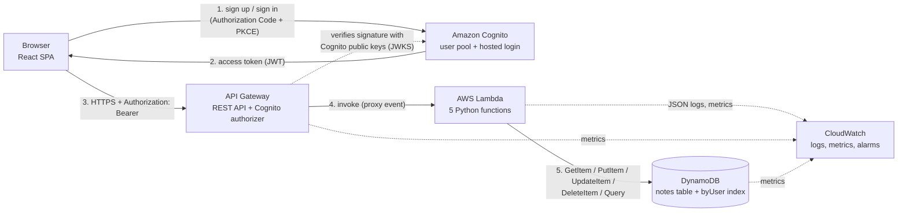
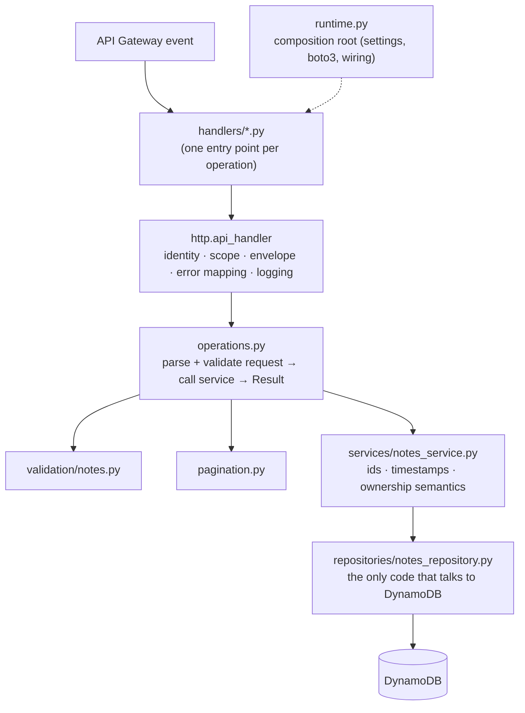
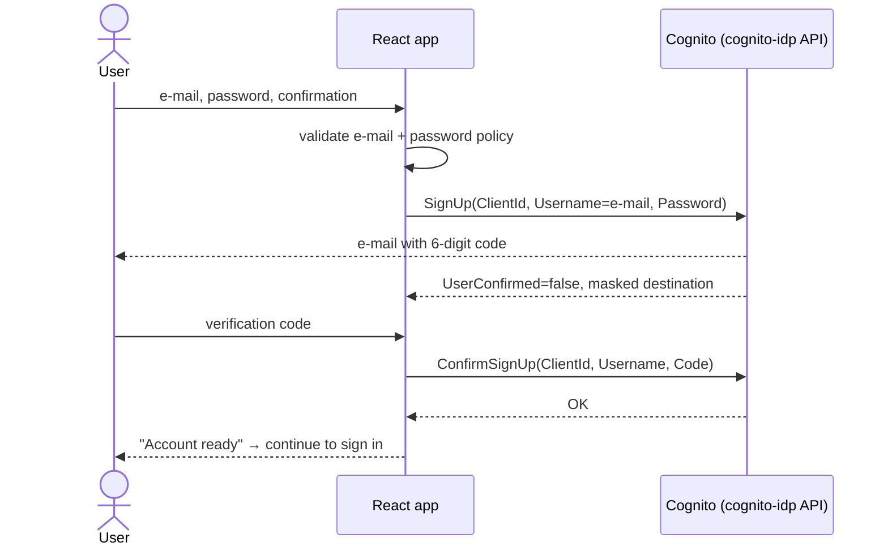
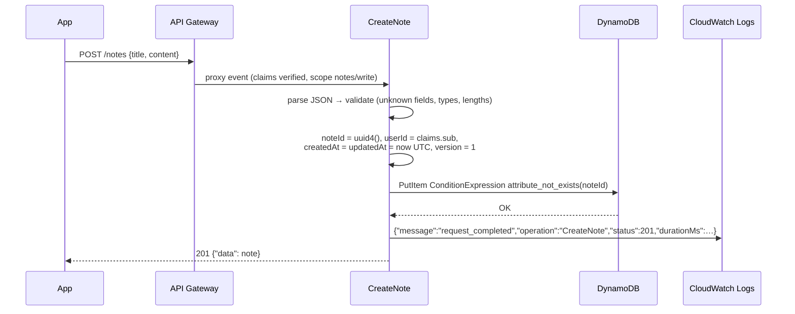
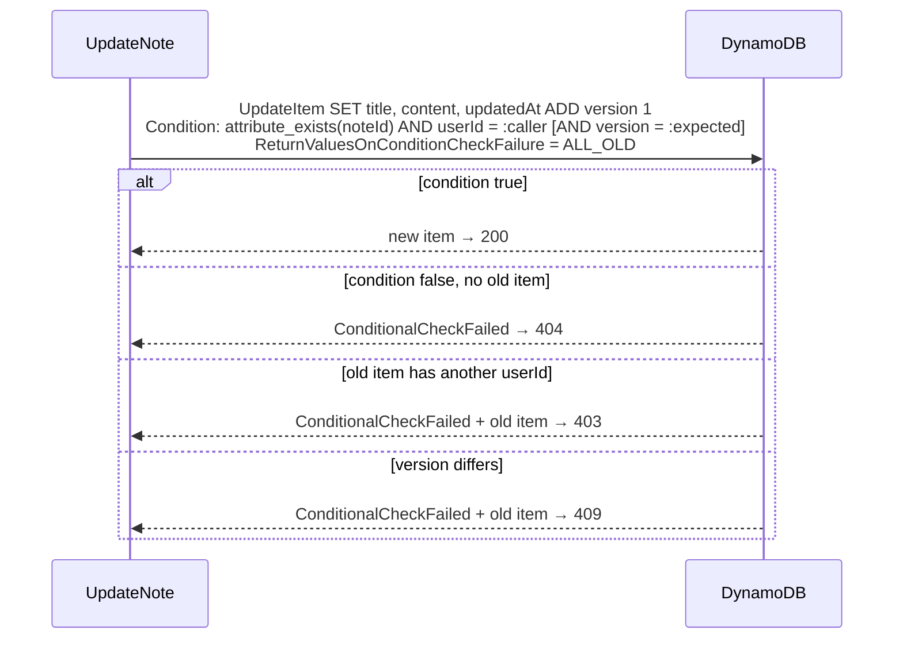
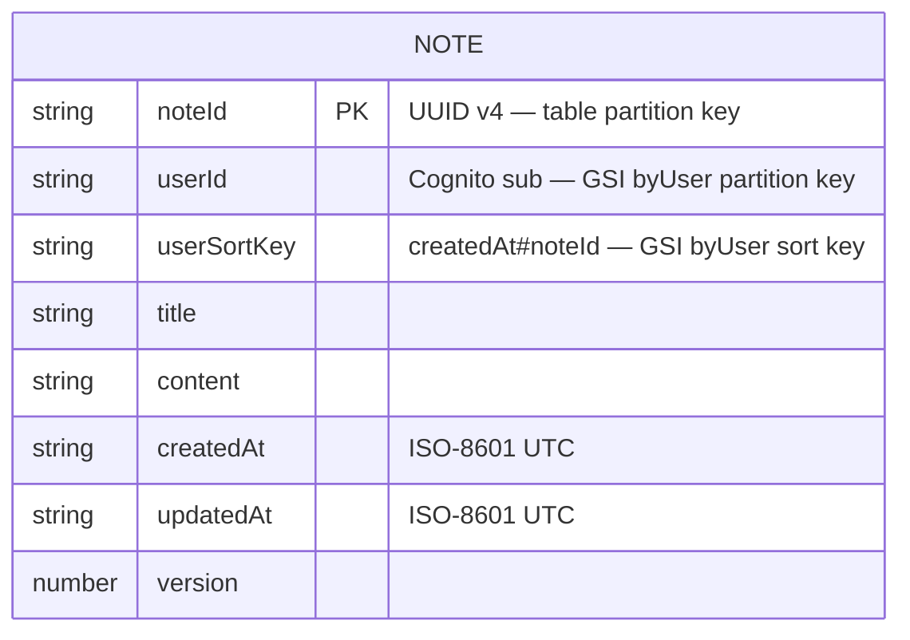
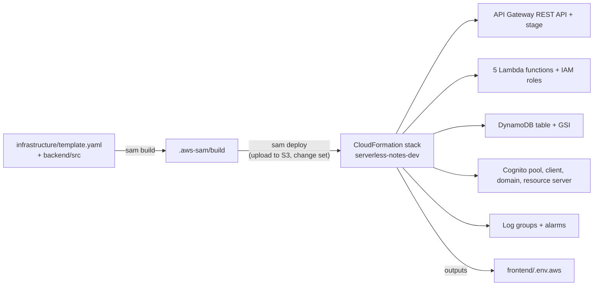
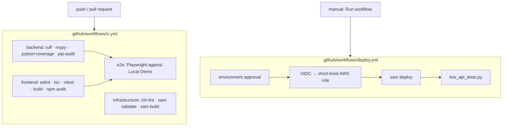
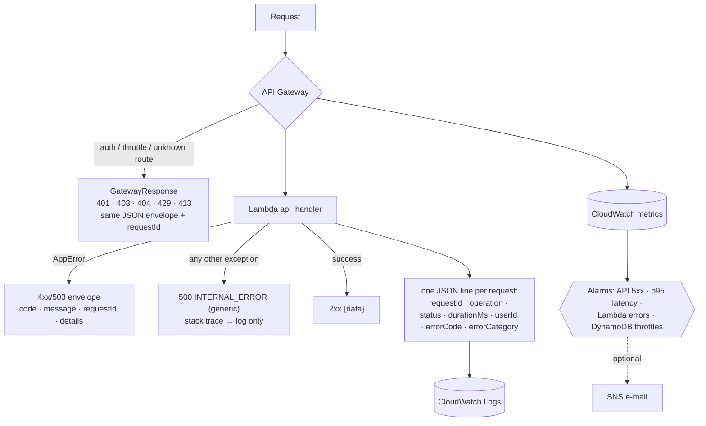

# Architecture

Everything in this document describes what is implemented in this repository. Region: `eu-central-1` (Frankfurt). All diagrams are Mermaid (GitHub renders them).

## 1. System overview



| Component | Responsibility | Defined in |
|---|---|---|
| React SPA (`frontend/`) | UI, sign-in redirect, calls the REST API. Holds no data and enforces no security rule. | `frontend/src` |
| Cognito user pool | Accounts, password policy, e-mail verification, token issuing, hosted login page | `infrastructure/template.yaml` (`UserPool`, `WebClient`, `NotesResourceServer`, `UserPoolDomain`) |
| API Gateway REST API | HTTPS endpoint, routing, **authentication** (JWT + scope), throttling, CORS preflight, uniform gateway error bodies | `NotesApi` |
| Lambda functions | Validation, **authorization** (ownership), business rules, logging | `backend/src/notes_api`, `*Function` resources |
| DynamoDB | Durable storage; atomic conditional writes | `NotesTable` |
| CloudWatch | Log groups (14-day retention), 4 alarms, optional SNS e-mail | `*LogGroup`, `*Alarm` |

No VPC, NAT gateway, server or container is involved.

## 2. Backend layering



Rules: dependencies point downwards only; `operations` and `services` contain no AWS calls; the repository is behind a `Protocol`, so unit tests use an in-memory fake and integration tests use `moto`. Extending the API with a second entity means adding a model, repository, service, operations and handlers alongside the existing ones — nothing existing has to change.

## 3. User registration



## 4. Sign-in (OAuth 2.0 Authorization Code + PKCE)

```mermaid
sequenceDiagram
    actor User
    participant App as React app
    participant Hosted as Cognito hosted login
    participant Tok as Cognito /oauth2/token
    App->>App: create code_verifier + state (sessionStorage),<br/>code_challenge = BASE64URL(SHA-256(verifier))
    App->>Hosted: redirect /oauth2/authorize?response_type=code&client_id&scope&state&code_challenge&code_challenge_method=S256
    User->>Hosted: e-mail + password (the app never sees them)
    Hosted-->>App: redirect /auth/callback?code=…&state=…
    App->>App: check state matches; delete stored verifier/state
    App->>Tok: POST grant_type=authorization_code, code, code_verifier
    Tok-->>App: access token, ID token, refresh token
    App->>App: keep tokens in memory only; schedule refresh
```
The public client has no secret; PKCE binds the authorization code to the browser that started the flow.

## 5. Authorized API request

```mermaid
sequenceDiagram
    participant App as React app
    participant GW as API Gateway
    participant Fn as Lambda
    participant DB as DynamoDB
    App->>GW: GET /notes/{id} + Authorization: Bearer <access token>
    alt token missing / invalid / expired
        GW-->>App: 401 {"error":{"code":"UNAUTHORIZED",…}}  (Lambda not invoked)
    else token lacks notes/read
        GW-->>App: 401/403 (Lambda not invoked)
    else valid
        GW->>Fn: event with requestContext.authorizer.claims (sub, scope, …)
        Fn->>Fn: user id = claims.sub; validate {id} is a UUID
        Fn->>DB: GetItem(noteId) ConsistentRead
        alt no item
            Fn-->>App: 404 NOT_FOUND
        else item.userId ≠ caller
            Fn-->>App: 403 FORBIDDEN (no content, no owner disclosed)
        else owner
            Fn-->>App: 200 {"data": note}
        end
    end
```

## 6. Create a note



## 7. Update a note (atomic ownership + optimistic locking)


Because the ownership test is part of the write, there is no moment between "check" and "write" in which another request could slip in. Delete works the same way.

## 8. Data model and access paths


| Operation | DynamoDB call | Key used |
|---|---|---|
| CreateNote | `PutItem` (conditional) | table: `noteId` |
| GetNote | `GetItem` (consistent) | table: `noteId` |
| UpdateNote | `UpdateItem` (conditional) | table: `noteId` |
| DeleteNote | `DeleteItem` (conditional) | table: `noteId` |
| ListNotes | `Query`, newest first, `Limit` | index `byUser`: `userId` |

Details and trade-offs: [`../database/DATABASE.md`](../database/DATABASE.md).

## 9. Deployment



## 10. CI/CD


Nothing deploys automatically. The deploy workflow uses GitHub OIDC; no AWS keys are stored.

## 11. Error handling and observability


How to investigate a failed request: [`../deployment/TROUBLESHOOTING.md`](../deployment/TROUBLESHOOTING.md).

## Differences from the semestral report

See [`../REQUIREMENTS.md`](../REQUIREMENTS.md) for the full comparison. In short: five single-purpose functions instead of three; a `byUser` index instead of application-level filtering; infrastructure as code instead of console configuration; Python 3.13 instead of 3.11; S3 (shown in the report's Figure 1) is not used because nothing needs it.
