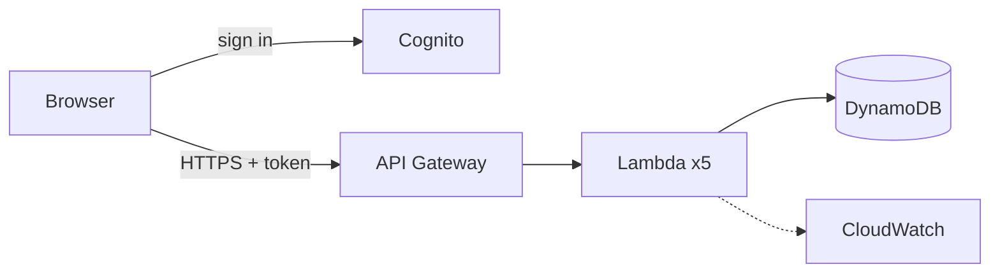

# Lesson 1 — What the project actually does

## In one minute
Serverless Notes is a private notebook on the internet. A signed-in user can create, list, read, change and delete short text notes. Each note belongs to exactly one user and nobody else can see or touch it. There is no server you manage: AWS runs small pieces of your code only when a request arrives.

## The simple explanation
Think of a bank's safe-deposit room. At the door a guard checks your ID card (**authentication**). Inside, your key only opens *your* box (**authorization**). The boxes are stored in a vault you never see (**the database**). A logbook records every visit (**logging**).

| Safe-deposit room | This project | AWS service |
|---|---|---|
| Office that issues ID cards | registers users, checks passwords, issues tokens | Amazon Cognito |
| Guard at the door | checks the token on every request | API Gateway (Cognito authorizer) |
| Clerk who handles your box | the code for each operation | AWS Lambda (5 Python functions) |
| Vault | stores the notes | Amazon DynamoDB |
| Logbook and alarm bell | logs, metrics, alarms | Amazon CloudWatch |

**CRUD** is the name for the four basic things you can do with stored data:

| Letter | Meaning | Here |
|---|---|---|
| C | Create | `POST /notes` |
| R | Read | `GET /notes` (list) and `GET /notes/{id}` (one) |
| U | Update | `PUT /notes/{id}` |
| D | Delete | `DELETE /notes/{id}` |

**Backend** = the part users never see: rules, security, storage. **Frontend** = what runs in the browser (`frontend/`). The thesis is about the backend; the frontend exists to demonstrate it.

**Serverless** does not mean "no servers". It means *you* do not rent, patch, scale or pay for idle servers. You upload functions; AWS runs as many copies as needed and bills per request. The trade-offs: a slow first request after idle (cold start), no memory between requests (stateless), and dependence on one cloud provider.

## In this repository

Try it now (two terminals):
```bash
make demo-backend     # real backend code, in-memory database, simulated users
make demo-frontend    # http://localhost:5173
```
Sign in as Alice, create a note, then go to Settings → switch to Bob. Bob cannot see Alice's note. That rule — not the user interface — is the heart of the project.

## Important source files
- `backend/src/notes_api/operations.py` — the five operations in ~70 lines; start here
- `backend/src/notes_api/models/note.py` — what a note is
- `infrastructure/template.yaml` — every AWS resource
- `docs/architecture/ARCHITECTURE.md` — diagrams

## بالعربي (مصري)
- **Serverless** مش معناها إن مفيش سيرفرات خالص. معناها إن إنت مش بتأجّر سيرفر وتسيبه شغال ٢٤ ساعة. AWS هي اللي بتشغّل الكود بتاعك لما ييجي request بس، وبتحاسبك على عدد الـ requests. لو مفيش حد بيستخدم التطبيق، تقريبًا مش بتدفع حاجة.
- **Authentication** يعني "إنت مين؟" (زي ما تورّي البطاقة للأمن). **Authorization** يعني "مسموحلك تعمل إيه؟" (المفتاح بتاعك بيفتح الخزنة بتاعتك إنت بس). الاتنين مختلفين ولازم الاتنين.
- **Backend** هو الجزء اللي المستخدم مش بيشوفه: القواعد والأمان وتخزين البيانات. الـ **Frontend** هو الصفحة اللي في المتصفح.

## Practical exercise
With the Local Demo backend running:
```bash
curl -s http://127.0.0.1:8787/notes -H 'Authorization: Demo alice'
curl -s http://127.0.0.1:8787/notes -H 'Authorization: Demo bob'
curl -s -i http://127.0.0.1:8787/notes
```
Write down: which notes each user sees, and what the third command returns. Then find, in `backend/local_demo/server.py`, the function that decides who the caller is.

## Check your understanding
1. What do the letters C, R, U, D stand for, and which HTTP request performs each here?
2. Name the AWS service responsible for (a) passwords, (b) running Python code, (c) storing notes.
3. What is the difference between authentication and authorization?
4. Give two advantages and two disadvantages of serverless compared with one rented server.
5. In the Local Demo, what is real and what is simulated?

<details><summary>Answers</summary>

1. Create `POST /notes`; Read `GET /notes` and `GET /notes/{id}`; Update `PUT /notes/{id}`; Delete `DELETE /notes/{id}`.
2. (a) Cognito, (b) Lambda, (c) DynamoDB.
3. Authentication proves who you are (token checked by API Gateway). Authorization decides whether you may act on this particular note (ownership checked by Lambda/DynamoDB).
4. Advantages: no server administration; automatic scaling; pay only for use. Disadvantages: cold starts; stateless functions; provider lock-in; harder local testing.
5. Real: all backend Python code. Simulated: identities (`Authorization: Demo alice`, in `_demo_claims`) and the database engine (moto in memory instead of DynamoDB).
</details>
