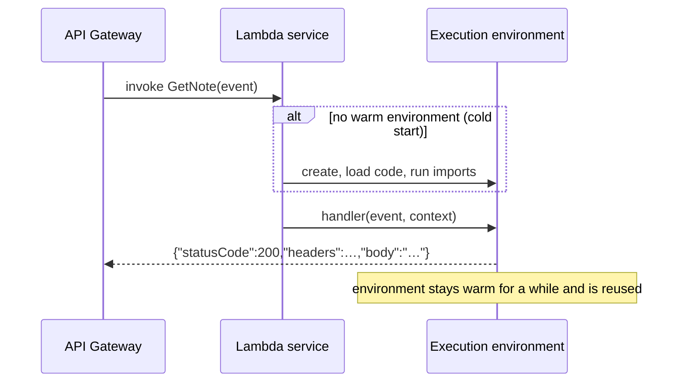

# Lesson 4 — AWS Lambda

## In one minute
Lambda runs a function you upload whenever an event arrives. For this project the event is "an HTTP request came through API Gateway". Lambda calls `handler(event, context)`, your code returns a dictionary, and API Gateway turns it into the HTTP response. You pay per request and per millisecond; when nothing happens, nothing runs.

## The simple explanation
A vending machine instead of a shop with staff: it does nothing until someone presses a button, serves that one request, and forgets it. If ten people come at once, imagine ten machines appearing.

- **Handler** — the function Lambda calls. Configured as `notes_api.handlers.create_note.handler` = file `notes_api/handlers/create_note.py`, variable `handler`.
- **Event** — a dictionary describing what happened.
- **Context** — information about the invocation (request id, remaining time).
- **Execution environment** — a small container with your code loaded. Code *outside* the handler runs once when the environment starts; the handler runs for every request.
- **Cold start** — a request that has to wait for a new environment to start (first request, after idle, or under rising load). **Warm** — an environment is already waiting.
- **Stateless** — never keep user data in global variables; the next request may land in another environment. State lives in DynamoDB.

## In this repository
The entire handler file `backend/src/notes_api/handlers/get_note.py`:
```python
from notes_api import operations, runtime
from notes_api.http import api_handler

handler = api_handler(
    "GetNote",
    operations.SCOPE_READ,
    operations.get_note,
    runtime.get_service,
    cors_allow_origin=runtime.cors_allow_origin,
    log_level=runtime.log_level,
)
```
The event API Gateway sends (REST API, proxy integration, payload format 1.0) — only the parts the code reads:
```json
{
  "httpMethod": "GET",
  "headers": {"Authorization": "Bearer eyJ…", "Content-Type": "application/json"},
  "pathParameters": {"id": "0b7f2c1e-8a55-4f0e-9d3a-6c1d2e3f4a5b"},
  "queryStringParameters": null,
  "body": null,
  "isBase64Encoded": false,
  "requestContext": {
    "requestId": "c6af9ac6-7b61-11e6-9a41-93e8deadbeef",
    "authorizer": {"claims": {"sub": "c3a4…", "token_use": "access", "scope": "notes/read notes/write"}}
  }
}
```
What the function must return:
```python
{"statusCode": 200,
 "headers": {"Content-Type": "application/json", "Access-Control-Allow-Origin": "http://localhost:5173", …},
 "body": "{\"data\": {…}}"}     # body is a STRING containing JSON
```

Configuration in `infrastructure/template.yaml` (`Globals.Function`): `Runtime: python3.13`, `Architectures: [arm64]`, `MemorySize: 256`, `Timeout: 10`, and environment variables (`NOTES_TABLE_NAME`, …) read by `config.py`. Each function has its own IAM role with one permitted DynamoDB action.

Why five functions and not one? One permission each (GetNote cannot delete), separate logs and metrics per operation. Cost: five separate cold starts.

## Important source files
`handlers/*.py` · `http.py` (`api_handler`, `json_response`) · `runtime.py` · `config.py` · template `Globals` and `*Function`

## بالعربي (مصري)
- **Lambda** زي ماكينة البيع: واقفة ساكتة لحد ما حد يدوس زرار، تخدمه وتنسى. ولو عشرة جم مع بعض، AWS بتشغّل عشر نسخ.
- **Cold start**: أول request بعد فترة سكون بياخد وقت أطول شوية، عشان AWS لسه بتجهّز "البيئة" وتحمّل الكود. اللي بعده بيبقى سريع (warm).
- **event** ده dictionary فيه كل تفاصيل الـ request. والـ handler لازم يرجّع dictionary فيه `statusCode` و`body`، والـ `body` لازم يكون **string** مش dict — غلطة مشهورة.
- **Stateless**: ما تخزّنش بيانات مستخدمين في متغيرات global؛ الـ request الجاي ممكن يروح لنسخة تانية خالص.

## Practical exercise
Call a handler by hand, exactly as Lambda would, against the in-memory table:
```bash
cd backend && .venv/bin/python - <<'PY'
import json, sys
sys.path[:0] = ["src", "."]
from local_demo.server import build_server
server, stop = build_server(0, with_seed=True)      # starts moto + configures the environment
from notes_api.handlers import list_notes
event = {"httpMethod": "GET", "headers": {}, "pathParameters": None, "queryStringParameters": None,
         "body": None, "requestContext": {"requestId": "my-test-1",
         "authorizer": {"claims": {"sub": "demo-user-alice", "token_use": "access", "scope": "notes/read"}}}}
response = list_notes.handler(event, None)
print(response["statusCode"], json.dumps(json.loads(response["body"]), indent=2)[:400])
stop()
PY
```
Then change the event: remove `authorizer`; set `scope` to `"openid"`; set `token_use` to `"id"`. Predict each status first.

## Check your understanding
1. What two arguments does Lambda pass to a handler?
2. Where does the handler find the note id, the body and the caller's identity in the event?
3. What type must `body` be in the returned dictionary?
4. What is a cold start and when does it happen?
5. Why must a Lambda function not store user data in a global variable?
6. Give one benefit and one cost of using five functions instead of one.

<details><summary>Answers</summary>

1. `event` (the request as a dict) and `context` (invocation metadata).
2. `event["pathParameters"]["id"]`, `event["body"]`, `event["requestContext"]["authorizer"]["claims"]["sub"]`.
3. A string (JSON text), not a dict.
4. Creating and initialising a new execution environment before the handler can run: first request, after idle, after deploy, or when concurrency rises.
5. Requests are spread over many short-lived environments; data would be lost or shown to the wrong caller. State belongs in DynamoDB.
6. Benefit: least-privilege role and separate observability per operation. Cost: more resources and separate cold starts.

Exercise: no authorizer → 401; scope `openid` → 403; `token_use: id` → 401.
</details>
