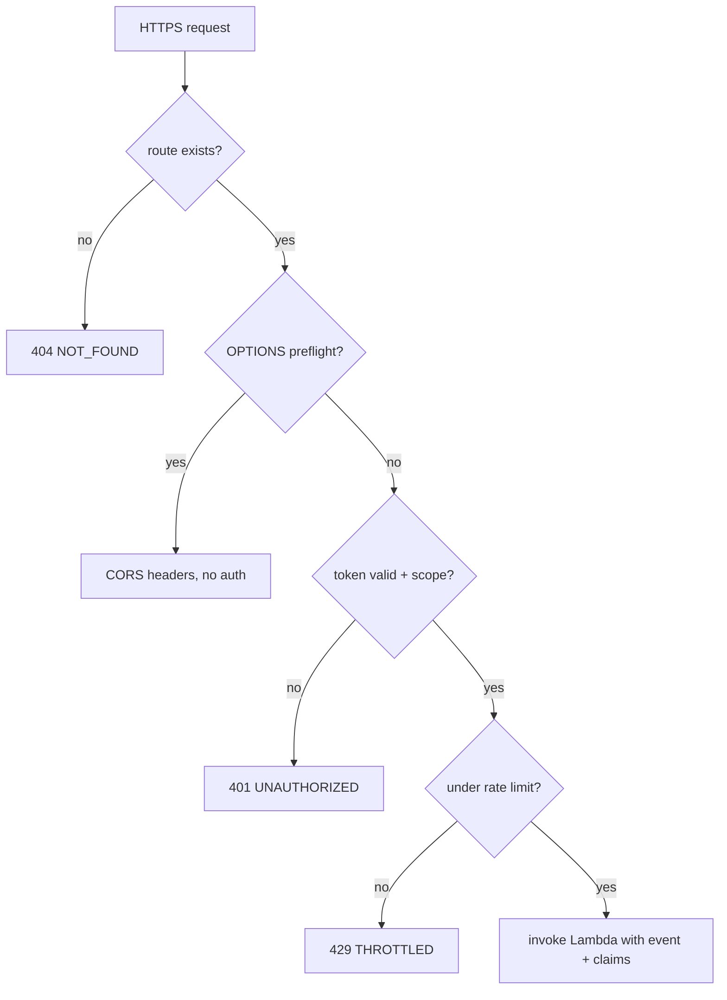

# Lesson 5 — API Gateway

## In one minute
API Gateway is the public HTTPS address of the backend. For each request it (1) finds the matching route, (2) asks the Cognito **authorizer** whether the token is valid and has the right scope, (3) applies throttling, (4) invokes the Lambda function for that route and (5) returns its answer. Requests that fail steps 1–3 never reach your code.

## The simple explanation
The reception desk of an office building: checks your badge, tells you which room to go to, and refuses entry when the lobby is too crowded. The people in the rooms (Lambda) only ever meet visitors who passed reception.

| Term | Meaning |
|---|---|
| REST API | the API Gateway product used here (there is also the newer "HTTP API") |
| Resource + method | a route, e.g. `GET /notes/{id}`; `{id}` is a path parameter |
| Stage | a deployed version with a name that appears in the URL: `…amazonaws.com/dev/notes` |
| Lambda proxy integration | pass the whole request to Lambda as one event; Lambda builds the whole response |
| Authorizer | checks credentials before the integration is called |
| Gateway response | the response API Gateway itself sends when *it* rejects a request |
| Throttling | a rate limit; excess requests get 429 |
| CORS | browser rule: a page from origin A may call origin B only if B allows it |

## In this repository
Routes are declared as `Events` on each function in `infrastructure/template.yaml`:
```yaml
GetNoteFunction:
  Type: AWS::Serverless::Function
  Properties:
    Handler: notes_api.handlers.get_note.handler
    Events:
      Api:
        Type: Api
        Properties:
          RestApiId: !Ref NotesApi
          Path: /notes/{id}
          Method: GET
          Auth:
            AuthorizationScopes: [notes/read]
```
The authorizer is the default for every method:
```yaml
NotesApi:
  Type: AWS::Serverless::Api
  Properties:
    Auth:
      DefaultAuthorizer: CognitoAuthorizer
      AddDefaultAuthorizerToCorsPreflight: false
      Authorizers:
        CognitoAuthorizer:
          UserPoolArn: !GetAtt UserPool.Arn
```
**Why scopes matter.** A Cognito authorizer *without* scopes accepts ID tokens. *With* `AuthorizationScopes` it requires an **access token** containing that scope. Read operations need `notes/read`; changing operations need `notes/write`.

**Throttling** (whole stage): `ThrottlingRateLimit: 10` requests per second, `ThrottlingBurstLimit: 20`. It is a token bucket: 20 tokens, refilled at 10 per second; a request with no token left gets 429.

**Gateway responses** make API Gateway's own errors look like ours:
```yaml
UNAUTHORIZED:
  StatusCode: 401
  ResponseTemplates:
    application/json: '{"error":{"code":"UNAUTHORIZED","message":"Authentication is required","requestId":"$context.requestId"}}'
```
One surprise to remember: for an unknown path or method, REST APIs report "Missing Authentication Token" (403 by default). The template maps that case to `404 NOT_FOUND`.

**CORS.** The app at `http://localhost:5173` calls `https://…amazonaws.com` — a different origin. Before a request with an `Authorization` header the browser sends a *preflight* `OPTIONS` request with no credentials. API Gateway answers it (`Cors:` block) with the allowed origin, methods and headers; that is why the preflight must *not* require authentication. The actual response then also needs `Access-Control-Allow-Origin`, which Lambda adds in `json_response`. CORS protects browser users; it does not stop curl — the token does that.


In the Local Demo, `backend/local_demo/server.py` plays this role: it routes, answers `OPTIONS`, builds the same event and fills `claims` from `Authorization: Demo <name>`. It does not throttle and does not validate any token.

## Important source files
`infrastructure/template.yaml` (`NotesApi`, the five `Events`) · `backend/src/notes_api/http.py` (`json_response`) · `backend/local_demo/server.py` (`_dispatch`)

## بالعربي (مصري)
- **API Gateway** هو موظف الاستقبال: بيشوف الكارنيه (الـ token)، يوجّهك للأوضة الصح (الـ Lambda)، ولو الزحمة زادت يقولك استنى (429). الكود بتاعك مش بيشوف غير الناس اللي عدّت من الاستقبال.
- **CORS** قاعدة في المتصفح بس: الصفحة اللي جاية من `localhost:5173` ما تقدرش تكلّم دومين تاني إلا لو الدومين التاني قال "مسموح". قبل الـ request الحقيقي المتصفح بيبعت `OPTIONS` (اسمه preflight) من غير token، وعشان كده الـ preflight لازم يعدّي من غير authentication.
- الـ **scope** زي صلاحية مكتوبة جوّه الـ token: `notes/read` للقراءة و`notes/write` للكتابة. لو الـ token مفيهوش الصلاحية، API Gateway بيرفض قبل ما يوصل للـ Lambda.

## Practical exercise
With the Local Demo backend running, watch a preflight and a real request:
```bash
curl -s -i -X OPTIONS http://127.0.0.1:8787/notes -H 'Origin: http://localhost:5173' \
     -H 'Access-Control-Request-Method: POST' -H 'Access-Control-Request-Headers: authorization,content-type'
curl -s -i -X OPTIONS http://127.0.0.1:8787/notes -H 'Origin: https://evil.example'
curl -s -i -X PATCH http://127.0.0.1:8787/notes -H 'Authorization: Demo alice'
```
Compare the `Access-Control-*` headers of the first two. Then open the browser's developer tools (Network tab) in the running app, create a note, and find the `OPTIONS` request that precedes the `POST`.

## Check your understanding
1. Name three things API Gateway does before Lambda runs.
2. What changes when `AuthorizationScopes` is set on a route?
3. Why is the `OPTIONS` preflight not authenticated?
4. What do rate 10 and burst 20 mean?
5. Why does the template define `GatewayResponses`?
6. Does CORS protect the API from a script using curl? What does?

<details><summary>Answers</summary>

1. Routing, authentication (authorizer), throttling (also CORS preflight, request size limits).
2. The authorizer requires an access token that contains the listed scope; ID tokens are no longer accepted.
3. Browsers send preflight requests without credentials; if it required a token, every cross-origin call would fail.
4. On average 10 requests per second are allowed, with short bursts of up to 20; beyond that → 429.
5. So errors produced by API Gateway (401, 403, 404, 429…) have the same JSON envelope and request id as errors produced by Lambda.
6. No — CORS is enforced only by browsers. The token (authentication) and ownership checks protect the API.
</details>
