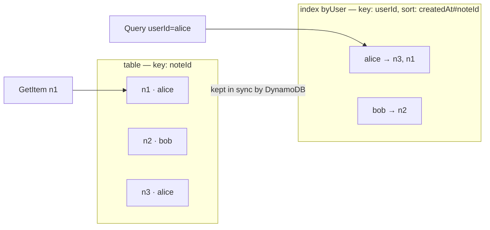

# Lesson 6 — DynamoDB

## In one minute
DynamoDB is a managed NoSQL database. A table holds **items** (like JSON objects). You must tell it the **key** up front, because the only fast ways to find data are "give me the item with this key" and "give me the items that share this partition key". This project uses the key `noteId`, plus an **index** that regroups the same items by `userId` so one user's notes can be listed quickly.

## The simple explanation
A cloakroom: you hand over a coat and get a numbered ticket. With the ticket, the attendant fetches your coat instantly (**GetItem** by key). Without it, the attendant must look at every coat (**Scan**) — slow, and they see everyone's coats. An **index** is a second list, sorted by owner name, pointing to the same coats: "all coats of Alice" becomes one lookup (**Query**).

| Term | Meaning | Here |
|---|---|---|
| Table | collection of items | `<stack>-notes` |
| Item / attribute | a record / a field | one note / `title` |
| Partition key | the value DynamoDB hashes to locate an item | `noteId` |
| Sort key | orders items that share a partition key | (index only) `userSortKey` |
| GSI | global secondary index: same data, different key | `byUser` = `userId` + `userSortKey` |
| Query | read items with one partition key (efficient) | list my notes |
| Scan | read the whole table (avoid) | never used |
| Condition expression | "do this write only if …" | ownership, existence, version |
| On-demand | pay per request, no capacity planning | `BillingMode: PAY_PER_REQUEST` |

No joins, no "SELECT … WHERE anything": you design the keys for the questions you will ask (the **access patterns**).

## In this repository
A stored item:
```json
{"noteId": "0b7f…", "userId": "c3a4…", "userSortKey": "2026-01-31T12:00:00.000Z#0b7f…",
 "title": "My first note", "content": "…", "createdAt": "2026-01-31T12:00:00.000Z",
 "updatedAt": "2026-01-31T12:00:00.000Z", "version": 1}
```
`userSortKey` starts with the creation time, so sorting the index descending gives "newest first"; the note id at the end breaks ties.

Listing (`repositories/notes_repository.py`):
```python
query = {
    "IndexName": self._user_index_name,
    "KeyConditionExpression": Key("userId").eq(user_id),
    "ScanIndexForward": False,  # newest first
    "Limit": limit,
}
```
Only items whose `userId` equals the caller are ever read. The original report listed notes by scanning and filtering — reading every user's notes on every list.

Updating — the most important lines in the project:
```python
condition = "attribute_exists(noteId) AND userId = :owner"
…
self._table.update_item(
    Key={"noteId": note_id},
    UpdateExpression="SET title = :title, content = :content, updatedAt = :updatedAt ADD version :one",
    ConditionExpression=condition,
    ExpressionAttributeValues=values,
    ReturnValues="ALL_NEW",
    ReturnValuesOnConditionCheckFailure="ALL_OLD",
)
```
DynamoDB checks the condition and writes in **one atomic step**. If the condition is false it writes nothing and (because of `ALL_OLD`) returns the item as it was, so the code can tell *why*: no item → 404; another owner → 403; otherwise the version was stale → 409.

`:owner`, `:title` are placeholders; values are passed separately, never glued into the expression — the DynamoDB equivalent of parameterised SQL.

**Pagination.** A query returns at most `Limit` items plus `LastEvaluatedKey` ("where I stopped"). The API encodes that position as `nextToken`; the next call passes it back as `ExclusiveStartKey`.

**Consistency.** Reading by `noteId` uses `ConsistentRead=True` (always the latest). The index is updated a moment after the table (*eventually consistent*): a list right after a create can miss the new note for a few milliseconds.



## Important source files
`backend/src/notes_api/repositories/notes_repository.py` · `models/note.py` (`to_item`, `user_sort_key`) · `pagination.py` · template `NotesTable` · `docs/database/DATABASE.md` · `tests/integration/test_repository.py`

## بالعربي (مصري)
- **Partition key** هو رقم التذكرة في الأمانات: بيه بتجيب الحاجة على طول. من غيره لازم تلف على كل الحاجات (ده الـ **Scan**) وده بطيء وغالي وبيخليك تقرا بيانات ناس تانية.
- الـ **GSI** (الـ index) كشف تاني لنفس البيانات بس مترتّب بالـ `userId`. فلما أقول "هات notes بتاعة Alice" بيبقى **Query** سريع على الكشف ده.
- الـ **Condition expression** معناها "اكتب بس لو الشرط صح". إحنا بنقول: "عدّل الـ note دي بس لو صاحبها هو اللي بيطلب". الفحص والكتابة بيحصلوا في خطوة واحدة، فمفيش لحظة في النص حد يقدر يلعب فيها.
- **Eventually consistent** يعني الـ index بيتحدّث بعد الجدول بلحظة صغيرة؛ عشان كده ممكن note لسه معمولة ما تظهرش في الـ list لمدة ميلي ثواني.

## Practical exercise
```bash
cd backend
.venv/bin/pytest tests/integration/test_repository.py -v
```
1. Read `test_update_is_conditional_on_owner_and_version` and match each `pytest.raises` to a clause of the condition.
2. Break the security on purpose: in `notes_repository.py` change the update condition to just `"attribute_exists(noteId)"`. Run `.venv/bin/pytest tests/security -q`. Which tests fail, and what would that mean for real users? Restore the line and re-run.
3. In `list_for_user`, what would you change to return the *oldest* notes first? Which test would then fail?

## Check your understanding
1. Why can't you ask DynamoDB "give me all notes where title contains X" efficiently?
2. What is the difference between Query and Scan?
3. Why was a GSI chosen instead of making `userId` the table's partition key?
4. Why is a condition expression safer than "read the note, check the owner in Python, then write"?
5. How does the code tell 404, 403 and 409 apart after a failed conditional write?
6. What does "eventually consistent" mean for the list endpoint?
7. Why are values passed as `:owner` placeholders?

<details><summary>Answers</summary>

1. Only key-based lookups are indexed; anything else requires reading every item (a Scan).
2. Query reads the items of one partition key; Scan reads the entire table.
3. With `userId` as the partition key, a note owned by someone else cannot be found by id, so the API could only return 404 — but the thesis requires 403 for an existing note of another user.
4. Between the check and the write another request could change or delete the item; a condition makes check-and-write atomic.
5. From the old item returned with the failure: none → 404; different `userId` → 403; same owner → the version clause failed → 409.
6. A note created milliseconds ago may not yet appear in a list, though `GET /notes/{id}` already returns it.
7. To keep data separate from the expression (no injection, no escaping problems, reserved words handled).

Exercise 2: the cross-user update tests fail (Bob's PUT returns 200) — any signed-in user could overwrite anyone's note.
</details>
