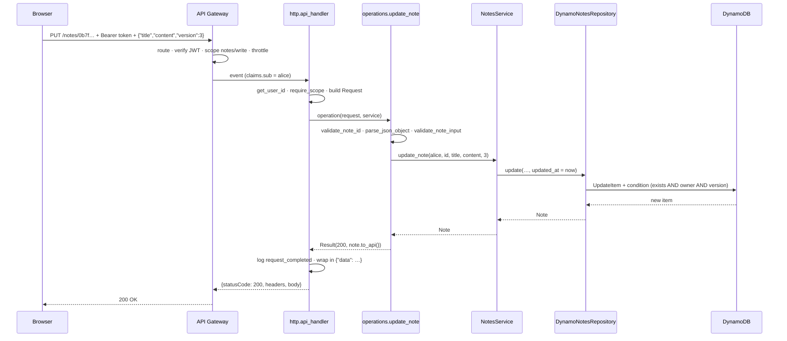

# Lesson 8 — Connecting everything: one request, start to finish

## In one minute
Follow a single `PUT /notes/{id}` ("save my edit") through every component and file. If you can retell this journey, you understand the system.

## The journey


| # | Where | File / resource | What happens | Can fail with |
|---|---|---|---|---|
| 1 | Browser | `frontend/src/pages/NoteEditorPage.tsx` → `services/notesApi.ts` → `services/apiClient.ts` | form validated; `PUT` sent with `Authorization: Bearer …` and the `version` last read | — |
| 2 | API Gateway | `template.yaml` `NotesApi`, `UpdateNoteFunction.Events` | route found; token verified; scope `notes/write` required; rate limit | 404, 401, 429 |
| 3 | Lambda entry | `handlers/update_note.py` | `handler` built by `api_handler` is invoked with the event | — |
| 4 | Wrapper | `http.py` `api_handler` | start timer; `get_user_id(event)`; `require_scope`; build `Request` (decode body, check Content-Type) | 401, 403, 415 |
| 5 | Operation | `operations.py` `update_note` | `validate_note_id` (UUID); `parse_json_object`; `validate_note_input(allow_version=True)` | 400, 413 |
| 6 | Service | `services/notes_service.py` `update_note` | picks the timestamp; calls the repository; translates storage outcomes into API errors | 404, 403, 409, 503 |
| 7 | Repository | `repositories/notes_repository.py` `update` | one conditional `UpdateItem` | — |
| 8 | DynamoDB | `NotesTable` | checks the condition and writes atomically; version +1 | condition failure |
| 9 | Back up | `models/note.py` `to_api` → `Result(200, …)` | note converted to the public JSON shape | — |
| 10 | Wrapper | `http.py` | one JSON log line; `json_response` adds headers and the `{"data": …}` envelope | 500 if anything unexpected was raised |
| 11 | API Gateway → browser | — | response relayed; the app updates its list and shows "Note saved" | — |

The log line written in step 10 (this is real output from the Local Demo):
```json
{"timestamp": "2026-11-15T09:27:16.471+00:00", "level": "INFO", "message": "request_completed",
 "requestId": "…", "operation": "UpdateNote", "httpMethod": "PUT", "status": 200,
 "durationMs": 4.35, "userId": "demo-user-alice", "errorCode": null, "errorCategory": null}
```
Note what is *not* there: the title, the content, the token.

## The same request when things go wrong
| Situation | Stops at step | Response |
|---|---|---|
| No token | 2 | 401 `UNAUTHORIZED` (Lambda never runs) |
| `"title": ""` | 5 | 400 `VALIDATION_ERROR` with `details` |
| id is not a UUID | 5 | 400 |
| Note belongs to Bob | 8 → 6 | 403 `FORBIDDEN` |
| Note was deleted meanwhile | 8 → 6 | 404 `NOT_FOUND` |
| Someone saved first (version is now 4) | 8 → 6 | 409 `VERSION_CONFLICT` |
| DynamoDB throttles | 7 → 6 | 503 `SERVICE_UNAVAILABLE` |
| A bug raises `KeyError` | anywhere → 10 | 500 `INTERNAL_ERROR`, stack trace in the log only |

## Why the layers
Each layer knows one thing: the wrapper knows HTTP, the operation knows the request format, the service knows the business rules, the repository knows DynamoDB. You can test the service without AWS, swap the database without touching validation, and add a new entity by adding files instead of editing existing ones.

## Important source files
All of `backend/src/notes_api/` — read in this order: `handlers/update_note.py` → `http.py` → `operations.py` → `validation/notes.py` → `services/notes_service.py` → `repositories/notes_repository.py` → `models/note.py`.

## بالعربي (مصري)
- الـ request بيعدّي على محطات بالترتيب: المتصفح ← API Gateway ← الـ wrapper (`api_handler`) ← الـ operation ← الـ service ← الـ repository ← DynamoDB، وبعدين يرجع نفس الطريق.
- كل طبقة ليها شغلانة واحدة: الـ wrapper بيفهم HTTP، الـ operation بتتأكد إن البيانات سليمة، الـ service فيها قواعد الشغل، والـ repository هو الوحيد اللي بيكلّم قاعدة البيانات.
- لو حصل غلط في أي محطة، بيتعمل `raise` لـ exception، والـ wrapper فوق هو اللي بيحوّله لرد HTTP مناسب (400 أو 403 أو 404 …). وأي غلط مش متوقع بيبقى 500 من غير ما نطلّع تفاصيل للمستخدم.

## Practical exercise
Start the backend with `make demo-backend` and keep its terminal visible. In another terminal:
```bash
A='Authorization: Demo alice'; J='Content-Type: application/json'; U=http://127.0.0.1:8787
ID=$(curl -s -X POST $U/notes -H "$A" -H "$J" -d '{"title":"v1","content":"x"}' | python3 -c 'import sys,json;print(json.load(sys.stdin)["data"]["noteId"])')
curl -s -X PUT $U/notes/$ID -H "$A" -H "$J" -d '{"title":"v2","content":"x","version":1}'
curl -s -X PUT $U/notes/$ID -H "$A" -H "$J" -d '{"title":"v3","content":"x","version":1}'
curl -s -X PUT $U/notes/$ID -H 'Authorization: Demo bob' -H "$J" -d '{"title":"hacked","content":"x"}'
```
For each of the three PUTs: predict the status, then find its `request_completed` line in the backend terminal and note `status`, `errorCode` and `durationMs`. For each failure, name the step in the table where it stopped.

## Check your understanding
1. Which component rejects a request without a token, and does Lambda run?
2. In which file is the note id validated? The ownership enforced?
3. Why does the browser send `version`?
4. Which layer turns `NoteOwnedByAnotherUser` into a 403?
5. What is written to the log for every request, and what is deliberately left out?
6. What happens to an unexpected exception?

<details><summary>Answers</summary>

1. API Gateway (the Cognito authorizer); Lambda is not invoked.
2. `validation/notes.py` (`validate_note_id`, called from `operations.py`); ownership in `repositories/notes_repository.py` (condition expression), translated in `services/notes_service.py`.
3. For optimistic locking: the server writes only if the stored version still equals it, otherwise 409.
4. The service (`NotesService.update_note`).
5. Request id, operation, method, status, duration, user id, error code/category. Left out: title, content, headers, tokens.
6. `api_handler` catches it, logs the stack trace with the request id, and returns a generic 500 body.

Exercise: 200, then 409 (`VERSION_CONFLICT`, stops at step 8), then 403 (`FORBIDDEN`, step 8).
</details>
