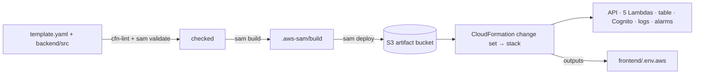

# Lesson 10 — Deployment: from source code to running cloud infrastructure

## In one minute
Nobody clicks in the AWS Console. One file, `infrastructure/template.yaml`, describes every resource. The SAM tool packages the Python code, uploads it, and asks CloudFormation to make reality match the file. Delete the stack and everything disappears. This is **infrastructure as code**: repeatable, reviewable, version-controlled.

> This has not been done yet for this project — the template is validated but was never deployed. You will be the first to run it.

## The simple explanation
The template is an architect's drawing; CloudFormation is the builder. You change the drawing, hand it over, and the builder works out what to add, alter or demolish. You never lay bricks by hand, so two buildings from the same drawing are identical.

| Term | Meaning |
|---|---|
| CloudFormation | AWS service that creates/updates/deletes resources from a template |
| Stack | one deployed instance of a template (`serverless-notes-dev`) |
| SAM | shorthand on top of CloudFormation for serverless apps (`AWS::Serverless::Function` expands into function + role + permissions + API wiring) |
| Change set | preview of what a deployment will change |
| Parameter | an input to the template (`Stage`, `AllowedOrigin`, …) |
| Output | a value the stack reports back (API URL, pool id, …) |
| `!Ref`, `!GetAtt`, `!Sub` | refer to another resource's id / attribute / build a string |

## In this repository

A resource and how it refers to others:
```yaml
ListNotesFunction:
  Type: AWS::Serverless::Function
  Properties:
    FunctionName: !Sub ${AWS::StackName}-list-notes
    Handler: notes_api.handlers.list_notes.handler
    Policies:
      - Version: "2012-10-17"
        Statement:
          - Effect: Allow
            Action: dynamodb:Query
            Resource: !Sub ${NotesTable.Arn}/index/byUser
```
`${NotesTable.Arn}` creates a dependency: CloudFormation builds the table first. The function may do exactly one thing — `Query` — on exactly one index.

Configuration reaches the code through environment variables set in `Globals` (`NOTES_TABLE_NAME: !Ref NotesTable`) and read in `config.py`. No account id, table name or URL is hard-coded.

The commands (also wrapped in the `Makefile`):
```bash
cd infrastructure
cp samconfig.example.toml samconfig.toml
sam validate                 # does the SAM transform accept it? (what CloudFormation will run)
sam validate --lint          # cfn-lint rules only - this form skips the transform
sam build                    # package backend/src for each function
sam deploy                   # show change set, ask, create/update the stack
make frontend-env            # (repo root) write frontend/.env.aws from the outputs
make live-test               # run the real acceptance tests
make destroy                 # delete everything
```
`Stage=dev` deletes the table and users with the stack; `Stage=prod` keeps the table and enables backups (see the `IsProd` condition).

**CI/CD** (`.github/workflows/`):
- `ci.yml` runs on every push and pull request: lint, type checks, tests, build, dependency audit, browser tests, template validation. A change that breaks a test cannot be merged unnoticed.
- `deploy.yml` runs only when a person starts it, waits for approval in a GitHub *environment*, and logs in to AWS with **OIDC**: GitHub proves its identity to AWS and receives credentials valid for minutes. No access key is stored anywhere.

## Important source files
`infrastructure/template.yaml` · `infrastructure/samconfig.example.toml` · `scripts/deployment/deploy.sh` · `scripts/deployment/write_frontend_env.py` · `scripts/cleanup/destroy.sh` · `.github/workflows/ci.yml`, `deploy.yml` · `docs/deployment/DEPLOYMENT.md`

## بالعربي (مصري)
- **Infrastructure as code** يعني بدل ما تدخل على AWS Console وتعمل كل حاجة بالماوس، بتكتب ملف واحد (`template.yaml`) فيه وصف كل الـ resources. AWS بتقراه وتبني اللي فيه بالظبط. ولو مسحت الـ stack كل حاجة بتتمسح.
- **CloudFormation** هو المقاول، والـ template هو الرسم الهندسي. **SAM** اختصارات بتسهّل كتابة الرسم لتطبيقات serverless.
- **`!Ref`** معناها "هات الـ ID بتاع الـ resource ده". بكده مفيش أسماء أو أرقام حسابات مكتوبة بإيدينا في الكود.
- **OIDC** في الـ CI: GitHub بياخد صلاحية مؤقتة من AWS لدقايق بس، فمفيش مفاتيح AWS متخزنة في أي حتة ممكن تتسرق.

## Practical exercise (no AWS account needed)
```bash
python3 -m venv /tmp/samenv && /tmp/samenv/bin/pip install -q cfn-lint aws-sam-cli
/tmp/samenv/bin/cfn-lint infrastructure/template.yaml && echo "lint ok"
/tmp/samenv/bin/sam validate --region eu-north-1 -t infrastructure/template.yaml
```
1. Break it: in `template.yaml` change `KeyType: HASH` to `KeyType: HASHH` under `NotesTable`, run `cfn-lint` again, read the message, undo.
2. Give `GetNoteFunction` a wildcard — change its `Action` to `dynamodb:*` — and explain in one sentence why that would be worse. Undo.
3. From the template alone, list every resource *type* that will be created and count them.
4. When you have an AWS account: follow `docs/deployment/DEPLOYMENT.md`, and write down every problem you hit and how you fixed it — that record is thesis material.

## Check your understanding
1. What is the advantage of a template over configuring resources in the console?
2. What do `sam build` and `sam deploy` each do?
3. How does the Lambda code learn the table's name?
4. What happens to the notes when a `dev` stack is deleted? A `prod` stack?
5. Why is the deploy workflow manual and approval-gated?
6. What does OIDC replace, and why is that safer?

<details><summary>Answers</summary>

1. Repeatable and reviewable: the same file always produces the same system; changes are visible in version control; the whole system can be removed cleanly.
2. `build` packages the source for each function; `deploy` uploads the packages and has CloudFormation create/update the stack via a change set.
3. Through the environment variable `NOTES_TABLE_NAME`, set in the template with `!Ref NotesTable` and read in `config.py`.
4. `dev`: table and data are deleted. `prod`: the table is retained (`DeletionPolicy: Retain`).
5. Deployment changes real, billable infrastructure; a human must decide, and tests must pass first.
6. Long-lived AWS access keys stored as secrets. Short-lived, narrowly trusted credentials cannot be leaked from the repository or reused later.
</details>
