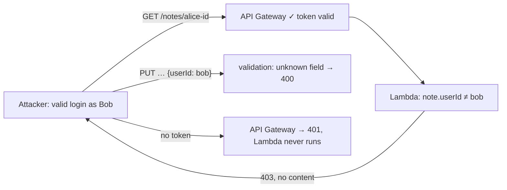

# Lesson 11 — Security

## In one minute
Security here rests on a chain: Cognito proves identity → API Gateway verifies the token → Lambda validates input and enforces ownership → DynamoDB makes the ownership check atomic → IAM limits what each function could do even if it were buggy. The frontend is never trusted. The single most important rule: **a user can only touch notes whose `userId` equals the `sub` in their verified token.**

## The ideas
**1. Never trust the client.** The browser is under the user's control. Hiding a button stops no one; every rule is enforced on the server.

**2. Identity comes from the verified token only.**
```python
# security/identity.py
claims = event["requestContext"]["authorizer"]["claims"]   # filled by API Gateway after verification
subject = claims.get("sub")
```
Not from the body, not from a header, not from the URL. And the body may not even contain owner fields:
```python
allowed = {"title", "content"} | ({"version"} if allow_version else set())
for name in sorted(set(payload) - allowed):
    issues.append({"field": name, "issue": "unknown field"})
```
Sending `{"title": "x", "content": "y", "userId": "bob"}` is a 400. (The attack this blocks is called *mass assignment*.)

**3. Check ownership on every operation (IDOR).** If the API returned any note whose id you know, that would be an *insecure direct object reference*. So: GET compares owner after reading; PUT and DELETE put the comparison inside the write.

**4. Avoid check-then-act races.**
```
unsafe:   read note → owner == me? → (someone else acts here) → write
safe:     write IF owner == me          ← one atomic DynamoDB operation
```
```python
ConditionExpression="attribute_exists(noteId) AND userId = :owner"
```

**5. Least privilege.** Each function's IAM role allows one action:

| Function | May | So even a bug cannot |
|---|---|---|
| GetNote | `GetItem` | modify or delete anything |
| ListNotes | `Query` on the index | scan the table |
| CreateNote | `PutItem` | read anything |

**6. Validate all input**, reject rather than "fix": wrong type, too long, unknown field, non-UUID id, non-JSON, oversized body → 400/413/415, never a crash.

**7. Say little when failing.**
```python
except Exception:
    status, error_code = 500, "INTERNAL_ERROR"
    body = error_body(error_code, "An unexpected error occurred", request_id)
    log_event(logger, logging.ERROR, "unhandled_exception", exc_info=True, …)
```
The client gets a generic message and a request id; the stack trace goes to the log only. A 403 reveals neither the note's content nor its owner.

**8. Keep secrets and personal content out of logs.** Logs record ids, status and duration — never titles, content, headers or tokens.

**9. Rate-limit.** The stage throttle returns 429 above 10 requests/second — protection against abuse and against a surprise bill.

**10. Browser side.** Tokens in memory, not `localStorage`; PKCE + `state`; a Content-Security-Policy that only allows the app's own scripts; React escapes note text, so `<script>` in a note is displayed, not executed.



## A deliberate trade-off: 403 or 404?
The thesis requires **403** when a note exists but belongs to someone else, and **404** when it does not exist. An attacker could therefore learn that a particular UUID exists. Is that serious? Ids are random 122-bit values that cannot be guessed, and nothing about the note is disclosed. Many APIs still prefer 404 for both. Be ready to explain both sides — this is a likely defence question.

## Important source files
`security/identity.py` · `validation/notes.py` · `repositories/notes_repository.py` · `http.py` · template `Policies` · `backend/tests/security/test_isolation.py` · `docs/security/SECURITY.md` (threat model and known limitations)

## بالعربي (مصري)
- **ما تثقش في الـ client أبدًا.** المتصفح في إيد المستخدم، يقدر يبعت أي request هو عايزه. إخفاء زرار في الواجهة مش أمان. كل قاعدة لازم تتطبّق على السيرفر.
- هوية المستخدم بتيجي من الـ **token المتحقَّق منه** بس (`sub`)، مش من الـ body ولا من header. ولو حد بعت `userId` في الـ body بنرفض الطلب كله.
- **Race condition**: لو فحصت الملكية الأول وبعدين كتبت في خطوتين، ممكن حاجة تتغيّر في النص. الحل إن الفحص والكتابة يبقوا عملية واحدة في DynamoDB (الـ condition).
- **Least privilege**: كل function معاها صلاحية واحدة بس. يعني حتى لو فيها bug، دالة القراءة ما تقدرش تمسح.
- في الأخطاء: بنقول للمستخدم أقل حاجة ممكنة، والتفاصيل (الـ stack trace) بتروح للـ logs بس.

## Practical exercise — attack your own API
With `make demo-backend` running:
```bash
U=http://127.0.0.1:8787; J='Content-Type: application/json'
ID=$(curl -s -X POST $U/notes -H 'Authorization: Demo alice' -H "$J" -d '{"title":"secret","content":"alice only"}' | python3 -c 'import sys,json;print(json.load(sys.stdin)["data"]["noteId"])')
curl -s -i $U/notes/$ID -H 'Authorization: Demo bob'                                   # 1 read
curl -s -i -X PUT $U/notes/$ID -H 'Authorization: Demo bob' -H "$J" -d '{"title":"x","content":"y"}'   # 2 overwrite
curl -s -i -X DELETE $U/notes/$ID -H 'Authorization: Demo bob'                          # 3 delete
curl -s -i -X POST $U/notes -H 'Authorization: Demo bob' -H "$J" -d '{"title":"x","content":"y","userId":"demo-user-alice"}'  # 4 forge owner
curl -s -i $U/notes -H 'Authorization: Demo bob' -H 'X-User-Id: demo-user-alice'       # 5 header trick
curl -s $U/notes/$ID -H 'Authorization: Demo alice'                                    # is Alice's note intact?
```
For each attempt record the status and whether any of Alice's data appeared. Then find the test in `backend/tests/security/test_isolation.py` that covers each attempt.

## Check your understanding
1. Why is hiding the Delete button for other users' notes not a security measure?
2. Where does the backend get the caller's identity, and where does it refuse to look?
3. What is a check-then-act race and how is it avoided here?
4. What does "least privilege" mean for the five functions?
5. Why does the 500 response contain no details?
6. Give the argument for 403 and the argument for 404 on someone else's note.
7. Name two known security limitations of this project.

<details><summary>Answers</summary>

1. Anyone can send the HTTP request directly; only server-side checks count.
2. From `requestContext.authorizer.claims.sub`, set by API Gateway after token verification; never from body, query string or custom headers.
3. Another request changes the data between the check and the write; avoided by a DynamoDB condition expression that checks and writes atomically.
4. Each function's role permits a single DynamoDB action on a single resource, so a bug or compromise in one cannot do the others' work.
5. Internal details (table names, stack traces) help attackers; they are logged with the request id instead.
6. 403: required by the thesis, tells the client precisely what happened. 404: does not reveal that the id exists.
7. Any two of: not yet verified on AWS; no MFA; throttling is per stage rather than per user; sign-up reveals registered e-mails; unsigned pagination token; access tokens valid until expiry after sign-out.

Exercise: 1–3 → 403; 4 → 400; 5 → 200 but only Bob's notes; Alice's note unchanged.
</details>
