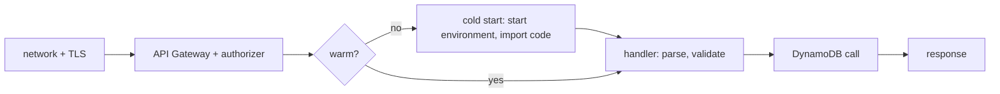

# Lesson 12 — Performance and cost

## In one minute
How fast: a warm request is mostly network + API Gateway + one DynamoDB call; a cold one adds the time to start a Lambda environment. How scalable: every part scales out automatically because no part keeps state between requests. How expensive: you pay per request, so cost is proportional to use and close to zero when idle.

> No number in this repository was measured on AWS. `docs/performance/PERFORMANCE.md` contains the analysis, one benchmark of the **local emulator**, and the procedure for measuring the real thing. Measuring it is your job for the bachelor thesis.

## Performance
Where the time goes for one request:

- **Latency** — time for one request. Report the **median** (typical) and **p95** (the slow 5 %), not only the mean: a few cold starts distort a mean.
- **Cold start** — only on the first request after idle or when load rises. Reduced here by: no third-party packages, creating the DynamoDB client once per environment (`runtime.py`), 256 MB memory.
- **Throughput** — requests per second. Limited on purpose to 10/s by the stage throttle; beyond that the real limits are the account's Lambda concurrency and DynamoDB partitions.
- **Query efficiency** — listing reads only one user's page through the index. A scan would read the whole table and get slower as *other* users add notes.

The local benchmark (application code only, in-memory emulator, same machine): median 2.4–4.4 ms per operation, 100 % success. It shows the code path is cheap. It says nothing about AWS latency.

## Scalability
| Part | How it scales | First limit you would meet |
|---|---|---|
| API Gateway | automatically | the stage throttle set in the template |
| Lambda | one environment per concurrent request | account concurrency quota (small on new accounts) |
| DynamoDB on-demand | automatically | a single extremely hot partition key |
| Cognito | automatically | API rate quotas |

Why this works: functions are **stateless**. Any request can be served by any environment, so adding environments needs no coordination. All shared state is in DynamoDB.

## Cost
Pay-per-use formula (prices `P` from the AWS pricing pages — see `AWS_COST_ANALYSIS.md`, and verify them):
```
monthly ≈ requests × P_api
        + requests × P_lambda_request
        + requests × duration_seconds × memory_GB × P_GB_second
        + write_units × P_write + read_units × P_read + stored_GB × P_storage
        + log_GB × P_log + alarms × P_alarm
        + max(0, active_users − free_users) × P_user
```
Worked example with symbols: 300,000 requests/month, 30 ms at 256 MB → Lambda duration = 300,000 × 0.03 s × 0.25 GB = 2,250 GB-seconds. Multiply by the GB-second price. The cost analysis estimates about $2.50/month for this scenario at list price, most of it API Gateway requests and alarms.

Key points for the defence:
- Idle cost is almost zero; a rented server costs the same whether used or not.
- Cost grows linearly with requests; at high steady load a server can become cheaper per request — serverless suits spiky or small workloads.
- The biggest line at scale is API Gateway REST requests; an HTTP API would be cheaper (see ADR 0001 for why REST was kept).
- A budget alert warns you; it does not stop spending. The throttle and deleting the stack do.

## Important source files
`docs/performance/PERFORMANCE.md` · `AWS_COST_ANALYSIS.md` · `scripts/testing/benchmark.py` · `backend/src/notes_api/runtime.py` · template `MethodSettings`, `BillingMode`

## بالعربي (مصري)
- **Cold start**: أول طلب بعد فترة هدوء بيبقى أبطأ عشان AWS بتجهّز نسخة جديدة من الـ function. الطلبات اللي بعده سريعة.
- **p95** معناها: ٩٥٪ من الطلبات كانت أسرع من الرقم ده. بنستخدمه مع الـ median لأن المتوسط لوحده بيتأثر بكام طلب بطيء.
- **الدفع على قد الاستخدام**: الفاتورة = عدد الطلبات × سعر الطلب تقريبًا. لو مفيش استخدام، تقريبًا مفيش فلوس. السيرفر العادي بتدفع إيجاره حتى وهو واقف فاضي.
- الأرقام الموجودة في المشروع **مش مقاسة على AWS**. دي قياسات على الجهاز المحلي بس. لازم إنت تقيس على AWS وتكتب الأرقام الحقيقية في الرسالة.

## Practical exercise
1. Run the benchmark locally (terminal 1: `make demo-backend`):
   ```bash
   backend/.venv/bin/python scripts/testing/benchmark.py --base-url http://127.0.0.1:8787 --demo-user alice --cycles 50 --label my-laptop
   ```
   Which operation is slowest? Open `notes_repository.py` and suggest why (hint: what does `update_item` return?).
2. Using the formula and the unit prices in `AWS_COST_ANALYSIS.md`, compute the monthly cost for 1,000,000 requests with 20 ms average duration at 256 MB. Which line dominates?
3. After deploying: follow "How to measure the deployed system" in `docs/performance/PERFORMANCE.md`; record warm median/p95 and the cold-start `Init Duration`. Compare with your local numbers and explain the difference.

## Check your understanding
1. What contributes to the latency of one request?
2. What is a cold start and name two things this project does to keep it short.
3. Why report median and p95 rather than only the mean?
4. Why does statelessness make scaling easy?
5. Why is the index important for performance as the number of users grows?
6. Under which traffic pattern is serverless cheaper than a rented server, and when might it not be?
7. Does an AWS budget prevent charges?

<details><summary>Answers</summary>

1. Network/TLS, API Gateway and authorizer, possible Lambda cold start, handler code, the DynamoDB call.
2. Starting a new execution environment before the handler runs. No third-party dependencies; clients created once and reused; adequate memory (also arm64).
3. Latency distributions are skewed by rare slow requests (cold starts); the median shows the typical case and p95 the slow tail.
4. No request depends on a particular instance, so more instances can be added or removed freely.
5. A list reads only the caller's notes regardless of table size; a scan would grow with everyone's data.
6. Low, irregular or unpredictable traffic. With constant high load, always-on capacity can cost less per request.
7. No — it only sends alerts.

Exercise 2 (with the approximate prices in the cost analysis): API Gateway ≈ $3.70; Lambda requests ≈ $0.20; Lambda duration = 1,000,000 × 0.02 × 0.25 = 5,000 GB-s ≈ $0.07; DynamoDB ≈ $0.57; logs ≈ $0.57 → about $5 plus alarms; API Gateway dominates.
</details>
