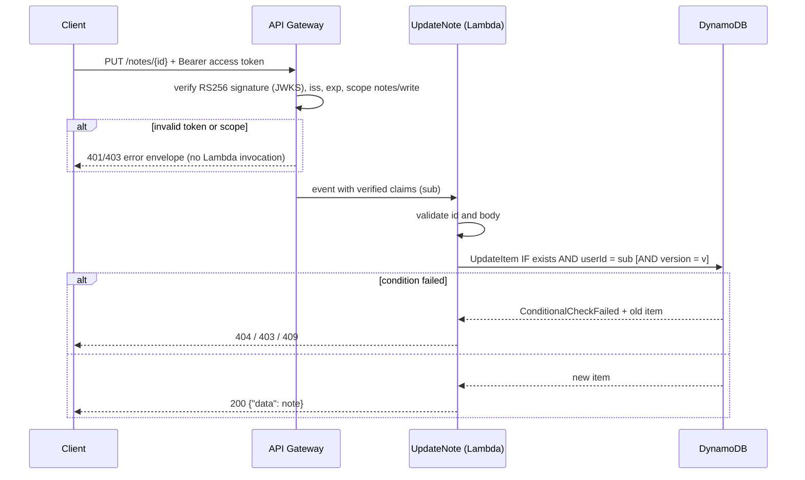
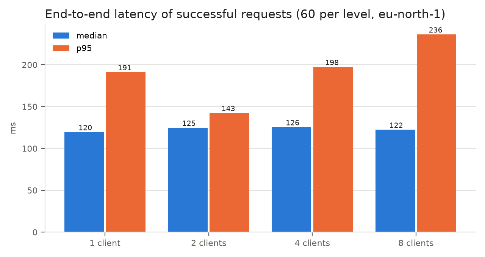
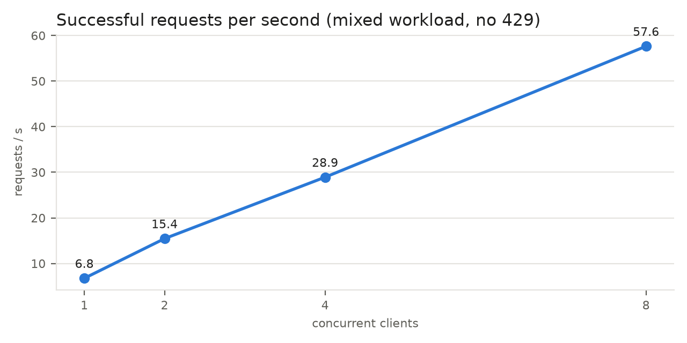
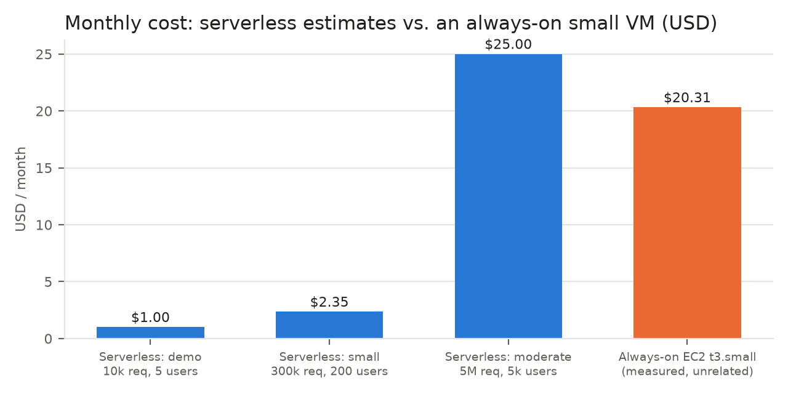

<!--
  DRAFT FOR AUTHOR REVIEW — NOT A FINAL SUBMISSION. Prepared with AI assistance (Claude Code) on
  2026-11-17 from this repository, its evidence files and the semestral report draft
  (docs/thesis/SEMESTRAL_REPORT.md, which stays unchanged). The author must read, verify and rewrite
  it; open items are in docs/thesis/BACHELOR_AUTHOR_REVIEW.md. [AUTHOR-VERIFY] marks claims and
  sources the author must check personally. Front matter (title page, official assignment, signed
  declaration) comes from the official VUT template.
-->

# Serverless CRUD API with Authentication

**Bachelor's thesis (draft)** · Brno University of Technology, Faculty of Electrical Engineering and Communication, Department of Telecommunications · Author: John Heshmat (256986) · Supervisor: doc. Ing. Lukáš Malina, Ph.D. · Academic year 2025/26 [AUTHOR-VERIFY: bachelor's thesis assignment date, deadline and academic year]

## Abstract

This thesis designs, implements and evaluates a serverless REST API with create, read, update and delete operations and token-based authentication on Amazon Web Services. A private-notes application serves as the demonstration: users register and sign in through Amazon Cognito, and five AWS Lambda functions written in Python 3.13 store their notes in Amazon DynamoDB behind an Amazon API Gateway REST API that verifies JWT access tokens and OAuth scopes. Ownership is enforced inside conditional database writes, all input is validated strictly, every error uses one response envelope with a request identifier, and CloudWatch provides structured logs and four alarms. The whole system is defined as infrastructure as code with AWS SAM and runs in the Stockholm region; a React client is published through Amazon CloudFront. The evaluation combines 193 automated backend tests, 38 functional and security checks and 10 negative-token tests against the deployed system, a sequential benchmark of 500 requests and a bounded concurrency benchmark with up to eight clients and 60 requests per second. The median end-to-end latency stayed at 120–126 ms at every concurrency level, Lambda scaled out to eight execution environments without errors, and the configured throttle of 10 requests per second per method answered with HTTP 429 as designed. Every forged, tampered or expired token was rejected. The estimated running cost is about one US dollar per month at demonstration scale, compared with about twenty dollars per month measured for an always-on small virtual server. The thesis discusses the limits of these results and the extensions that would be needed for production use.

**Keywords:** serverless computing, REST API, CRUD, authentication, authorization, JSON Web Token, OAuth 2.0, AWS Lambda, Amazon API Gateway, Amazon DynamoDB, Amazon Cognito, performance evaluation, scalability, cloud cost

*Czech abstract (Abstrakt) and keywords: to be written by the author from the semestral version* [AUTHOR-VERIFY].

---

## 1 Introduction and objectives

A typical application backend authenticates users, stores their records and lets them read, change and delete them. Serverless cloud services promise to provide such a backend without operating servers: code runs in functions started by requests, data is kept in a managed database, identity is delegated to a managed user directory, and the operator pays per request [1], [14].

The official assignment asks for a demonstrational serverless backend: a REST API with CRUD operations and secure user authentication, built from serverless functions, an API gateway and a managed database, which processes requests reliably and in time, protects accounts and data, and shows the advantages of serverless over a server-based solution. The semestral thesis covered research, design and a prototype (tasks 1–3). This bachelor's thesis covers:

- **Task 4** — implement the full serverless backend (REST API, database, authentication) with all required entities, user management, logging and monitoring;
- **Task 5** — evaluate functionality, performance, scalability, security and costs, and discuss extensions such as web or mobile clients and integrations.

The thesis is structured as follows. Chapters 2–5 analyse requirements and summarise the theoretical background and the choice of AWS (condensed from the semestral thesis). Chapters 6–10 describe the design and implementation. Chapters 11–16 present the evaluation, Chapters 17–19 discuss results, limitations and extensions, and Chapter 20 concludes. Measured results, configuration facts and architectural expectations are distinguished explicitly throughout.

## 2 Requirements analysis

The demonstration application is a multi-user private notes service with one entity, **Note**. The assignment does not prescribe further entities, so "all required entities" is satisfied by the Note entity together with the user accounts managed by Cognito.

*Table 2.1 — Functional requirements*

| ID | Requirement | Source |
|---|---|---|
| F-1 | CRUD operations on notes through a REST API | assignment, semestral design |
| F-2 | Endpoints `POST /notes`, `GET /notes`, `GET /notes/{id}`, `PUT /notes/{id}`, `DELETE /notes/{id}` | semestral design |
| F-3 | JWT authentication on every endpoint | assignment (token-based access) |
| F-4 | Each note is visible and modifiable only by its owner | assignment (protect stored data) |
| F-5 | Status codes 201, 200, 400, 401, 403 (another user's existing note), 404 | semestral design |
| F-6 | Attributes `noteId`, `userId`, `title`, `content`, `createdAt`, `updatedAt` | semestral design |
| F-7 | Validation of inputs and consistent error responses | assignment task 3 |
| U-1 | User management: registration, e-mail verification, sign-in, sign-out, password reset | assignment task 4 |

*Table 2.2 — Non-functional requirements*

| ID | Requirement | Evaluated in |
|---|---|---|
| N-1 | Managed, automatically scaling services; no servers to operate | Ch. 5, 13 |
| N-2 | Reliable and timely processing | Ch. 12, 15 |
| N-3 | Logging of every API call, traceable individual requests; monitoring | Ch. 15 |
| N-4 | Security of accounts and data | Ch. 14 |
| N-5 | Low cost, especially when idle | Ch. 16 |
| N-6 | Reproducible deployment | Ch. 10 |

## 3 Theoretical background

**Cloud and serverless.** NIST defines cloud computing by on-demand self-service, resource pooling and rapid elasticity, with IaaS, PaaS and SaaS service models [15]. Serverless computing adds that the user does not allocate resources and pays only for what is used; it combines Function as a Service with managed Backend-as-a-Service components [14]. Its trade-offs are cold starts, statelessness, provider limits, vendor lock-in and possibly higher cost at constant high load [1], [14], [16].

**REST and HTTP.** REST models data as resources identified by URLs and manipulated through a uniform interface [4], [13]; HTTP semantics define the meaning of methods such as PUT (full replacement) and of the status codes [12].

**Managed NoSQL databases.** Key-value stores such as DynamoDB partition data by key and scale horizontally; queries must use a key, and global secondary indexes provide additional, eventually consistent access paths [3], [7].

**Tokens, OAuth 2.0 and PKCE.** A JSON Web Token carries signed claims (issuer, subject, expiry) that a verifier can check without a session store [2], [9]. OAuth 2.0 issues access tokens to clients [10]; browser clients use the authorization code flow with PKCE, which binds the code exchange to a secret verifier held by the client [11]. A verifier must check signature, issuer, expiry and token purpose; Cognito signs with RS256 and distinguishes ID tokens from access tokens, which carry `client_id`, `token_use` and `scope` [8].

**Object-level authorization.** Authenticating a caller does not authorize access to a particular record; broken object-level authorization is the first risk of the OWASP API Security Top 10 [20]. Every request naming a record must check its owner.

## 4 Comparison of cloud and serverless technologies

*Table 4.1 — Serverless building blocks* [5]–[8], [16], [17] [AUTHOR-VERIFY: current service names]

| Component | AWS | Microsoft Azure | Google Cloud |
|---|---|---|---|
| Functions | AWS Lambda | Azure Functions | Cloud Run functions |
| API gateway | Amazon API Gateway | Azure API Management | API Gateway, Apigee |
| NoSQL database | Amazon DynamoDB | Azure Cosmos DB | Firestore |
| User directory issuing JWTs | Amazon Cognito user pools | Microsoft Entra External ID | Identity Platform |
| Logs and monitoring | Amazon CloudWatch | Azure Monitor | Cloud Logging / Monitoring |
| Infrastructure as code | CloudFormation, AWS SAM | ARM templates, Bicep | Infrastructure Manager (Terraform) |

Within AWS, two API Gateway variants exist: the **REST API** supports Cognito user-pool authorizers with per-route OAuth scopes, request throttling per method, gateway-response customisation and usage plans; the **HTTP API** is cheaper per request and supports JWT authorizers but fewer features [6]. The REST API was chosen for its scope enforcement and customisable gateway errors (ADR 0001), accepting roughly three times the per-request price (Ch. 16).

## 5 Justification of the selected AWS architecture

1. **Authentication at the edge.** The Cognito authorizer validates tokens and scopes before any function runs, so unauthenticated traffic costs no Lambda or database work [6], [8].
2. **One description of the whole system.** AWS SAM describes API, functions, table, user pool, logs and alarms in one template [18].
3. **Pay-per-use** for every component, which fits a demonstration with irregular traffic (Ch. 16).
4. **Literature and documentation** — the recommended literature targets AWS [1].
5. **Region.** The original plan named Frankfurt (eu-central-1); the AWS organization of the account used allows workloads only in Stockholm (eu-north-1), confirmed with the IAM policy simulator. All services used are available there (ADR 0008) [AUTHOR-VERIFY: supervisor agreement].

## 6 System architecture and design

*Figure 6.1 — Architecture (editable Mermaid source; export as an image for the final document)*

```mermaid
flowchart LR
  B[Browser: React client] -- "static files (HTTPS)" --> CF[CloudFront + private S3 (OAC)]
  B -- "sign-up / hosted sign-in, PKCE" --> CO[Cognito user pool]
  CO -- "access token (RS256 JWT)" --> B
  B -- "HTTPS, Bearer token" --> AG[API Gateway REST API\nCognito authorizer + scopes\nthrottling 10 req/s per method\nCORS, gateway responses]
  AG --> F1[CreateNote] & F2[ListNotes] & F3[GetNote] & F4[UpdateNote] & F5[DeleteNote]
  F1 & F3 & F4 & F5 -- "one action each" --> T[(DynamoDB table\nPK noteId)]
  F2 -- "Query" --> G[(GSI byUser\nuserId, createdAt#noteId)]
  F1 & F2 & F3 & F4 & F5 -. "JSON logs, metrics" .-> CW[CloudWatch logs + 4 alarms]
```

Each operation has its own function so that its IAM role allows exactly one DynamoDB action and its logs and metrics are separate; the functions share one code package (ADR 0003). The cost is five independent cold starts, measured in Chapter 12.

*Figure 6.2 — Authorized update (sequence)*



## 7 Authentication and authorization

**User management** is delegated to a Cognito user pool: self sign-up with e-mail as username, verification code by e-mail, password policy (at least 12 characters with upper- and lower-case letters, digits and symbols), recovery by verified e-mail, and the hosted sign-in page. The public web client (no secret) uses only the authorization code flow with PKCE; `PreventUserExistenceErrors` is enabled, refresh-token revocation is on, and access tokens are valid for 60 minutes, refresh tokens for one day (configuration read on 17 November 2026).

**Authentication** happens in API Gateway: the authorizer verifies the signature with the pool's public keys, the issuer and the expiry, and each route requires a scope — `notes/read` for reads, `notes/write` for writes. Because ID tokens carry no custom scopes, they are rejected. The functions repeat the essential checks (presence of `sub`, `token_use = access`, scope) as defence in depth and take the caller's identity only from the verified claims.

**Authorization** is ownership-based. There is one role, the authenticated owner; a second app client that receives only `notes/read` exists to demonstrate scope enforcement. The client cannot set `userId`, `noteId`, timestamps or `version`; unknown fields are rejected.

## 8 Data model and REST API specification

*Table 8.1 — DynamoDB table `serverless-notes-dev-notes` (on-demand, encrypted at rest)*

| Attribute | Type | Role |
|---|---|---|
| `noteId` | S (UUID v4) | partition key |
| `userId` | S | owner (`sub`); partition key of GSI `byUser` |
| `userSortKey` | S | `<createdAt>#<noteId>`; sort key of `byUser` |
| `title` | S | 1–200 characters |
| `content` | S | 0–20,000 characters |
| `createdAt`, `updatedAt` | S | ISO 8601 UTC, milliseconds |
| `version` | N | optimistic-locking counter |

The relationship between users and notes is one-to-many; the user records live in Cognito and are linked by `userId = sub`. Listing queries the `byUser` index for one user, newest first, with an opaque continuation token; `Scan` is never used and not permitted by IAM. The `noteId` key keeps the distinction between "another user's note" (403) and "no such note" (404) that a composite key would lose (ADR 0002).

*Table 8.2 — Endpoints*

| Method and path | Scope | Success | Errors |
|---|---|---|---|
| `POST /notes` | `notes/write` | 201 | 400, 401, 413, 415, 429, 503 |
| `GET /notes?limit&nextToken` | `notes/read` | 200 + `meta` | 400, 401, 429, 503 |
| `GET /notes/{id}` | `notes/read` | 200 | 400, 401, 403, 404, 429, 503 |
| `PUT /notes/{id}` | `notes/write` | 200 | 400, 401, 403, 404, 409, 413, 415, 429, 503 |
| `DELETE /notes/{id}` | `notes/write` | 200 | 400, 401, 403, 404, 429, 503 |

Responses use the envelope `{"data": …}`, `{"data": […], "meta": {"count", "limit", "nextToken"}}` or `{"error": {"code", "message", "requestId", "details?"}}`; API Gateway's own errors (401, 403, 429, unknown routes) are configured to use the same envelope and CORS headers. The full contract is `docs/api/openapi.yaml`.

## 9 Implementation

The backend (`backend/src/notes_api/`) is written in Python 3.13 for Lambda on arm64 with 256 MB of memory and has no third-party runtime dependencies. Its layers are: handler → HTTP wrapper (identity, error mapping, envelope, logging) → operation (parsing, validation) → service (rules) → repository (the only DynamoDB access). The service depends on a repository protocol and is unit-tested with an in-memory fake; the repository is tested against an emulated DynamoDB (`moto`).

Key mechanisms:
- **Validation** rejects non-JSON bodies, bodies over 128 KiB, unknown fields, wrong types and invalid identifiers, and reports all problems at once.
- **Errors** are subclasses of `AppError`; unexpected exceptions become 500 without details, DynamoDB failures 503.
- **Ownership** for update and delete is a condition expression of the write; `ReturnValuesOnConditionCheckFailure=ALL_OLD` lets the function distinguish 404, 403 and 409 without a second read.
- **Optimistic locking** with `version` prevents lost updates.
- **Logging** writes one JSON line per request without personal data.
- **Cold-start optimisation**: the DynamoDB client is created during Lambda initialisation, which halved the measured cold-start time (Ch. 12).

A React/TypeScript client (sign-up, hosted sign-in with PKCE, notes list and editor, tokens in memory only) is published from a private S3 bucket through CloudFront with Origin Access Control, HTTPS and security headers [19].

## 10 Deployment and infrastructure as code

`infrastructure/template.yaml` (AWS SAM) creates 33 resources: the REST API with authorizer, scopes, throttling and gateway responses; five functions with one IAM role and one log group (14-day retention) each; the table and index; the user pool with domain, resource server, web and read-only clients; four alarms and an optional SNS topic. `infrastructure/frontend-hosting.yaml` creates the bucket, distribution, OAC and headers policy. Both templates are validated by `cfn-lint` and `sam validate` in continuous integration (GitHub Actions), and deployments go through CloudFormation change sets that are reviewed before execution. The development stack was deployed on 17 November 2026; a manual GitHub deployment workflow exists but its OIDC role was deliberately not created, so deployment is performed from the workstation with documented commands (`docs/deployment/DEPLOYMENT.md`).

## 11 Functional testing

*Table 11.1 — Functional test results* (raw outputs in `evidence/`)

| Level | Tool | Result |
|---|---|---|
| Unit, integration and security tests of the backend | pytest + moto | 193 passed, 99 % line and branch coverage |
| Frontend unit and component tests | Vitest | 66 passed |
| Browser journeys against the local emulator | Playwright | 14 passed, including an accessibility audit |
| Live functional and security checks on AWS | `live_api_tests.py` | 38/38 passed |
| Browser test of the deployed system | Playwright, real Cognito | sign-up, sign-in, CRUD, reload, isolation between two users, sign-out |
| Manual check by the author | real mailbox | registration, e-mailed code, sign-in, password reset, CRUD on the public site (no evidence file) |

The live checks reproduce the thirteen test cases of the semestral design plus "delete a missing note", and cover unchanged data after another user's attempts, the token boundary, unknown routes, validation, CORS and throttling. All five endpoints and all specified status codes were observed on the deployed system.

## 12 Performance measurements

**Sequential benchmark** (100 cycles of create → list → read → update → delete, 500 requests, new TLS connection per request, client in Central Europe): 100 % success; median 118.8–122.1 ms and p95 141.6–152.3 ms per endpoint; first requests after deployment 746–949 ms (cold starts). Inside Lambda a warm request took 10–14 ms and used about 92 MB of 256 MB (`evidence/benchmarks/aws-dev-eu-north-1.json`).

**Cold starts.** Creating the AWS SDK client during the first request made cold requests take 1.2–1.4 s inside Lambda; moving it to the initialisation phase reduced this to 0.55–0.69 s.

**Concurrency benchmark** (`scripts/testing/concurrency_benchmark.py`; mix 50 % read one, 30 % list, 20 % update; 60 requests per level; one client machine):

*Table 12.1 — Latency of successful requests by concurrency (ms)*

| Clients | Offered req/s | Success | Median | p95 | Worst observed |
|---|---|---|---|---|---|
| 1 | 6.8 | 60/60 | 119.7 | 191.3 | 926.7 (cold start) |
| 2 | 15.5 | 60/60 | 124.9 | 142.6 | 217.3 |
| 4 | 28.9 | 60/60 | 125.6 | 197.6 | 284.5 |
| 8 | 57.6 | 60/60 | 122.5 | 236.4 | 273.4 |
| 8, repeated with 100 requests | 60.5 | 100/100 | 120.7 | 145.1 | 258.9 |
| 8, paced to 8 req/s | 8.0 | 80/80 | 120.6 | 150.2 | 207.7 |





The median did not change with concurrency; p95 widened because each new execution environment paid one cold start (11 cold starts, average initialisation 330–430 ms) and because of network variance. With 60–100 samples per level, p99 is effectively the worst observation and is not reported as a stable percentile. Most of the ~120 ms is the network path and TLS set-up from the client; the function itself needs about 10 ms.

## 13 Scalability evaluation

**Observed:** throughput grew linearly from 6.8 to 57.6 successful requests per second as clients increased from one to eight; Lambda's account-wide concurrency peaked at 8 of the 400 available; no Lambda, DynamoDB or gateway error occurred (`evidence/aws/bachelor-evaluation.json`).

**Throttling.** The stage is configured with 10 requests per second and a burst of 20. The measurement showed that this limit applies **per method**: the mixed workload, spread over three methods, was never throttled even at 60 requests per second for one second, while a single method answered HTTP 429 to 6 % of a 1.7 s burst at 59 requests per second and to 17 % of a 5 s run at 20 requests per second, accepting 16.4 requests per second — above the nominal 14, consistent with the documented best-effort nature of throttling [21].


**Expected beyond the tested range (not measured):** Lambda adds execution environments up to the account concurrency quota (400 here) [22]; DynamoDB on-demand adapts to the request rate, and every operation addresses a key or one user's index partition, so no operation becomes slower with the number of users [7]; API Gateway's account limit in this account is 10,000 requests per second with a burst of 5,000. The first limit a real load would hit is therefore the deliberately low per-method throttle, which can be raised by a template parameter. Large-scale behaviour was not measured, because it would require raising the limits and a distributed load generator.

## 14 Security evaluation

*Table 14.1 — Threats, protections and tests* (details: `docs/security/SECURITY_EVALUATION.md`)

| Threat | Protection | Test | Result |
|---|---|---|---|
| Missing, malformed or non-Bearer token | Cognito authorizer | live T02, T05, A01, A04 | 401 |
| Unsigned (`alg: none`) or HS256-forged token | RS256 with the pool's keys only | N01, N02 | 401 |
| Token signed with a foreign key / foreign issuer | JWKS signature, issuer check | N03, N04 | 403 / 401 |
| Modified claims (`exp`, `sub`) | signature over the payload | N05, N06, A02 | 403 |
| Expired token | `exp` check | N07 (self-signed) 401; E01 (real token 90 s after expiry) pending (expected 401) | see text |
| ID token instead of access token; missing scope | per-route scopes | A03, A07 | 401 |
| Access to another user's note | owner in condition expression | T07, T10, T13, H01, H02, browser | 403, data unchanged |
| Mass assignment, malformed or oversized input | strict validation | V01–V04, unit tests | 400 / 413 |
| Data leakage in errors and logs | generic errors, log hygiene | tests, CloudWatch inspection | none found |
| Token theft in the browser | in-memory tokens, CSP, headers | browser inspection | no token in storage |
| Excessive privileges | one DynamoDB action per function | template tests, deployed roles | least privilege |
| Token use after account deletion | short token lifetime | R01 | accepted until expiry (limitation) |

No critical vulnerability was found. Residual risks: no MFA, WAF or CAPTCHA; throttling shared by all users; sign-up reveals registered e-mail addresses; 403 reveals that a guessed identifier exists (required by the design); access tokens stay valid for up to 60 minutes after sign-out or deletion; the development table has no point-in-time recovery or deletion protection; no independent penetration test.

## 15 Reliability, logging and monitoring

Every request produces one structured log line with the request identifier, which appears in every error response; a user-reported error can therefore be traced with CloudWatch Logs Insights, as was demonstrated. Logs are kept for 14 days. Four alarms watch API 5xx errors, p95 latency above 2 s, Lambda errors and DynamoDB throttling; all were in state OK with data. A notification target (`AlarmEmail`) is not configured on the development stack, so the notification path is **not verified** (`docs/operations/MONITORING_RELIABILITY.md`).

Failure handling: DynamoDB errors are retried by the SDK and then mapped to 503 (retryable); unexpected exceptions to 500 without details; excess traffic to 429; concurrent edits to 409. A success response is sent only after DynamoDB has stored the write durably across availability zones; single-note reads are strongly consistent, lists eventually consistent. The deployment uses one region; a regional outage would make the service unavailable.

## 16 Cost evaluation

*Table 16.1 — Cost components (eu-north-1 list prices from the AWS Price List API [23], 2026-11-16/17)*

| Service | Billed for | Price |
|---|---|---|
| API Gateway REST | requests | USD 3.50 per million |
| Lambda (arm64) | requests, GB-seconds | USD 0.20 per million + USD 0.0000133334 per GB-s |
| DynamoDB on-demand | request units, storage | USD 0.67 per million writes, 0.1345 per million reads |
| Cognito Lite | monthly active users | first 10,000 free |
| CloudWatch | log ingestion, alarm metrics | USD 0.54 per GB; USD 0.10 per alarm metric (9 used) |
| CloudFront, S3 (client) | transfer, requests, storage | within CloudFront's always-free allowance at this scale |

*Table 16.2 — Estimated monthly cost (list price, no free tier)*

| Scenario | Requests | Estimate |
|---|---|---|
| Demonstration (5 users) | 10,000 | ≈ USD 1 (mostly alarms) |
| Small application (200 users) | 300,000 | ≈ USD 2.35 |
| Moderate use (5,000 users) | 5,000,000 | ≈ USD 25 (≈ 70 % API Gateway) |

**Reconciliation with the bill.** Cost Explorer (October and 1–17 November 2026) shows gross usage of USD 9.55 and 11.51, fully offset by Free-plan credits, so the payable amount was USD 0. All of it came from an unrelated EC2 `t3.small` instance with its volume and public IPv4 address, terminated on 17 November; the thesis services had not yet appeared with a non-zero amount because of the reporting delay and their small usage (estimated below USD 0.10). The credit balance on 17 November 2026 was USD 158.72. The unrelated instance provides a measured reference for an always-on server: about USD 20.3 per month regardless of use.



**Cost risk.** Because the throttle applies per method, a client with valid credentials could in the worst case sustain about 50 requests per second, i.e. roughly USD 600 per month; a budget alert or lower limits mitigate this (`AWS_COST_ANALYSIS.md`).

## 17 Results and discussion

*Table 17.1 — Fulfilment of the assignment*

| Task | Result | Status |
|---|---|---|
| 4 REST API, database, authentication | deployed stack, 5 endpoints, DynamoDB, Cognito | complete, verified on AWS |
| 4 All required entities | Note + Cognito users | complete |
| 4 User management | sign-up, verification, sign-in, sign-out, reset | complete (reset verified manually) |
| 4 Logging and monitoring | structured logs, tracing, 4 alarms | complete; notification path unverified |
| 5 Functionality | 193 + 66 + 14 tests, 38 live checks | evaluated |
| 5 Performance | sequential and concurrent benchmarks | evaluated (single client machine) |
| 5 Scalability | up to 8 clients / 60 req/s measured; beyond argued | partly measured |
| 5 Security | 19 threats, live negative tests | evaluated; no penetration test |
| 5 Costs | price model, bill reconciliation | evaluated; thesis-service bill pending |
| 5 Extensions | Chapter 19 | discussed |

The serverless design met its goals at the tested scale: latency was dominated by the network rather than by the backend, scaling required no configuration, and the idle cost was close to zero. The main engineering lessons were that throttling settings must be understood per method, that SDK initialisation belongs in the cold-start phase, and that authorization must be enforced in the data layer, not only in the client.

## 18 Limitations

- Measurements come from one client location and machine; no distributed load test, and no test above 60 requests per second.
- The thesis-service share of the bill was not yet visible in Cost Explorer.
- Alarm notifications, a penetration test and a token from a second real user pool were not tested.
- Development stage only: no backups, default CloudFront domain, single region.
- Security features deliberately omitted: MFA, WAF, per-user rate limits, account-deletion UI.

## 19 Future extensions

Mobile client using the same API and Cognito flows; integrations through webhooks or an event bus (e.g. publishing note changes to Amazon EventBridge); search across notes; sharing notes between users (a second access pattern and a new authorization rule); production hardening (MFA, WAF, SES for e-mail, PITR, staging environment, custom domain); a distributed load test with raised limits; and a measured comparison with a container-based implementation.

## 20 Conclusion

The thesis delivered a complete serverless backend for a multi-user notes application on AWS: a REST API with five endpoints, a DynamoDB data model with a per-user index, Cognito-based user management with OAuth scopes, strict validation, uniform errors, structured logging and alarms, all deployed reproducibly from code. The evaluation showed correct behaviour in 38 live checks and 193 automated tests, rejection of every forged, tampered and expired token tested, a stable median latency of about 120 ms from one to eight concurrent clients, linear throughput growth, and an estimated running cost of about one dollar per month. The results support the claim that a serverless backend suits small and irregular workloads with little operational effort, while large-scale behaviour, production hardening and a longer cost observation remain future work.

---

## 21 Bibliography

ČSN ISO 690. URLs were reachable on 17 November 2026; the author must confirm that each source supports the sentence citing it [AUTHOR-VERIFY].

[1] SBARSKI, Peter; CUI, Yan and NAIR, Ajay. *Serverless Architectures on AWS*. 2nd ed. Shelter Island: Manning Publications, 2022. ISBN 978-1-61729-542-3.
[2] MADDEN, Neil. *API Security in Action*. Shelter Island: Manning Publications, 2020. ISBN 978-1-61729-602-4.
[3] KLEPPMANN, Martin. *Designing Data-Intensive Applications*. Sebastopol: O'Reilly Media, 2017. ISBN 978-1-4493-7332-0.
[4] RICHARDSON, Leonard; AMUNDSEN, Mike and RUBY, Sam. *RESTful Web APIs*. Sebastopol: O'Reilly Media, 2013. ISBN 978-1-4493-5806-8. [AUTHOR-VERIFY: ISBN]
[5] AMAZON WEB SERVICES. *AWS Lambda Developer Guide* [online]. [cit. 2026-11-17]. Available at: https://docs.aws.amazon.com/lambda/latest/dg/welcome.html
[6] AMAZON WEB SERVICES. *Amazon API Gateway Developer Guide* [online]. [cit. 2026-11-17]. Available at: https://docs.aws.amazon.com/apigateway/latest/developerguide/welcome.html
[7] AMAZON WEB SERVICES. *Amazon DynamoDB Developer Guide* [online]. [cit. 2026-11-17]. Available at: https://docs.aws.amazon.com/amazondynamodb/latest/developerguide/Introduction.html
[8] AMAZON WEB SERVICES. *Amazon Cognito Developer Guide* [online]. [cit. 2026-11-17]. Available at: https://docs.aws.amazon.com/cognito/latest/developerguide/what-is-amazon-cognito.html
[9] JONES, Michael B.; BRADLEY, John and SAKIMURA, Nat. *JSON Web Token (JWT)*. RFC 7519. IETF, 2015. DOI 10.17487/RFC7519.
[10] HARDT, Dick (ed.). *The OAuth 2.0 Authorization Framework*. RFC 6749. IETF, 2012. DOI 10.17487/RFC6749.
[11] SAKIMURA, Nat; BRADLEY, John and AGARWAL, Naveen. *Proof Key for Code Exchange by OAuth Public Clients*. RFC 7636. IETF, 2015. DOI 10.17487/RFC7636.
[12] FIELDING, Roy T.; NOTTINGHAM, Mark and RESCHKE, Julian (eds.). *HTTP Semantics*. RFC 9110. IETF, 2022. DOI 10.17487/RFC9110.
[13] FIELDING, Roy Thomas. *Architectural Styles and the Design of Network-based Software Architectures*. Doctoral dissertation. Irvine: University of California, Irvine, 2000. Available at: https://ics.uci.edu/~fielding/pubs/dissertation/top.htm
[14] JONAS, Eric et al. *Cloud Programming Simplified: A Berkeley View on Serverless Computing*. Technical Report UCB/EECS-2019-3. University of California, Berkeley, 2019.
[15] MELL, Peter and GRANCE, Timothy. *The NIST Definition of Cloud Computing*. NIST SP 800-145. NIST, 2011. DOI 10.6028/NIST.SP.800-145.
[16] MICROSOFT. *Azure Functions documentation* [online]. [cit. 2026-11-17]. Available at: https://learn.microsoft.com/en-us/azure/azure-functions/
[17] GOOGLE. *Cloud Run functions documentation* [online]. [cit. 2026-11-17]. Available at: https://cloud.google.com/functions/docs
[18] AMAZON WEB SERVICES. *AWS Serverless Application Model Developer Guide* [online]. [cit. 2026-11-17]. Available at: https://docs.aws.amazon.com/serverless-application-model/latest/developerguide/what-is-sam.html
[19] AMAZON WEB SERVICES. *Restricting access to an Amazon S3 origin* (CloudFront Developer Guide) [online]. [cit. 2026-11-17]. Available at: https://docs.aws.amazon.com/AmazonCloudFront/latest/DeveloperGuide/private-content-restricting-access-to-s3.html
[20] OWASP FOUNDATION. *OWASP API Security Top 10 – 2023* [online]. [cit. 2026-11-17]. Available at: https://owasp.org/API-Security/editions/2023/en/0x11-t10/
[21] AMAZON WEB SERVICES. *Throttle requests to your REST APIs for better throughput in API Gateway* [online]. [cit. 2026-11-17]. Available at: https://docs.aws.amazon.com/apigateway/latest/developerguide/api-gateway-request-throttling.html
[22] AMAZON WEB SERVICES. *Understanding Lambda function scaling* [online]. [cit. 2026-11-17]. Available at: https://docs.aws.amazon.com/lambda/latest/dg/lambda-concurrency.html
[23] AMAZON WEB SERVICES. *AWS Pricing* [online]. [cit. 2026-11-17]. Available at: https://aws.amazon.com/pricing/

## 22 Appendices

**A. Evidence index**

| Evidence | File |
|---|---|
| Backend tests and coverage | `evidence/tests/backend-pytest.txt` |
| Live functional and security checks (38) | `evidence/tests/live-api-tests.json` |
| Negative-token tests (N01–N07, R01, E01) | `evidence/tests/token-security-tests.json` |
| Sequential benchmark | `evidence/benchmarks/aws-dev-eu-north-1.json` |
| Concurrency benchmark and throttle runs | `evidence/benchmarks/aws-concurrency-eu-north-1.json`, `aws-concurrency-throttle-eu-north-1.json`, `aws-throttle-single-method-eu-north-1.json` |
| Lambda statistics, alarms, log groups, Cost Explorer | `evidence/aws/bachelor-evaluation.json` |
| CloudWatch tracing and cold starts | `evidence/aws/cloudwatch.txt` |
| Deployed resources, change sets | `evidence/aws/deployed-resources.txt`, `evidence/builds/` |
| Screenshots of the deployed system | `evidence/screenshots/aws-11-isolation-forbidden.png`, `aws-12-notes-list.png`, `aws-13-hosted-cloudfront-notes.png` |
| Figures with data tables | `docs/thesis/figures/*.png`, `*.csv` (generated by `scripts/docs/make_figures.py`) |

**B. Use of AI tools (draft statement — adapt to VUT rules and agree with the supervisor)** [AUTHOR-VERIFY]

*The implementation, tests, infrastructure templates, evaluation scripts and documentation were developed with the assistance of the AI coding assistant Claude Code (Anthropic), which also prepared a first draft of this text from the project's documentation and evidence. The author reviewed, verified and revised all content and is responsible for it. All measurements were produced by executing the scripts in the repository against the deployed system; raw results are stored in the repository.*

**C. Repository:** https://github.com/Joun-Mikhail/CRUD (public) · live client: https://d11c0a7q5fx9qi.cloudfront.net
