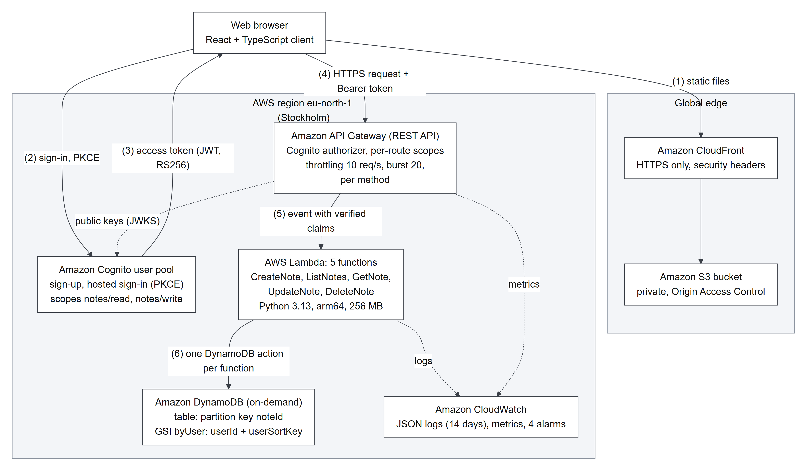
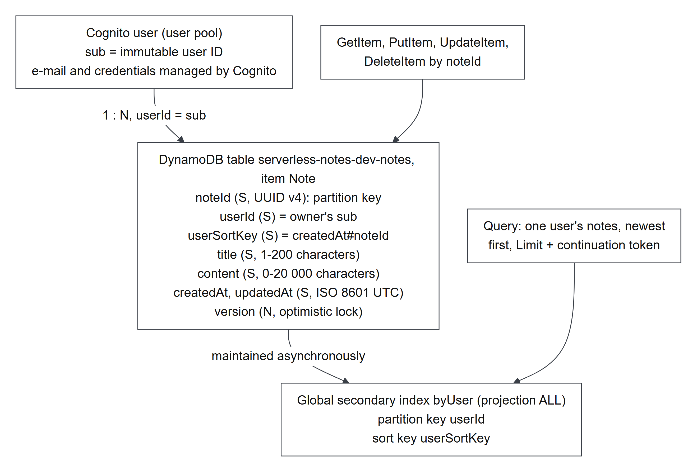
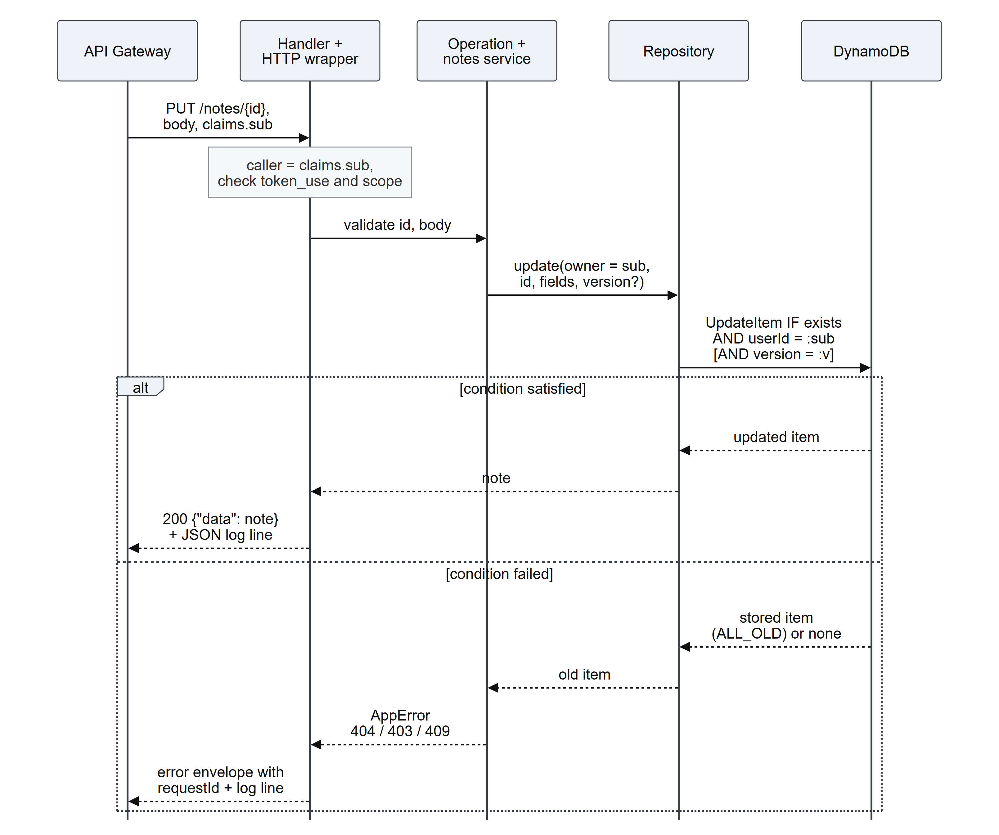
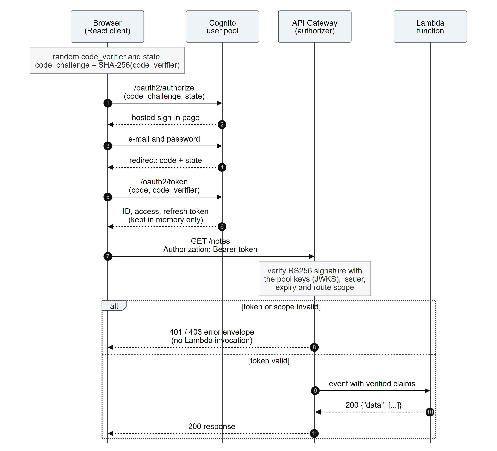
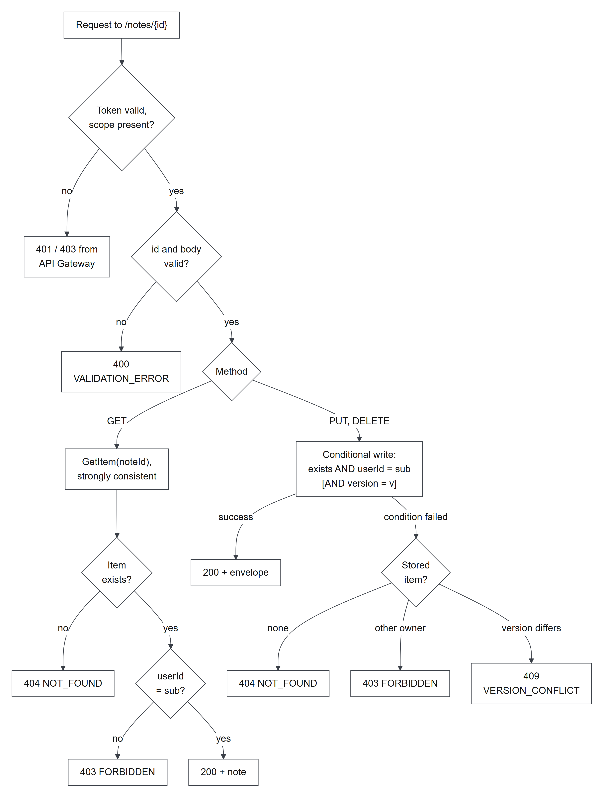
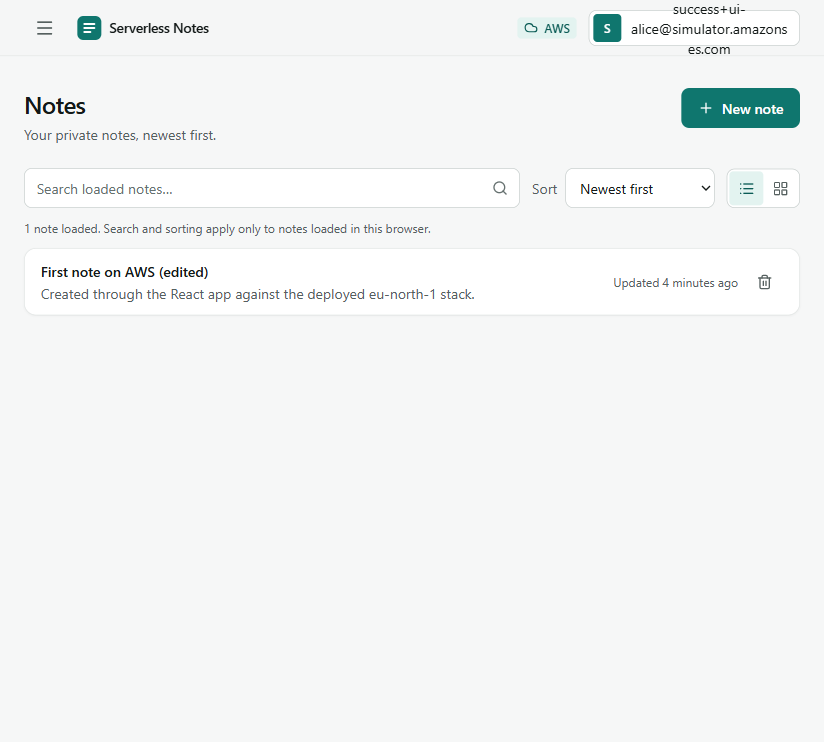
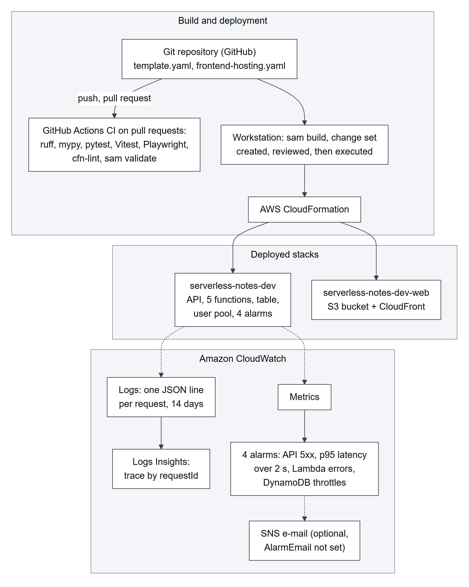
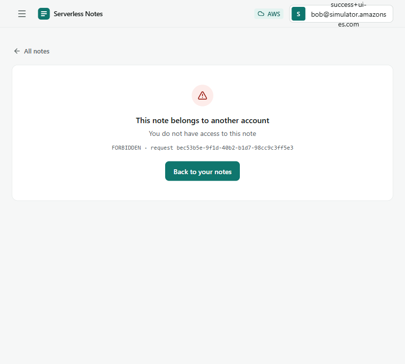
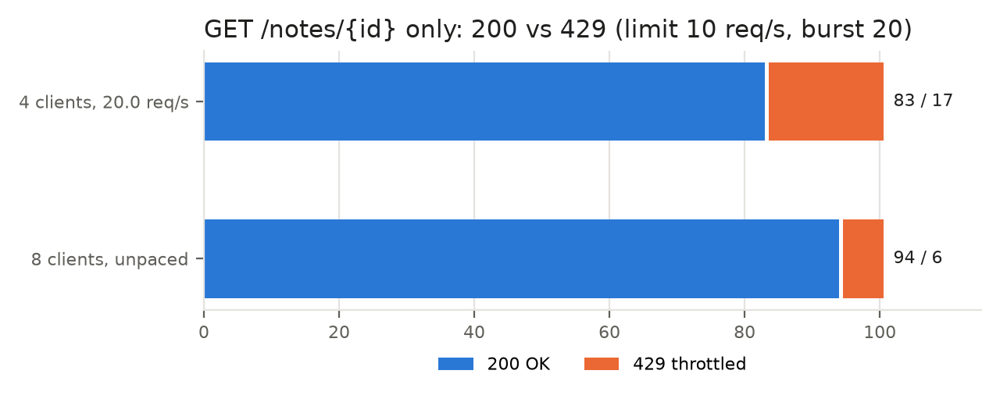
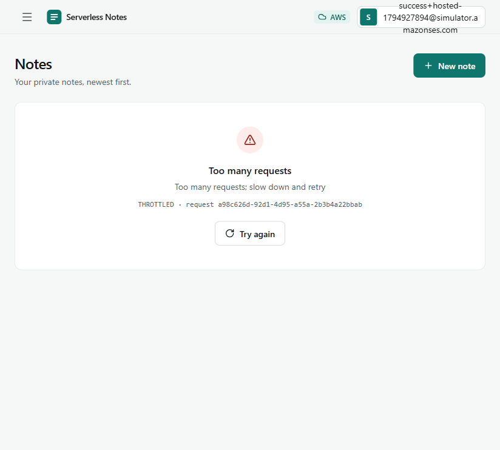

<!--
  Editable source of the bachelor's thesis review copy. Build: scripts/docs/build_thesis.py
  (DOCX and PDF in docs/thesis/export/). Prepared with AI assistance (Claude Code) on 2026-11-17 from
  this repository, its evidence files and the semestral thesis draft. [AUTHOR-VERIFY] marks claims,
  sources and decisions the author must check personally. Checklist: docs/thesis/BACHELOR_AUTHOR_REVIEW.md;
  overall status: docs/thesis/FINAL_HANDOVER.md.
-->

## Assignment

*The bachelor's thesis assignment generated by the BUT information system was not available. The wording below is copied from the assignment page of the semestral thesis, which lists the follow-up tasks of the bachelor's thesis. Replace this page with the official bachelor's thesis assignment.* [AUTHOR-VERIFY: academic year, dates, title and wording of the bachelor's thesis assignment]

**Title of thesis:** Serverless CRUD API with Authentication

The task is to design a demonstrational serverless backend based on a cloud platform. The goal is to build a REST API with Create, Read, Update and Delete (CRUD) operations and secure user authentication, using serverless functions, an API gateway and a managed database service. The system should clearly show how such an architecture can provide scalable, low-maintenance backend services for applications that work with signed-in users and structured data.

Partial tasks are to ensure reliable and timely processing of user requests, apply basic security techniques for protecting user accounts and stored data, and demonstrate the advantages of using a serverless cloud backend instead of a traditional server-based solution.

1. Research relevant cloud platforms, serverless technologies, managed databases and common methods for user authentication and authorization (for example token-based access).
2. Design a demonstration application and the overall architecture of the REST API, including main entities and data model, API endpoints, request/response formats, user roles and basic access rules.
3. Implement and test a basic serverless backend prototype with CRUD operations for at least one selected entity, including simple validation and error handling, and describe the studied technologies and proposed solution in the semestral project report.

Following Bachelor thesis:

4. Implement the full serverless backend (REST API, database and authentication) on the chosen cloud platform, with support for all required entities, user management, logging and monitoring.
5. Evaluate the achieved properties of the system (functionality, performance, scalability, security aspects and costs) and describe them in the bachelor thesis, including a discussion of possible future extensions such as a web or mobile client or integration with other systems.

Supervisor: doc. Ing. Lukáš Malina, Ph.D.

## Abstract

This thesis designs, implements and evaluates a serverless REST API with create, read, update and delete operations and token-based authentication on Amazon Web Services. A private-notes application serves as the demonstration: users register and sign in through Amazon Cognito, and five AWS Lambda functions written in Python 3.13 store their notes in Amazon DynamoDB behind an Amazon API Gateway REST API that verifies JWT access tokens and OAuth scopes. Ownership is enforced inside conditional database writes, all input is validated strictly, every error uses one response envelope with a request identifier, and Amazon CloudWatch provides structured logs and four alarms. The whole system is defined as infrastructure as code with AWS SAM and runs in the Stockholm region; a React client is published through Amazon CloudFront. The evaluation combines 193 automated backend tests, 38 functional and security checks and ten token tests against the deployed system, a sequential benchmark of 500 requests and a bounded concurrency benchmark with up to eight clients and about 60 requests per second. The median end-to-end latency stayed between 120 and 126 ms at every concurrency level, Lambda scaled out to eight execution environments without errors, and the configured throttle of 10 requests per second per method answered with HTTP 429 as designed. Every forged, tampered or expired token that was tested was rejected. The estimated running cost is about one US dollar per month at demonstration scale at list price, whereas an always-on small virtual server in the same account cost about twenty dollars per month. The thesis discusses the limits of these results and the extensions needed for production use.

**Keywords:** serverless computing, REST API, CRUD, authentication, authorization, JSON Web Token, OAuth 2.0, AWS Lambda, Amazon API Gateway, Amazon DynamoDB, Amazon Cognito, performance evaluation, scalability, cloud cost

## Abstrakt

Tato bakalářská práce se zabývá návrhem, implementací a vyhodnocením bezserverového (serverless) REST API s operacemi vytvoření, čtení, úpravy a mazání (CRUD) a s autentizací založenou na tokenech v prostředí Amazon Web Services. Jako demonstrační aplikace slouží služba pro správu soukromých poznámek: uživatelé se registrují a přihlašují pomocí služby Amazon Cognito a pět funkcí AWS Lambda v jazyce Python 3.13 ukládá jejich poznámky do databáze Amazon DynamoDB. Před funkcemi stojí Amazon API Gateway (REST API), která ověřuje přístupové tokeny JWT a rozsahy oprávnění OAuth. Vlastnictví záznamu se kontroluje přímo v podmíněném zápisu do databáze, všechny vstupy se přísně validují, každá chyba používá jednotný formát odpovědi s identifikátorem požadavku a služba Amazon CloudWatch poskytuje strukturované záznamy a čtyři alarmy. Celý systém je popsán jako infrastruktura v kódu (AWS SAM) a běží v regionu Stockholm; webový klient v Reactu je publikován přes Amazon CloudFront. Vyhodnocení zahrnuje 193 automatizovaných testů backendu, 38 funkčních a bezpečnostních kontrol a deset testů tokenů proti nasazenému systému, sekvenční měření 500 požadavků a omezené měření souběžnosti s nejvýše osmi klienty a přibližně 60 požadavky za sekundu. Medián doby odezvy zůstal na všech úrovních souběžnosti mezi 120 a 126 ms, Lambda se bez chyb rozšířila na osm prostředí a nastavené omezení 10 požadavků za sekundu na metodu odpovídalo podle návrhu kódem HTTP 429. Všechny testované podvržené, upravené i expirované tokeny byly odmítnuty. Odhadované náklady při demonstračním provozu činí podle ceníku přibližně jeden americký dolar měsíčně, zatímco trvale běžící malý virtuální server ve stejném účtu stál přibližně dvacet dolarů měsíčně. Práce diskutuje omezení výsledků a rozšíření potřebná pro produkční provoz. [AUTHOR-VERIFY: Czech wording and terminology; agree on the use of the term "serverless" in Czech with the supervisor]

**Klíčová slova:** bezserverové výpočty (serverless), REST API, CRUD, autentizace, autorizace, JSON Web Token, OAuth 2.0, AWS Lambda, Amazon API Gateway, Amazon DynamoDB, Amazon Cognito, vyhodnocení výkonu, škálovatelnost, náklady cloudu

## Bibliographic citation

HESHMAT, John. *Serverless CRUD API with Authentication.* Bachelor's Thesis. Brno: Brno University of Technology, Faculty of Electrical Engineering and Communication, Department of Telecommunications, 2027. Advised by doc. Ing. Lukáš Malina, Ph.D.

[AUTHOR-VERIFY: format taken from the official FEKT template sample; the year of submission and the final citation come from the faculty system.]

<!-- mainmatter -->

## Introduction

A typical application backend authenticates users, stores their records and lets them read, change and delete them. For a long time such a backend meant operating servers: choosing their size, keeping their operating systems patched, configuring load balancers and paying for capacity whether or not anybody used it. Serverless cloud services promise to provide the same backend without servers to operate. Code runs in short-lived functions that the platform starts for each request, data is kept in a managed database, identity is delegated to a managed user directory, and the operator pays per request [1], [2].

These promises are attractive, but they are not free of trade-offs. Functions start with a delay when no execution environment is ready, the platform imposes limits, every component is specific to one provider, and the bill depends on traffic that the operator does not control. Whether a serverless backend is "scalable, low-maintenance" and secure, as the assignment of this thesis expects, therefore has to be shown on a concrete system and measured rather than assumed.

This thesis builds and evaluates such a system: a multi-user notes service on Amazon Web Services (AWS). The semestral thesis studied the technologies, designed the application and implemented a first prototype. The bachelor's thesis completes the backend with user management, logging and monitoring, deploys it, and evaluates its functionality, performance, scalability, security and costs on the deployed system. Throughout the text, measured results, configuration facts read from the deployed system and architectural expectations taken from the documentation are distinguished explicitly, because they carry different weight.

## Aims of the thesis

The official assignment asks for a demonstrational serverless backend: a REST API with CRUD operations and secure user authentication, built from serverless functions, an API gateway and a managed database, which processes requests reliably and in time, protects accounts and data, and shows the advantages of serverless over a server-based solution. Tasks 1–3 (research, design and a prototype) were the subject of the semestral thesis; their results are summarised in Chapters 1–4 so that this thesis can be read on its own. The bachelor's thesis covers the two follow-up tasks:

- **Task 4** — implement the full serverless backend (REST API, database and authentication) on the chosen platform, with support for all required entities, user management, logging and monitoring (Chapters 4–8);
- **Task 5** — evaluate the achieved properties of the system — functionality, performance, scalability, security aspects and costs — and discuss possible extensions such as a web or mobile client or integration with other systems (Chapters 9–15).

The concrete objectives derived from these tasks are: (1) a deployed backend that meets the functional requirements of Chapter 3; (2) user management covering registration, verification, sign-in, sign-out and password reset; (3) structured logging, request tracing and alarms; (4) a reproducible deployment from code; and (5) an evaluation in which every quantitative statement is backed by a stored measurement or a stated assumption.

## 1 Theoretical background

### 1.1 Cloud computing and serverless

The NIST definition describes cloud computing as on-demand network access to a shared pool of configurable resources that can be provisioned and released rapidly with minimal management effort, and distinguishes infrastructure, platform and software as a service [3]. With infrastructure as a service the customer still operates virtual machines; with platform as a service the provider runs the platform and the customer deploys applications.

Serverless computing goes further. Jonas et al. characterise it by three properties: storage and computation are decoupled and scale separately, code runs without the user allocating resources, and the user pays in proportion to the resources used rather than allocated [2]. In practice it combines **Function as a Service** — short-lived, stateless functions started by an event such as an HTTP request — with **Backend as a Service** — managed building blocks such as databases, identity providers and queues that the functions use [1], [2].

### 1.2 Advantages and trade-offs

Compared with a backend on rented virtual machines or containers, a serverless backend removes operating-system maintenance and capacity planning, scales by starting more execution environments as traffic grows, costs almost nothing when idle, and inherits the availability of managed multi-zone services [1], [2], [4]. The trade-offs are equally important for an honest evaluation [1], [2]:

- **cold starts** — the first request to a new execution environment waits for it to be created; this effect is measured in Chapters 10 and 11;
- **statelessness** — nothing survives between requests except in external services, so all state lives in the database;
- **limits** — for example, an AWS Lambda invocation runs for at most 15 minutes with a synchronous payload of at most 6 MB [5], and a DynamoDB item is limited to 400 KB [6];
- **vendor lock-in** — services and configuration are provider-specific;
- **cost at constant high load** — per-request prices can exceed the price of permanently running capacity (Chapter 13);
- **testing** — managed services cannot run on a developer's machine, so emulators and a deployed test environment are needed.

### 1.3 REST and HTTP

The REST architectural style models data as resources identified by URLs that are manipulated through a uniform interface [7], [8]. HTTP semantics define the meaning of the methods — for example that PUT replaces the target resource — and of the status codes [9]. A REST API for CRUD operations therefore maps create, read, update and delete onto POST, GET, PUT and DELETE, and reports outcomes with standard status codes rather than with application-specific flags.

### 1.4 Managed NoSQL databases

Relational databases offer joins, transactions and a flexible query language, but a managed relational database typically runs on provisioned instances that cost money even when idle. Key-value and document databases partition data by key and scale horizontally; in exchange, every efficient query must name the partition key [6], [10]. Amazon DynamoDB is such a database. In on-demand mode it charges per request and adapts to traffic without capacity planning; data is replicated across three availability zones and encrypted at rest [6]. Its central design rule is to model the table around the access patterns: an operation that cannot use a key needs a `Scan`, which reads the whole table. Global secondary indexes (GSI) add access paths with a different key; they are maintained asynchronously and read with eventual consistency [6].

### 1.5 Token-based authentication

**Authentication** establishes who the caller is; **authorization** decides whether that caller may perform an operation on a specific resource [11]. Instead of server-side sessions, an API can accept **tokens** that carry signed claims and can be verified without a session store, which suits stateless functions [11]. A JSON Web Token (JWT) consists of three Base64url-encoded parts — header, payload and signature [12]. The header names the algorithm and the key identifier (`kid`); the payload carries claims such as the issuer (`iss`), the subject (`sub`) and the expiry (`exp`); the signature protects both. Amazon Cognito signs its tokens with RS256, so anyone can verify them with the public keys the user pool publishes as a JSON Web Key Set [13]. A verifier must check the signature, the issuer, the expiry and the intended use: Cognito issues ID tokens for clients and access tokens — with `client_id`, `token_use = access` and the granted `scope` — for APIs [13].

### 1.6 OAuth 2.0, OpenID Connect and PKCE

OAuth 2.0 is a framework in which an authorization server issues access tokens that a client presents to a resource server [14]; OpenID Connect adds the ID token. A browser application cannot keep a client secret, so it uses the **authorization code flow with Proof Key for Code Exchange (PKCE)** [15]: the client sends only the SHA-256 hash of a random `code_verifier` with the sign-in request and must present the verifier itself when it exchanges the returned code for tokens, which makes an intercepted code useless. A random `state` value protects the redirect against cross-site request forgery [14].

### 1.7 Object-level authorization

A valid token proves identity, not the right to access a particular record. *Broken Object Level Authorization* — an authenticated user accessing another user's object by changing its identifier — is the first risk of the OWASP API Security Top 10 [16]. Every request that names a resource must therefore check that the resource belongs to the caller, using an identity the client cannot forge.

## 2 Comparison of cloud technologies and selection

### 2.1 Serverless building blocks of the major platforms

The three largest public clouds offer comparable building blocks for the assignment (Table 2.1) [5], [6], [13], [17]–[19]. All of them can satisfy the functional requirements. The differences that mattered for this project were how directly the API gateway can verify a JWT from the provider's own user directory, how mature the tooling is for describing the whole stack as code, and the available literature. [AUTHOR-VERIFY: service names change often; check each against the current documentation.]

*Table 2.1 — Serverless building blocks of three major platforms*

| Component | AWS | Microsoft Azure | Google Cloud |
|---|---|---|---|
| Functions | AWS Lambda | Azure Functions | Cloud Run functions |
| API gateway | Amazon API Gateway | Azure API Management | API Gateway, Apigee |
| NoSQL database | Amazon DynamoDB | Azure Cosmos DB | Firestore |
| User directory issuing JWTs | Amazon Cognito user pools | Microsoft Entra External ID | Identity Platform |
| Logs and monitoring | Amazon CloudWatch | Azure Monitor | Cloud Logging, Cloud Monitoring |
| Infrastructure as code | CloudFormation, AWS SAM | ARM templates, Bicep | Infrastructure Manager (Terraform) |

### 2.2 REST API or HTTP API in Amazon API Gateway

Within AWS, API Gateway offers two products [17]. The **REST API** supports Cognito user-pool authorizers with OAuth scopes required per route, throttling settings per method, customisable gateway responses and usage plans. The **HTTP API** is cheaper per request and supports JWT authorizers, but has fewer of these features. The REST API was chosen because per-route scope enforcement and uniform gateway errors were part of the design (repository, ADR 0001). The price of this choice is quantified in Chapter 13: at moderate traffic the REST API is the largest cost item.

### 2.3 Justification of the selected architecture

1. **Authentication before any code runs.** The Cognito authorizer validates tokens and scopes in API Gateway, so unauthenticated traffic never invokes a function or reaches the database [13], [17].
2. **One description of the whole system.** AWS SAM, an extension of CloudFormation, describes the API, functions, table, user pool, logs and alarms in one template that can be reviewed and redeployed [20].
3. **Pay-per-use for every component**, which fits a demonstration with irregular traffic (Chapter 13).
4. **Literature and documentation.** The literature recommended for the assignment targets AWS [1], and the services are documented in detail [5], [6], [13], [17].

### 2.4 Region

The original plan named Frankfurt (eu-central-1). The AWS account used for the project belongs to an organization whose service control policy denies workload services in every region except Stockholm (eu-north-1); this was confirmed with the IAM policy simulator on 16 November 2026 (repository, ADR 0008). The system therefore runs in eu-north-1, which is also an EU region and offers every service used. [AUTHOR-VERIFY: confirm that the supervisor accepts the region change.]

## 3 Requirements

The demonstration application is a multi-user private notes service with one application entity, the **Note**. The assignment does not prescribe further entities; "all required entities" is therefore satisfied by the Note together with the user accounts, which are managed by Cognito. Table 3.1 lists the functional requirements and Table 3.2 the non-functional ones with the chapters in which they are evaluated.

*Table 3.1 — Functional requirements*

| ID | Requirement | Source |
|---|---|---|
| F-1 | CRUD operations on notes through a REST API | assignment, semestral design |
| F-2 | Endpoints `POST /notes`, `GET /notes`, `GET /notes/{id}`, `PUT /notes/{id}`, `DELETE /notes/{id}` | semestral design |
| F-3 | JWT authentication on every endpoint | assignment (token-based access) |
| F-4 | Each note is visible and modifiable only by its owner | assignment (protect stored data) |
| F-5 | Status codes 201, 200, 400, 401, 403 (another user's existing note), 404 | semestral design |
| F-6 | Attributes `noteId`, `userId`, `title`, `content`, `createdAt`, `updatedAt` | semestral design |
| F-7 | Validation of inputs and consistent error responses | assignment, task 3 |
| U-1 | User management: registration, e-mail verification, sign-in, sign-out, password reset | assignment, task 4 |

*Table 3.2 — Non-functional requirements*

| ID | Requirement | Evaluated in |
|---|---|---|
| N-1 | Managed, automatically scaling services; no servers to operate | Chapters 7, 11 |
| N-2 | Reliable and timely processing of requests | Chapters 8, 10, 11 |
| N-3 | Logging of every API call, traceable individual requests, monitoring | Chapter 8 |
| N-4 | Security of user accounts and stored data | Chapter 12 |
| N-5 | Low cost, especially when idle | Chapter 13 |
| N-6 | Reproducible deployment | Chapter 7 |

## 4 System architecture and design

### 4.1 Overview

Figure 4.1 shows the deployed system. A browser loads the web client from Amazon CloudFront, signs the user in with the Cognito user pool and receives an access token. Each API request carries this token to Amazon API Gateway, which verifies it and the route's scope before it invokes one of five Lambda functions. The functions validate the input, enforce ownership and read or write the notes in DynamoDB. CloudWatch receives logs and metrics. All resources of the backend are created from one AWS SAM template in eu-north-1; the web client is served from a second stack.



### 4.2 One function per operation

Each operation has its own Lambda function — CreateNote, ListNotes, GetNote, UpdateNote and DeleteNote — instead of one function with internal routing. The reasons are least privilege, because each function's IAM role permits exactly one DynamoDB action on the table or the index, and observability, because each operation has its own logs and metrics. The functions share one code package, so no code is duplicated. The cost is five independent sets of execution environments and therefore five separate cold starts (repository, ADR 0003), which is visible in the measurements of Chapter 11.

### 4.3 Data model

Figure 4.2 and Table 4.1 show the data model. The table `serverless-notes-dev-notes` uses `noteId` as its partition key. The global secondary index `byUser` has the partition key `userId` and the sort key `userSortKey = "<createdAt>#<noteId>"`, so one user's notes can be listed newest first with a `Query` that reads only that user's items. The relationship between users and notes is one-to-many; user records live in Cognito and are linked by `userId = sub`.



*Table 4.1 — Attributes of a note*

| Attribute | Type | Set by | Rule |
|---|---|---|---|
| `noteId` | string (UUID v4) | server | partition key |
| `userId` | string | server | `sub` claim of the creator; never changes |
| `userSortKey` | string | server | `<createdAt>#<noteId>`; sort key of `byUser` |
| `title` | string | client | 1–200 characters after trimming, no control characters |
| `content` | string | client | 0–20 000 characters |
| `createdAt`, `updatedAt` | string | server | ISO 8601, UTC, milliseconds |
| `version` | number | server | starts at 1, incremented by each update |

A composite primary key (`userId`, `noteId`) was considered and rejected: a lookup by `noteId` alone would then be impossible, and the API could no longer distinguish "another user's note" (403) from "no such note" (404), which requirement F-5 demands (repository, ADR 0002). Table 4.2 shows that every operation maps to exactly one keyed DynamoDB call; `Scan` is never used, and the IAM roles do not permit it.

*Table 4.2 — Access patterns*

| Operation | DynamoDB call |
|---|---|
| Create | `PutItem` with the condition `attribute_not_exists(noteId)` |
| Read one | `GetItem`, strongly consistent; owner compared in the service |
| List own | `Query` on `byUser`, newest first, `Limit` and continuation token |
| Update | `UpdateItem` with the condition: exists, owner = caller (and version matches, if sent) |
| Delete | `DeleteItem` with the condition: exists, owner = caller |

### 4.4 REST API

Table 4.3 specifies the five endpoints. Requests and responses are JSON. Every response uses one envelope: `{"data": …}` for one resource, `{"data": […], "meta": {"count", "limit", "nextToken"}}` for a list, and `{"error": {"code", "message", "requestId", "details"}}` for errors. The `requestId` is API Gateway's request identifier, which is also written to the logs, so an error reported by a user can be traced (Chapter 8). API Gateway's own errors — missing or invalid token, throttling, unknown routes — are configured as gateway responses with the same envelope and CORS headers. The complete contract is the OpenAPI document `docs/api/openapi.yaml`.

*Table 4.3 — Endpoints*

| Method and path | Scope | Success | Possible errors |
|---|---|---|---|
| `POST /notes` | `notes/write` | 201 + note | 400, 401, 413, 415, 429, 503 |
| `GET /notes?limit&nextToken` | `notes/read` | 200 + list and `meta` | 400, 401, 429, 503 |
| `GET /notes/{id}` | `notes/read` | 200 + note | 400, 401, 403, 404, 429, 503 |
| `PUT /notes/{id}` | `notes/write` | 200 + note | 400, 401, 403, 404, 409, 413, 415, 429, 503 |
| `DELETE /notes/{id}` | `notes/write` | 200 | 400, 401, 403, 404, 429, 503 |

Two decisions follow the assignment's design literally and are discussed as trade-offs. Returning 403 for another user's note reveals that a note with that identifier exists; the disclosure is small because identifiers are random 122-bit UUIDs. DELETE returns 200 with a body instead of 204, which keeps the envelope uniform [9].

### 4.5 Request processing

Figure 4.3 follows an authorized update through the layers of a function. The handler takes the caller's identity from the claims that API Gateway verified, the operation layer validates the request, the service applies the business rules, and the repository issues a single conditional `UpdateItem`. Because the ownership check is part of the write, no other request can change the note between the check and the write.



## 5 Authentication, authorization and user management

### 5.1 User management

User management is delegated to a Cognito user pool. Users sign up in the web client with their e-mail address as the user name, confirm the address with a code sent by e-mail, sign in on the pool's hosted sign-in page, sign out, and reset a forgotten password through the verified address. The password policy requires at least twelve characters with upper- and lower-case letters, digits and symbols. The configuration read from the deployed pool on 17 November 2026 also showed that `PreventUserExistenceErrors` is enabled for the app client, refresh-token revocation is on, access tokens are valid for 60 minutes and refresh tokens for one day. The account administration itself — for example disabling a user — is done in Cognito; the application has no administrator role.

### 5.2 Sign-in and token verification

Figure 5.1 shows the sign-in with the authorization code flow and PKCE and the subsequent API call. The public web client has no secret and may use only the code flow. It keeps the tokens in memory, never in browser storage. API Gateway's Cognito authorizer verifies the signature of the access token with the pool's public keys, its issuer and its expiry, and each route requires a scope: `notes/read` for reads and `notes/write` for writes. ID tokens carry no custom scopes and are therefore rejected by every route.



### 5.3 Authorization rules

The application has one role, the authenticated owner of notes. A second app client that receives only `notes/read` exists to demonstrate that scope enforcement works. The functions repeat the essential checks as defence in depth — presence of `sub`, `token_use = access` and the required scope — and take the caller's identity only from `event.requestContext.authorizer.claims.sub`, which only API Gateway can fill. The client can never set `userId`, `noteId`, timestamps or `version` (except `version` as a precondition of PUT); unknown fields are rejected. Figure 5.2 summarises the decisions taken for every request that names a note.



## 6 Implementation

### 6.1 Structure of the backend

The backend (`backend/src/notes_api/`) is written in Python 3.13 for Lambda on arm64 (AWS Graviton) with 256 MB of memory and a 10 s timeout. It has no third-party runtime dependencies; `boto3` is provided by the Lambda runtime. Table 6.1 shows its layers. The service depends on a repository interface (a Python `Protocol`), so its rules are unit-tested with an in-memory implementation, while the repository is tested against an emulated DynamoDB (`moto`). The code is type-checked with `mypy` in strict mode and linted with `ruff`.

*Table 6.1 — Layers of the backend*

| Layer | Module | Responsibility |
|---|---|---|
| Handler | `handlers/*.py` | entry point of each function |
| HTTP wrapper | `http.py` | identity extraction, scope check, error mapping, envelope, logging |
| Operation | `operations.py` | parsing and validation of the request |
| Service | `services/notes_service.py` | business rules: ownership, versioning |
| Repository | `repositories/notes_repository.py` | the only code that calls DynamoDB |

### 6.2 Validation and error handling

Validation is strict and reports all problems of a request together. The body must be a JSON object sent as `application/json` and at most 128 KiB; `POST` accepts exactly `title` and `content`, `PUT` additionally an optional positive integer `version`; values are never converted implicitly; identifiers must be UUIDs, `limit` an integer from 1 to 100, and a malformed continuation token is rejected. Errors are raised as subclasses of one `AppError` class with a status code and an error code (`VALIDATION_ERROR`, `NOT_FOUND`, `FORBIDDEN`, `VERSION_CONFLICT` and others). The HTTP wrapper converts them into the envelope; any unexpected exception becomes a 500 response without internal details while the stack trace is logged, and database throttling or unavailability becomes a retryable 503.

### 6.3 Ownership, concurrency and pagination

For reads the service loads the note and compares its owner with the caller. For updates and deletes the owner check is part of the DynamoDB condition expression, so check and write are one atomic operation; with `ReturnValuesOnConditionCheckFailure=ALL_OLD` a failed condition returns the stored item, from which the function decides between 404, 403 and 409 without a second read. Optimistic locking with the `version` attribute prevents lost updates when the same note is edited in two places. Listing uses an opaque continuation token that contains only a position, never a user identifier; the server always combines it with the caller's identity, so a token copied from another user cannot reveal their notes.

### 6.4 Logging and cold-start optimisation

Each request produces one structured JSON log line with the request identifier, operation, status, error code and duration, and with the caller's opaque `sub`; titles, contents, tokens and e-mail addresses are never logged. The DynamoDB client is created during the Lambda initialisation phase rather than during the first request. This change halved the cold-start time measured inside Lambda (Chapter 10).

### 6.5 Web client

A React and TypeScript client demonstrates the API and covers the "web client" extension named in the assignment. It registers users, signs them in through the hosted page with PKCE, keeps tokens in memory only, and provides a notes list and an editor. It is published at https://d11c0a7q5fx9qi.cloudfront.net from a private Amazon S3 bucket through CloudFront with Origin Access Control, HTTPS and security headers including a content security policy [21]. Figure 6.1 shows the client working against the deployed stack.



> **Screenshot placeholder (not a figure yet).** The public site at the CloudFront address with a signed-in test user and a list of notes. The existing file `evidence/screenshots/aws-13-hosted-cloudfront-notes.png` shows the public site in a *throttled* state (Figure 11.4), not a notes list. Capture a new screenshot without personal e-mail addresses and insert it here. [AUTHOR-VERIFY]

## 7 Infrastructure as code and deployment

The template `infrastructure/template.yaml` (AWS SAM) creates the 33 resources of the backend stack `serverless-notes-dev`: the REST API with its authorizer, scopes, throttling settings and gateway responses; the five functions, each with its own IAM role and log group with 14-day retention; the table and index; the user pool with its domain, resource server and two app clients; the four alarms and an optional SNS topic. The template `infrastructure/frontend-hosting.yaml` creates the bucket, the CloudFront distribution, the Origin Access Control and the response-headers policy of the second stack, `serverless-notes-dev-web`.

Figure 7.1 shows the delivery and monitoring path. Continuous integration in GitHub Actions runs on every pull request: static analysis, type checks, unit and browser tests, dependency audits, `cfn-lint` and `sam validate`. Deployments are made from the developer's workstation through CloudFormation change sets, which list every resource to be added, modified or replaced and are reviewed before execution. A manual GitHub deployment workflow exists, but its OIDC role was deliberately not created, so it has not been used (`docs/deployment/DEPLOYMENT.md`). The development stack was deployed on 17 November 2026.



## 8 Logging, monitoring and reliability

### 8.1 Logging and tracing

Every request writes one JSON log line, and the request identifier in the log is the one returned in every error envelope. A 403 shown in the browser was traced to its log line with CloudWatch Logs Insights, and the logs of the 729 Lambda invocations of the concurrency benchmark were grouped by operation and status without any error lines and without personal data (`evidence/aws/cloudwatch.txt`, `evidence/aws/bachelor-evaluation.json`). The five log groups keep data for 14 days. API Gateway access logs are optional in the template and were left off, because they require an account-wide CloudWatch role; requests rejected by the gateway are therefore visible only in metrics.

### 8.2 Alarms

Table 8.1 lists the four alarms. On 17 November 2026 all of them were in the state OK and receiving data. Notifications are sent only when the template parameter `AlarmEmail` is set; on the development stack it is not, so an alarm would change its state without notifying anybody. The notification path is therefore **not verified**. No failure was injected deliberately to trigger an alarm, because that would require breaking the deployed stack.

*Table 8.1 — CloudWatch alarms*

| Alarm | Condition | Failure class |
|---|---|---|
| `api-5xx` | API `5XXError` ≥ 1 within 5 min | gateway or function failure visible to clients |
| `api-latency-p95` | API `Latency` p95 > 2 000 ms for 3 × 5 min | slow responses |
| `lambda-errors` | sum of `Errors` of the five functions ≥ 1 within 5 min | crashes, timeouts |
| `dynamodb-throttles` | throttled DynamoDB requests ≥ 1 within 5 min | database capacity |

> **Screenshot placeholder (not a figure yet).** CloudWatch Logs Insights tracing one `requestId`, or the alarm list of the stack. Capture it in the AWS console with the account ID hidden (procedure in `docs/deployment/TROUBLESHOOTING.md`). [AUTHOR-VERIFY]

### 8.3 Failure handling and durability

Table 8.2 summarises the designed behaviour in failure situations. A success response is sent only after DynamoDB has acknowledged the write, and DynamoDB stores data durably across three availability zones [6]. Reading a single note is strongly consistent, so a note can be read immediately after it was written; the list uses the index and is eventually consistent. The deployment uses one region, so a regional outage would make the service unavailable, and the development table has no point-in-time recovery (the template enables it for a production stage).

*Table 8.2 — Failure modes*

| Failure | Behaviour | Client sees |
|---|---|---|
| DynamoDB throttling or transient error | retried by the SDK, then mapped to an application error | 503 `SERVICE_UNAVAILABLE` (retryable) |
| Unexpected exception | caught by the HTTP wrapper, stack trace logged | 500 `INTERNAL_ERROR` without details |
| Function timeout (10 s) | invocation aborted by Lambda | 5xx from API Gateway |
| Too many requests | throttled by API Gateway per method | 429 `THROTTLED` in the error envelope |
| Concurrent edits of one note | conditional write with `version` | 409 `VERSION_CONFLICT`, no lost update |
| Availability-zone failure | regional multi-zone services | transparent (provider guarantee, not tested) |
| Region failure | single-region deployment | outage |

## 9 Functional testing

### 9.1 Method

Testing has four levels: unit tests of validation, pagination tokens, identity extraction and service rules; integration tests of the repository and of complete handler-to-database flows against an emulated DynamoDB; security tests of isolation, ownership, error disclosure, log hygiene and concurrent writes; and live tests against the deployed stack (`scripts/testing/live_api_tests.py`), which create temporary Cognito users, call the real API and delete the users afterwards. The web client has its own unit tests (Vitest) and browser tests (Playwright). Local results were obtained with an emulator and are labelled as such; only the live tests prove behaviour on AWS.

### 9.2 Results

Table 9.1 summarises the results; the raw outputs are stored in the repository's `evidence/` directory.

*Table 9.1 — Functional test results*

| Level | Tool | Result | Evidence |
|---|---|---|---|
| Backend unit, integration and security tests | pytest, moto (local) | 193 passed, 99 % line and branch coverage | `evidence/tests/backend-pytest.txt` |
| Frontend unit and component tests | Vitest (local) | 66 passed | `evidence/tests/frontend-vitest.txt` |
| Browser journeys against the local emulator | Playwright (local) | 14 passed, including an accessibility audit | `evidence/tests/frontend-e2e-playwright.txt` |
| Live functional and security checks on AWS | `live_api_tests.py` | 38 of 38 passed | `evidence/tests/live-api-tests.json` |
| Browser test of the deployed system | Playwright, real Cognito | sign-up, sign-in, CRUD, reload, isolation between two users, sign-out passed | `docs/testing/TESTING.md`, screenshots |
| Manual check by the author | real mailbox | registration, e-mailed code, sign-in, password reset, CRUD on the public site | no evidence file |

Table 9.2 groups the 38 live checks. They reproduce the test cases of the semestral design, confirm that another user's attempts leave a note unchanged, and cover the token boundary, routing, validation, CORS and throttling. All five endpoints and all specified status codes were observed on the deployed system. Figure 9.1 shows the isolation case as the user sees it.

*Table 9.2 — Live checks against the deployed stack (17 November 2026)*

| Group | IDs | What is checked | Passed |
|---|---|---|---|
| CRUD and status codes | T01–T15 (16 checks) | every endpoint, 201/200/400/401/403/404, delete of a missing note | 16/16 |
| Isolation | H01–H02 | another user's attempts leave the note unchanged and invisible | 2/2 |
| Authentication boundary | A01–A07 | garbage token, modified signature, ID token, non-Bearer scheme, unknown route with a token, read-only scope | 7/7 |
| Routing | R01–R02 | unknown route without a token, unsupported method | 2/2 |
| Validation | V01–V04 | client-supplied `userId`, malformed JSON, invalid id, oversized body | 4/4 |
| CORS | C01–C04 | preflight origin and headers, CORS headers on a success and on a gateway 401 | 4/4 |
| Throttling | L01–L03 | a burst above the limit yields only 200 and 429; 429 uses the error envelope | 3/3 |



## 10 Performance measurements

### 10.1 Method

Performance was measured end to end from one Windows workstation on a home connection in Central Europe against eu-north-1, which is the path a real user would take. Each request used a new TLS connection. The client-side latency therefore includes the network, TLS handshake, API Gateway with the authorizer, Lambda and DynamoDB. Inside Lambda, the `REPORT` lines in CloudWatch give the duration of the function itself, its initialisation time on a cold start and the memory used. All runs were bounded in size, so that they could neither generate significant cost nor harm the account.

### 10.2 Sequential benchmark

The first benchmark ran 100 sequential cycles of create → list → read → update → delete (500 requests) on 17 November 2026, right after a deployment. Table 10.1 shows the results: all requests succeeded, and the median latency was about 120 ms for every endpoint.

*Table 10.1 — Sequential benchmark: client-side latency per endpoint in ms (`evidence/benchmarks/aws-dev-eu-north-1.json`)*

| Endpoint | Median | p95 | Maximum (cold start) | Success |
|---|---|---|---|---|
| POST /notes | 121.1 | 141.6 | 807.6 | 100 % |
| GET /notes | 119.4 | 149.3 | 949.1 | 100 % |
| GET /notes/{id} | 118.8 | 145.8 | 768.6 | 100 % |
| PUT /notes/{id} | 121.7 | 152.3 | 908.4 | 100 % |
| DELETE /notes/{id} | 122.1 | 149.6 | 745.9 | 100 % |

### 10.3 Time inside Lambda and cold starts

A warm request needed a median of about 10–14 ms inside Lambda and used about 92 MB of the 256 MB of memory, so most of the 120 ms is network, TLS, API Gateway and the authorizer. The first measurements showed cold starts of 1.2–1.4 s inside Lambda, because the AWS SDK client was created during the first request. After the client was moved to the initialisation phase, a cold start took 0.55–0.69 s inside Lambda (`evidence/aws/cloudwatch.txt`). Because every function has its own environments, each of the five functions pays its own first cold start, which explains the five maxima in Table 10.1.

## 11 Concurrency and scalability evaluation

### 11.1 Method

The concurrency benchmark (`scripts/testing/concurrency_benchmark.py`) creates a temporary user, seeds five notes and then runs closed-loop clients — each sends its next request as soon as the previous one has finished — at 1, 2, 4 and 8 concurrent clients with 60 requests per level. The mix is 50 % reads of one note, 30 % list requests and 20 % updates, so three of the five methods are exercised. A paced run (8 clients limited to 8 requests per second in total) and two throttle runs complete the measurement. Safety limits capped the run at 8 clients and 600 requests and stopped it on any server error; HTTP 429 responses were recorded but not retried. The temporary user and its notes were deleted afterwards. The whole evaluation took place on 17 November 2026 between 19:05 and 19:14 UTC.

### 11.2 Results

Table 11.1 and Figures 11.1 and 11.2 show the results. All requests of the mixed workload succeeded at every level. Throughput grew almost linearly from 6.8 to 57.6 successful requests per second, and a repeated run with 100 requests at 8 clients reached 60.5 requests per second. The median stayed between 120 and 126 ms.

*Table 11.1 — Concurrency benchmark: latency of successful requests in ms (`evidence/benchmarks/aws-concurrency-eu-north-1.json`, `aws-concurrency-throttle-eu-north-1.json`)*

| Clients | Successful req/s | Success | Median | p95 | Worst observed |
|---|---|---|---|---|---|
| 1 | 6.75 | 60/60 | 119.7 | 191.3 | 926.7 (cold start) |
| 2 | 15.45 | 60/60 | 124.9 | 142.6 | 217.3 |
| 4 | 28.92 | 60/60 | 125.6 | 197.6 | 284.5 |
| 8 | 57.64 | 60/60 | 122.5 | 236.4 | 273.4 |
| 8, repeated with 100 requests | 60.50 | 100/100 | 120.7 | 145.1 | 258.9 |
| 8, paced to 8 req/s | 8.01 | 80/80 | 120.6 | 150.2 | 207.7 |


The 95th percentile widened at four and eight clients. The Lambda statistics in Table 11.2 explain why: each new execution environment paid one cold start (11 cold starts in total, average initialisation 330–430 ms), and network variance adds to the tail. With only 60–100 samples per level, the 99th percentile is effectively the worst observation and is therefore reported as such, not as a stable percentile. The account-wide number of concurrent Lambda executions peaked at 8 of the 400 available in the account.

*Table 11.2 — Lambda statistics during the concurrency evaluation, 19:05–19:14 UTC (`evidence/aws/bachelor-evaluation.json`)*

| Function | Invocations | Median ms | p95 ms | Cold starts | Avg. init ms | Max. memory MB |
|---|---|---|---|---|---|---|
| GetNote | 429 | 10.0 | 25.0 | 4 | 430 | 93 |
| ListNotes | 140 | 13.3 | 29.9 | 3 | 388 | 93 |
| UpdateNote | 130 | 8.4 | 29.4 | 2 | 330 | 93 |
| CreateNote | 15 | 15.6 | 151.9 | 1 | 386 | 93 |
| DeleteNote | 15 | 12.3 | 130.3 | 1 | 388 | 93 |

### 11.3 Throttling

The stage is configured with a rate of 10 requests per second and a burst of 20. The mixed workload was never throttled, even at 60 requests per second, which would have been impossible if the limit applied to the whole stage. Two runs against a single method (`GET /notes/{id}`) confirmed that the limit applies **per method** (Table 11.3, Figure 11.3): with 8 unpaced clients at 58.8 requests per second, 6 of 100 requests received HTTP 429 during the 1.7 s run; with 4 clients paced at 20 requests per second for 5 s, 17 of 100 were throttled and 16.4 requests per second were accepted. Both results exceed what a strict token bucket of 10 requests per second with a burst of 20 would allow, which is consistent with the documentation's statement that throttling is applied on a best-effort basis [22]. Every throttled response carried the uniform error envelope, as Figure 11.4 shows from the client's side.

*Table 11.3 — Single-method throttle runs (`evidence/benchmarks/aws-throttle-single-method-eu-north-1.json`)*

| Run | Duration | Offered req/s | HTTP 200 | HTTP 429 | Accepted req/s |
|---|---|---|---|---|---|
| 8 clients, unpaced | 1.7 s | 58.77 | 94 | 6 | 55.24 |
| 4 clients, paced to 20 req/s | 5.06 s | 19.78 | 83 | 17 | 16.42 |





### 11.4 Scalability beyond the tested range

Behaviour beyond about 60 requests per second was **not measured**; it would require raising the throttle and a distributed load generator. Table 11.4 lists the limits that would apply, with their source. Lambda adds execution environments up to the account's concurrency quota (400 in this account) [23]; DynamoDB on-demand adapts to the request rate, and because every operation addresses a key or one user's partition of the index, no operation becomes slower as the number of users grows [6]. The first limit a real load would hit is therefore the deliberately low per-method throttle, which is a template parameter and serves as a cost guard.

*Table 11.4 — Limits beyond the tested range*

| Layer | Limit | Basis |
|---|---|---|
| API Gateway stage | 10 req/s, burst 20, per method | measured (Table 11.3) |
| API Gateway account | 10 000 req/s, burst 5 000 | account configuration, not load-tested |
| Lambda | 400 concurrent executions in this account; about 10 ms per warm request | account configuration; 8 environments measured |
| DynamoDB on-demand | adapts automatically; per-partition limits apply | documentation [6]; keyed access enforced by tests |

## 12 Security evaluation

### 12.1 Method

The security evaluation combines the automated security tests, the live checks of Chapter 9, a dedicated set of negative-token tests against the deployed system and a review of the deployed configuration. The token tests (`scripts/testing/token_security_tests.py`) obtain a real access token for a temporary user and derive forged tokens from it with a local key; no real user's password or token was used, and nothing was written to the database. The user was deleted immediately after the token had been issued, which also made it possible to observe what happens to the token of a deleted account.

### 12.2 Negative-token tests

Table 12.1 shows the results: all ten checks behaved as expected. The authorizer answered 401 when it could not use a token at all — unsigned, signed with an unknown key identifier, from a foreign issuer, or expired — and 403 for a well-formed token whose signature did not match the pool's key. A real access token sent 90 s after its expiry was rejected. The token of the deleted user, in contrast, was still accepted until it expired (R01): the authorizer validates tokens statelessly and does not ask Cognito whether the account still exists.

*Table 12.1 — Negative-token tests on GET /notes, 17 November 2026 (`evidence/tests/token-security-tests.json`)*

| ID | Token | Expected | Result |
|---|---|---|---|
| P01 | real access token (control) | 200 | 200 |
| N01 | `alg: none`, real claims, no signature | 401 or 403 | 401 |
| N02 | HS256 signed with a random secret (algorithm confusion) | 401 or 403 | 401 |
| N03 | RS256 signed with a foreign key, real issuer and `kid` | 401 or 403 | 403 |
| N04 | foreign issuer (unauthorized user pool), own key | 401 or 403 | 401 |
| N05 | `exp` extended by one day, original signature | 401 or 403 | 403 |
| N06 | `sub` replaced (impersonation), original signature | 401 or 403 | 403 |
| N07 | self-signed token with an expiry in the past | 401 or 403 | 401 |
| R01 | real token after the user was deleted (observation) | 200 until expiry | 200 |
| E01 | real token 90 s after its expiry | 401 | 401 |

### 12.3 Threats and protections

Table 12.2 condenses the threat analysis of `docs/security/SECURITY_EVALUATION.md`, which covers 19 threats. No critical vulnerability was found, so no change of code or infrastructure was needed.

*Table 12.2 — Main threats, protections and test results*

| Threat | Protection | Test | Result |
|---|---|---|---|
| Missing, malformed or non-Bearer token | Cognito authorizer on every route | T02, T05, A01, A04 | 401 |
| Forged, re-signed or tampered token | RS256 with the pool's keys, issuer check | N01–N07, A02 | 401 / 403 |
| Expired token | expiry check | N07, E01 | 401 |
| ID token instead of access token; missing scope | per-route scopes | A03, A07 | 401 |
| Access to another user's note | owner check in the condition expression | T07, T10, T13, H01, H02, browser test | 403, data unchanged |
| Mass assignment, malformed or oversized input | strict validation | V01–V04, unit tests | 400 / 413 |
| Data leakage in errors and logs | generic errors, log hygiene | tests, CloudWatch inspection | none found |
| Token theft in the browser | tokens in memory, CSP, security headers | browser inspection | no token in storage |
| Excessive privileges | one DynamoDB action per function | template tests, deployed roles | least privilege confirmed |
| Token use after account deletion | short token lifetime | R01 | accepted until expiry (limitation) |
| Data loss | encryption, multi-zone storage | configuration review | no backups in dev (limitation) |

### 12.4 Configuration review and residual risks

The configuration review (17 November 2026) found the expected settings — password policy, verified-e-mail recovery, code flow only, `PreventUserExistenceErrors`, token revocation, encryption at rest, data trace off in API Gateway — and the following accepted limitations of a development-stage prototype: multi-factor authentication is off; there is no WAF or CAPTCHA in front of sign-up; the throttle is shared by all users rather than applied per user; the sign-up flow reveals whether an e-mail address is registered; 403 reveals that a guessed identifier exists (required by the design); access tokens remain valid for up to 60 minutes after sign-out or account deletion; the development table has no point-in-time recovery and neither the table nor the user pool has deletion protection; the CloudFront domain is the default one; and there was no independent penetration test. A token from a second *real* Cognito user pool was not tested; a self-signed token with a foreign issuer was used instead (N04).

## 13 Cost evaluation

### 13.1 Pricing model

Every component is billed per use (Table 13.1). Unit prices for eu-north-1 were read from the AWS Price List API on 16 and 17 November 2026 [24]; the estimates below use list prices without any free tier, so that they cannot understate the cost.

*Table 13.1 — Cost components in eu-north-1 (list prices)*

| Service | Billed for | Price |
|---|---|---|
| API Gateway REST API | requests | USD 3.50 per million |
| Lambda (arm64) | requests and GB-seconds | USD 0.20 per million + USD 0.0000133334 per GB-s |
| DynamoDB on-demand | request units and storage | USD 0.67 per million writes, USD 0.1345 per million reads |
| Cognito (Lite) | monthly active users | first 10 000 free |
| CloudWatch | log ingestion, alarm metrics | USD 0.54 per GB; USD 0.10 per alarm metric (9 used) |
| CloudFront, S3 (web client) | transfer, requests, storage | within CloudFront's always-free allowance at this scale |

### 13.2 Scenarios

Table 13.2 applies the prices to three usage scenarios. The assumptions are documented in `AWS_COST_ANALYSIS.md`: a request mix of 50 % list, 25 % read, 10 % create, 10 % update and 5 % delete; an average billed Lambda duration of 30 ms at 256 MB; notes of about 1 KB; and about 0.9 KB of logs per request.

*Table 13.2 — Estimated monthly cost (list price, no free tier)*

| Scenario | Users | Requests per month | Estimate |
|---|---|---|---|
| Demonstration and testing | 5 | 10 000 | ≈ USD 1 (mostly the alarms) |
| Small application | 200 | 300 000 | ≈ USD 2.35 |
| Moderate use | 5 000 | 5 000 000 | ≈ USD 25 (≈ 70 % API Gateway) |

The cost grows linearly with traffic and falls almost to zero without it. At demonstration scale the four alarms dominate; at moderate scale the REST API requests account for about 70 % of the total, and an HTTP API would cost roughly a third as much per request.

### 13.3 Reconciliation with the bill

Two Cost Explorer queries (USD 0.01 each) covered October and 1–17 November 2026 (Table 13.3). The gross usage was USD 9.55 and USD 11.51, fully offset by the account's Free-plan credits, so the payable amount was USD 0.00 in both months. All of it came from an EC2 `t3.small` instance with its volume and public IPv4 address that was unrelated to this thesis and was terminated on 17 November 2026. The thesis services did not yet appear with a non-zero amount, because the stack had only just been deployed, Cost Explorer data lag by up to a day, and the usage was small (estimated below USD 0.10). The measured share of the thesis services therefore remains to be confirmed. [AUTHOR-VERIFY: re-run the Cost Explorer query a few days after 17 November 2026 and replace this paragraph with the measured amounts.]

*Table 13.3 — Cost Explorer, gross usage before credits (`evidence/aws/bachelor-evaluation.json`)*

| Month | Gross usage | Credits | Payable | Unrelated EC2 instance (compute + EC2-other + VPC) | Thesis services |
|---|---|---|---|---|---|
| October 2026 | USD 9.55 | −9.55 | 0.00 | 7.02 + 0.91 + 1.62 | S3 USD 0.0001 |
| November 2026 (1–17) | USD 11.51 | −11.51 | 0.00 | 8.42 + 1.13 + 1.96 | S3 USD 0.0001 |

### 13.4 Comparison with an always-on server

The unrelated instance provides a measured reference for a small always-on server: about USD 0.68 per day, i.e. USD 20.3 per month, whether it is used or not. Figure 13.1 compares it with the serverless estimates. The serverless system is cheaper by an order of magnitude at demonstration and small scale; at moderate scale the two are of the same order, but a single small instance would then also need a managed database, a load balancer and operating effort, which were not measured. Where exactly serverless becomes more expensive depends on the server set-up and was not determined.


### 13.5 Cost risk

Pay-per-use also means that cost follows traffic that the operator does not control. Because the throttle applies per method, a client with valid credentials could sustain about 50 requests per second across the five methods; continuously, that is about 130 million requests or roughly USD 600 per month at list price. A budget alert, lower limits or per-user usage plans would bound this risk.

## 14 Discussion

### 14.1 Fulfilment of the assignment

Table 14.1 relates the tasks of the assignment to the results.

*Table 14.1 — Fulfilment of tasks 4 and 5*

| Task | Result | Status |
|---|---|---|
| 4 — REST API, database, authentication | deployed stack, five endpoints, DynamoDB, Cognito | complete, verified on AWS |
| 4 — All required entities | Note and Cognito users | complete |
| 4 — User management | sign-up, verification, sign-in, sign-out, password reset | complete (reset verified manually) |
| 4 — Logging and monitoring | structured logs, request tracing, four alarms | complete; notification path not verified |
| 5 — Functionality | 193 + 66 + 14 tests, 38 live checks | evaluated |
| 5 — Performance | sequential and concurrent benchmarks | evaluated (one client machine) |
| 5 — Scalability | up to 8 clients and 60 req/s measured; beyond argued | partly measured |
| 5 — Security | negative-token tests, threat analysis, configuration review | evaluated; no penetration test |
| 5 — Costs | price model, scenarios, reconciliation with the bill | evaluated; thesis-service share of the bill pending |
| 5 — Extensions | web client implemented; others in Chapter 15 | discussed |

### 14.2 Discussion of the results

At the tested scale the serverless design met its goals. Latency was dominated by the network path rather than by the backend: the functions needed about 10 ms of the roughly 120 ms that a client in Central Europe experienced. Scaling required no configuration — Lambda simply started more execution environments — and the price of scaling out was one cold start of a few hundred milliseconds per new environment. The idle cost was close to zero, an order of magnitude below a permanently running small server. These observations support the claim of the assignment that a serverless backend suits applications with small and irregular traffic and little operating effort.

Three lessons were not obvious from the documentation alone. First, the throttling settings of the REST API apply per method, so the effective capacity and the worst-case cost are five times higher than the nominal stage setting suggests. Second, initialising SDK clients during the initialisation phase halves the cold-start time. Third, authorization must be enforced in the data layer: putting the owner check into the conditional write closed the race between check and write and made the 403/404/409 distinction possible without a second read.

### 14.3 Limitations

- All measurements come from one client machine and location; there was no distributed load test and no test above about 60 requests per second, and each concurrency level had only 60–100 samples.
- The share of the thesis services in the real bill was not yet visible in Cost Explorer; the cost figures are list-price estimates.
- Alarm notifications, a penetration test and a token from a second real user pool were not tested.
- Only a development stage exists: no backups or deletion protection, the default CloudFront domain and a single region.
- Security features were deliberately omitted: multi-factor authentication, a WAF, per-user rate limits and account deletion in the user interface.

## 15 Future extensions

- **Mobile client.** A mobile application can use the same API unchanged and the same Cognito flows (authorization code with PKCE through the system browser).
- **Integration with other systems.** Publishing note changes as events — for example to Amazon EventBridge — would let other systems react without polling; webhooks would serve external consumers.
- **Sharing and search.** Sharing notes between users requires a second access pattern and a new authorization rule; full-text search requires a search index.
- **Production hardening.** Multi-factor authentication, a WAF, Amazon SES for e-mail, point-in-time recovery, deletion protection, a staging environment, a custom domain and a configured alarm notification target.
- **Further evaluation.** A distributed load test with raised limits, a longer cost observation, and a measured comparison with a container-based implementation of the same API.

## Conclusion

The thesis delivered a complete serverless backend for a multi-user notes application on AWS: a REST API with five endpoints, a DynamoDB data model with a per-user index, Cognito-based user management with OAuth scopes, strict validation, uniform errors, structured logging and alarms, all deployed reproducibly from code, together with a web client. The evaluation showed correct behaviour in 38 live checks and 193 automated backend tests, rejection of every forged, tampered and expired token that was tested, a stable median latency of about 120 ms from one to eight concurrent clients, linear growth of throughput up to about 60 requests per second, and an estimated running cost of about one US dollar per month at demonstration scale. The evaluation also identified the limits of the prototype: per-method throttling shared by all users, access tokens that stay valid until they expire, no backups in the development stage, and behaviour at large scale that was argued but not measured. The results support the conclusion that a serverless backend suits small and irregular workloads with little operating effort, while production hardening, large-scale tests and a longer observation of the costs remain future work.

## Bibliography

ČSN ISO 690, numeric citations in order of first citation. URLs were reachable on 17 November 2026. [AUTHOR-VERIFY: confirm for every source that it supports the sentence citing it; an HTTP 200 response does not prove that.]

[1] SBARSKI, Peter; CUI, Yan and NAIR, Ajay. *Serverless Architectures on AWS*. 2nd ed. Shelter Island: Manning Publications, 2022. ISBN 978-1-61729-542-3.

[2] JONAS, Eric et al. *Cloud Programming Simplified: A Berkeley View on Serverless Computing*. Technical Report UCB/EECS-2019-3. Berkeley: University of California, Berkeley, 2019. Available at: https://www2.eecs.berkeley.edu/Pubs/TechRpts/2019/EECS-2019-3.html

[3] MELL, Peter and GRANCE, Timothy. *The NIST Definition of Cloud Computing*. NIST Special Publication 800-145. Gaithersburg: National Institute of Standards and Technology, 2011. DOI 10.6028/NIST.SP.800-145.

[4] AMAZON WEB SERVICES. *AWS Well-Architected Framework: Serverless Applications Lens* [online]. [cit. 2026-11-17]. Available at: https://docs.aws.amazon.com/wellarchitected/latest/serverless-applications-lens/welcome.html

[5] AMAZON WEB SERVICES. *AWS Lambda Developer Guide* [online]. [cit. 2026-11-17]. Available at: https://docs.aws.amazon.com/lambda/latest/dg/welcome.html

[6] AMAZON WEB SERVICES. *Amazon DynamoDB Developer Guide* [online]. [cit. 2026-11-17]. Available at: https://docs.aws.amazon.com/amazondynamodb/latest/developerguide/Introduction.html

[7] FIELDING, Roy Thomas. *Architectural Styles and the Design of Network-based Software Architectures*. Doctoral dissertation. Irvine: University of California, Irvine, 2000. Available at: https://ics.uci.edu/~fielding/pubs/dissertation/top.htm

[8] RICHARDSON, Leonard; AMUNDSEN, Mike and RUBY, Sam. *RESTful Web APIs*. Sebastopol: O'Reilly Media, 2013. ISBN 978-1-4493-5806-8. [AUTHOR-VERIFY: ISBN of the edition used]

[9] FIELDING, Roy T.; NOTTINGHAM, Mark and RESCHKE, Julian (eds.). *HTTP Semantics*. RFC 9110. Internet Engineering Task Force, 2022. DOI 10.17487/RFC9110. Available at: https://www.rfc-editor.org/rfc/rfc9110

[10] KLEPPMANN, Martin. *Designing Data-Intensive Applications*. Sebastopol: O'Reilly Media, 2017. ISBN 978-1-4493-7332-0.

[11] MADDEN, Neil. *API Security in Action*. Shelter Island: Manning Publications, 2020. ISBN 978-1-61729-602-4.

[12] JONES, Michael B.; BRADLEY, John and SAKIMURA, Nat. *JSON Web Token (JWT)*. RFC 7519. Internet Engineering Task Force, 2015. DOI 10.17487/RFC7519. Available at: https://www.rfc-editor.org/rfc/rfc7519

[13] AMAZON WEB SERVICES. *Amazon Cognito Developer Guide* [online]. [cit. 2026-11-17]. Available at: https://docs.aws.amazon.com/cognito/latest/developerguide/what-is-amazon-cognito.html

[14] HARDT, Dick (ed.). *The OAuth 2.0 Authorization Framework*. RFC 6749. Internet Engineering Task Force, 2012. DOI 10.17487/RFC6749. Available at: https://www.rfc-editor.org/rfc/rfc6749

[15] SAKIMURA, Nat; BRADLEY, John and AGARWAL, Naveen. *Proof Key for Code Exchange by OAuth Public Clients*. RFC 7636. Internet Engineering Task Force, 2015. DOI 10.17487/RFC7636. Available at: https://www.rfc-editor.org/rfc/rfc7636

[16] OWASP FOUNDATION. *OWASP API Security Top 10 – 2023* [online]. [cit. 2026-11-17]. Available at: https://owasp.org/API-Security/editions/2023/en/0x11-t10/

[17] AMAZON WEB SERVICES. *Amazon API Gateway Developer Guide* [online]. [cit. 2026-11-17]. Available at: https://docs.aws.amazon.com/apigateway/latest/developerguide/welcome.html

[18] MICROSOFT. *Azure Functions documentation* [online]. [cit. 2026-11-17]. Available at: https://learn.microsoft.com/en-us/azure/azure-functions/

[19] GOOGLE. *Cloud Run functions documentation* [online]. [cit. 2026-11-17]. Available at: https://cloud.google.com/functions/docs

[20] AMAZON WEB SERVICES. *AWS Serverless Application Model Developer Guide* [online]. [cit. 2026-11-17]. Available at: https://docs.aws.amazon.com/serverless-application-model/latest/developerguide/what-is-sam.html

[21] AMAZON WEB SERVICES. *Restricting access to an Amazon S3 origin* (Amazon CloudFront Developer Guide) [online]. [cit. 2026-11-17]. Available at: https://docs.aws.amazon.com/AmazonCloudFront/latest/DeveloperGuide/private-content-restricting-access-to-s3.html

[22] AMAZON WEB SERVICES. *Throttle requests to your REST APIs for better throughput in API Gateway* [online]. [cit. 2026-11-17]. Available at: https://docs.aws.amazon.com/apigateway/latest/developerguide/api-gateway-request-throttling.html

[23] AMAZON WEB SERVICES. *Understanding Lambda function scaling* [online]. [cit. 2026-11-17]. Available at: https://docs.aws.amazon.com/lambda/latest/dg/lambda-concurrency.html

[24] AMAZON WEB SERVICES. *AWS Pricing* [online]. [cit. 2026-11-17]. Available at: https://aws.amazon.com/pricing/ (unit prices for eu-north-1 read from the AWS Price List API; see the repository's `AWS_COST_ANALYSIS.md`)

## Symbols and abbreviations

| Abbreviation | Meaning |
|---|---|
| API | Application Programming Interface |
| AWS | Amazon Web Services |
| CI | Continuous Integration |
| CORS | Cross-Origin Resource Sharing |
| CRUD | Create, Read, Update, Delete |
| CSP | Content Security Policy |
| FaaS / BaaS | Function as a Service / Backend as a Service |
| GSI | Global Secondary Index |
| HTTP(S) | Hypertext Transfer Protocol (Secure) |
| IAM | Identity and Access Management |
| JSON | JavaScript Object Notation |
| JWKS | JSON Web Key Set |
| JWT | JSON Web Token |
| MFA | Multi-Factor Authentication |
| OAC | Origin Access Control |
| OIDC | OpenID Connect |
| PKCE | Proof Key for Code Exchange |
| REST | Representational State Transfer |
| SAM | Serverless Application Model |
| SCP | Service Control Policy |
| SNS | Simple Notification Service |
| UUID | Universally Unique Identifier |
| WAF | Web Application Firewall |

## List of appendices

A. Evidence index

B. Reproducing the evaluation

C. Use of AI tools

D. Repository and electronic attachment

## A Evidence index

| Evidence | File |
|---|---|
| Backend tests and coverage | `evidence/tests/backend-pytest.txt` |
| Live functional and security checks (38) | `evidence/tests/live-api-tests.json` |
| Negative-token tests (P01, N01–N07, R01, E01) | `evidence/tests/token-security-tests.json` |
| Sequential benchmark | `evidence/benchmarks/aws-dev-eu-north-1.json` |
| Concurrency benchmark and throttle runs | `evidence/benchmarks/aws-concurrency-eu-north-1.json`, `aws-concurrency-throttle-eu-north-1.json`, `aws-throttle-single-method-eu-north-1.json` |
| Lambda statistics, alarms, log groups, Cost Explorer | `evidence/aws/bachelor-evaluation.json` |
| CloudWatch tracing and cold starts | `evidence/aws/cloudwatch.txt` |
| Deployed resources and change sets | `evidence/aws/deployed-resources.txt`, `evidence/builds/` |
| Screenshots of the deployed system | `evidence/screenshots/aws-11-isolation-forbidden.png`, `aws-12-notes-list.png`, `aws-13-hosted-cloudfront-notes.png` |
| Charts with their data tables | `docs/thesis/figures/fig-*.png` and `.csv` (`scripts/docs/make_figures.py`) |
| Diagram sources | `docs/thesis/figures/src/*.mmd` (`scripts/docs/render_diagrams.mjs`) |

## B Reproducing the evaluation

Every measurement can be repeated against a deployed stack with the scripts in the repository; each script creates temporary users and deletes them afterwards. The commands below assume valid AWS credentials for the account and the stack name `serverless-notes-dev`.

```
python scripts/testing/live_api_tests.py --stack-name serverless-notes-dev
python scripts/testing/concurrency_benchmark.py --stack-name serverless-notes-dev
python scripts/testing/token_security_tests.py --stack-name serverless-notes-dev
python scripts/testing/collect_aws_evidence.py --start <ISO time> --end <ISO time>   # read-only; two Cost Explorer calls
uv run --no-project --with matplotlib python scripts/docs/make_figures.py
```

[AUTHOR-VERIFY: check the exact options of each script with --help before quoting them; the token test waits about one hour for the expiry check unless --skip-expiry is given.]

## C Use of AI tools

[AUTHOR-VERIFY: adapt to the current BUT/FEKT rules on the use of generative AI and agree the wording with the supervisor.]

*Draft statement:* The implementation, tests, infrastructure templates, evaluation scripts and documentation were developed with the assistance of the AI coding assistant Claude Code (Anthropic), which also prepared a first draft of this text from the project's documentation and evidence. The author reviewed, verified and revised all content and is responsible for it. All measurements were produced by executing the scripts in the repository against the deployed system; the raw results are stored in the repository.

## D Repository and electronic attachment

Source code, infrastructure templates, tests, evaluation scripts, raw evidence and the sources of this text: https://github.com/Joun-Mikhail/CRUD (public repository). Live web client of the development stack: https://d11c0a7q5fx9qi.cloudfront.net (may be removed after the defence). [AUTHOR-VERIFY: describe the content of the electronic attachment in the form the faculty requires.]
