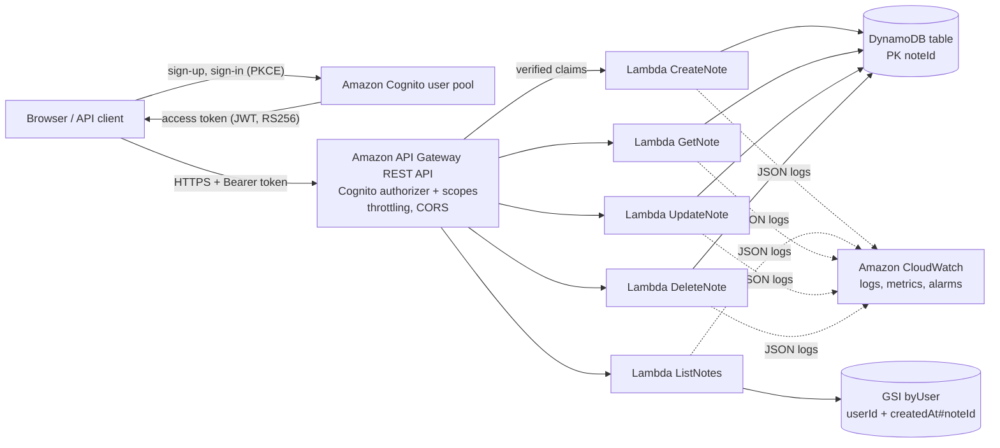

<!--
  DRAFT FOR AUTHOR REVIEW — NOT A FINAL SUBMISSION.
  Prepared with AI assistance (Claude Code) on 2026-11-17 from the repository, its evidence files and the
  original semestral report (Downloads/"CRUD  Serverless-256986 (1).pdf", kept unchanged).
  Every passage must be read, understood, verified and rewritten in the author's own words where needed.
  Markers: [AUTHOR-VERIFY] = a claim or source the author must check personally before submission.
  Open items are collected in docs/thesis/AUTHOR_REVIEW.md. The VUT title page, assignment page and
  signed declaration must be taken from the official faculty template (they are only summarised here).
-->

# Serverless CRUD API with Authentication

**Semestral thesis** · Brno University of Technology, Faculty of Electrical Engineering and Communication, Department of Telecommunications

| | |
|---|---|
| Author | John Heshmat (ID 256986) |
| Supervisor | doc. Ing. Lukáš Malina, Ph.D. |
| Study programme | Bachelor's programme Electrical Engineering, specialisation Electronics and Communication Technologies |
| Academic year | 2025/26 |
| Assignment date / deadline | 15. 9. 2025 / 16. 1. 2026 (from the official assignment page) [AUTHOR-VERIFY] |

> Front matter to be produced with the official VUT template, in this order: title page, official assignment page (unchanged), abstract and keywords (English and Czech), bibliographic citation, author's declaration (signed), acknowledgement (optional), contents, list of figures and tables.

## Abstract

This semestral thesis studies how a secure REST API with create, read, update and delete (CRUD) operations can be built from managed serverless cloud services instead of self-operated servers. It compares the serverless offerings of the major cloud platforms, summarises token-based authentication with JSON Web Tokens, OAuth 2.0 and PKCE, and designs a demonstration application in which every user manages private notes. The design defines the Note entity, a DynamoDB data model with a per-user secondary index, five REST endpoints, the request and response formats, one user role with two OAuth scopes and ownership-based access rules. The prototype is implemented on Amazon Web Services in the Stockholm region (eu-north-1) with Amazon API Gateway, five Python 3.13 AWS Lambda functions, Amazon DynamoDB and Amazon Cognito, and is described entirely as infrastructure as code with AWS SAM. Validation rejects malformed input with descriptive errors, and every error, including those produced by API Gateway, uses one JSON envelope with a request identifier. The prototype was tested with 193 automated backend tests (99 % code coverage) and with 38 checks against the deployed system, which confirmed authentication, cross-user isolation, validation, CORS and throttling. A bounded measurement of 500 requests gave a median end-to-end latency of about 120 ms. The estimated running cost at demonstration scale is about one US dollar per month at list price. The thesis closes with the limitations of the prototype and the work planned for the bachelor's thesis.

**Keywords:** serverless computing, REST API, CRUD, authentication, authorization, JSON Web Token, OAuth 2.0, PKCE, Amazon Web Services, AWS Lambda, Amazon API Gateway, Amazon DynamoDB, Amazon Cognito, infrastructure as code

## Abstrakt [AUTHOR-VERIFY: Czech wording]

Tato semestrální práce se zabývá návrhem zabezpečeného REST API s operacemi vytvoření, čtení, úpravy a mazání (CRUD) postaveného na spravovaných bezserverových (serverless) cloudových službách. Práce porovnává serverless nabídku hlavních cloudových platforem, shrnuje autentizaci založenou na tokenech (JSON Web Token, OAuth 2.0, PKCE) a navrhuje demonstrační aplikaci pro správu soukromých poznámek uživatelů. Návrh zahrnuje entitu Note, datový model v DynamoDB se sekundárním indexem podle uživatele, pět koncových bodů REST, formáty požadavků a odpovědí a přístupová pravidla založená na vlastnictví záznamu. Prototyp je implementován v Amazon Web Services v regionu Stockholm (eu-north-1) pomocí služeb Amazon API Gateway, AWS Lambda (Python 3.13), Amazon DynamoDB a Amazon Cognito a je popsán jako infrastruktura v kódu (AWS SAM). Prototyp byl ověřen 193 automatizovanými testy a 38 kontrolami nasazeného systému; medián odezvy při 500 požadavcích byl přibližně 120 ms a odhadované měsíční náklady při demonstračním provozu činí přibližně jeden americký dolar.

**Klíčová slova:** serverless, REST API, CRUD, autentizace, autorizace, JSON Web Token, OAuth 2.0, Amazon Web Services, AWS Lambda, Amazon DynamoDB, Amazon Cognito

## Bibliographic citation

HESHMAT, John. *Serverless CRUD API with Authentication* [online]. Brno, 2026. Semestral thesis. Brno University of Technology, Faculty of Electrical Engineering and Communication, Department of Telecommunications. Supervisor doc. Ing. Lukáš Malina, Ph.D. [AUTHOR-VERIFY: the original report called this a "Bachelor's Thesis"; use the faculty's exact citation format and URL]

---

## 1 Introduction

Many applications need the same backend: users sign in, store structured data and later read, change or delete it. Running such a backend traditionally means operating servers — choosing their size, patching operating systems, configuring load balancers and paying for capacity even when nobody uses it. Serverless cloud services move these tasks to the provider: code runs in short-lived functions started by requests, data lives in a managed database, and identity is handled by a managed user directory. The application team writes business logic and configuration, and pays per request.

The goal of this thesis, as set by the official assignment, is to design a demonstrational serverless backend on a cloud platform: a REST API with CRUD operations and secure user authentication, built from serverless functions, an API gateway and a managed database. The system should process requests reliably and in time, protect user accounts and stored data with basic security techniques, and show the advantages of a serverless backend over a traditional server-based one.

The assignment divides the work into two stages:

- **Semestral thesis (this document):** (1) research relevant cloud platforms, serverless technologies, managed databases and methods of user authentication and authorization, including token-based access; (2) design a demonstration application and the REST API architecture — entities, data model, endpoints, request and response formats, user roles and access rules; (3) implement and test a basic serverless prototype with CRUD operations for at least one entity, including validation and error handling.
- **Bachelor's thesis (follow-up):** (4) implement the full backend with user management, logging and monitoring; (5) evaluate functionality, performance, scalability, security and costs and discuss extensions such as a web or mobile client.

During the semester the implementation progressed beyond the prototype: the system was deployed to AWS, measured, and given a web client. These results are reported where they support the semestral goals, but they are labelled as work towards the bachelor's thesis (Chapters 6 and 8), and the evaluation required by item 5 is only begun here.

The thesis is organised as follows. Chapter 2 compares cloud platforms and serverless services and justifies the choice of AWS. Chapter 3 covers authentication and authorization. Chapter 4 presents the design, Chapter 5 the implementation, and Chapter 6 the testing and the first measurements. Chapter 7 discusses security and limitations, Chapter 8 summarises how the assignment was fulfilled, and Chapter 9 outlines future work.

## 2 Cloud platforms and serverless technologies

### 2.1 Cloud service models

The NIST definition describes cloud computing as on-demand network access to a shared pool of configurable resources that can be provisioned and released quickly with minimal management effort, and distinguishes three service models: infrastructure (IaaS), platform (PaaS) and software as a service (SaaS) [15]. With IaaS the customer still operates virtual machines; with PaaS the provider runs the platform and the customer deploys applications.

**Serverless computing** goes one step further. Jonas et al. characterise it by three properties: storage and computation are decoupled and scale separately; code is executed without the user allocating resources; and the user pays in proportion to the resources used rather than allocated [14]. In practice serverless consists of two parts:

- **Function as a Service (FaaS)** — short-lived, stateless functions started by an event such as an HTTP request (AWS Lambda, Azure Functions, Google Cloud Run functions);
- **Backend as a Service (BaaS)** — managed building blocks that the functions use: databases, identity providers, queues and object storage [1], [14].

### 2.2 Advantages and trade-offs of serverless

Compared with a backend running on rented virtual machines or containers, a serverless backend offers [1], [14], [18]:

- **no server operation** — no operating system patching, capacity planning or load-balancer configuration;
- **automatic scaling** — each request can get its own execution environment, and the platform adds environments as traffic grows;
- **pay per use** — with no traffic the compute cost is close to zero, which suits small applications with irregular load;
- **built-in availability** — managed services run across several availability zones of a region.

The trade-offs are equally important for an honest evaluation:

- **cold starts** — the first request to a new execution environment waits for it to be created (measured for this prototype in Section 6.5);
- **statelessness** — nothing can be kept between requests except in external services, so all state lives in the database;
- **limits** — for example, an AWS Lambda invocation runs for at most 15 minutes and a synchronous request or response payload is limited to 6 MB [5]; a DynamoDB item is limited to 400 KB [7];
- **vendor lock-in** — the services and their configuration are provider-specific;
- **cost at constant high load** — per-request prices can exceed the price of permanently running capacity;
- **testing and debugging** — the managed services cannot run on a developer's machine, which requires emulators or a deployed test environment.

### 2.3 Comparison of cloud platforms

The three largest public cloud platforms offer comparable serverless building blocks. Table 2.1 maps the components required by the assignment to their services.

*Table 2.1 — Serverless building blocks of three major platforms* [5]–[8], [16], [17] [AUTHOR-VERIFY: service names change; check each against the current documentation]

| Component | Amazon Web Services | Microsoft Azure | Google Cloud |
|---|---|---|---|
| Functions (FaaS) | AWS Lambda | Azure Functions | Cloud Run functions (formerly Cloud Functions) |
| API gateway | Amazon API Gateway (REST and HTTP APIs) | Azure API Management | API Gateway, Apigee |
| Managed NoSQL database | Amazon DynamoDB | Azure Cosmos DB | Firestore |
| User directory issuing JWTs | Amazon Cognito user pools | Microsoft Entra External ID | Identity Platform / Firebase Authentication |
| Logging and monitoring | Amazon CloudWatch | Azure Monitor | Cloud Logging, Cloud Monitoring |
| Infrastructure as code | AWS CloudFormation, AWS SAM | Azure Resource Manager, Bicep | Infrastructure Manager (Terraform) |

All three platforms can satisfy the functional requirements. The differences that matter for this project are how directly the API gateway can verify a JWT from the provider's own user directory, how mature the tooling for describing the whole stack as code is, and the availability of literature and documentation.

### 2.4 Choice of AWS

AWS was selected for these reasons:

1. **Integrated JWT verification at the gateway.** An API Gateway REST API can use a Cognito user pool as an authorizer and require OAuth scopes per route, so unauthenticated or insufficiently privileged requests never reach the functions [6], [8].
2. **Infrastructure as code for every component.** AWS SAM, an extension of CloudFormation, describes the API, functions, table, user pool, logs and alarms in one template, which makes the deployment reproducible and reviewable [19].
3. **Literature and documentation.** The recommended literature for the assignment is written for AWS [1], and the services are documented in detail [5]–[8].
4. **Cost.** All services used are billed per request or per active user, and the account used for the project had a Free plan with credits (Section 6.7).

**Region.** The original report named Frankfurt (eu-central-1). The AWS account used for the project belongs to an organization whose service control policy denies workload services in all regions except Stockholm (eu-north-1); this was confirmed with the IAM policy simulator on 16 November 2026 (repository, ADR 0008). The prototype therefore runs in eu-north-1, which is also an EU region and offers every service used [AUTHOR-VERIFY: confirm that the region choice is acceptable to the supervisor].

### 2.5 Managed databases

Relational databases offer joins, transactions and a flexible query language, but a managed relational database typically runs on provisioned instances that cost money even when idle. NoSQL key-value and document databases trade query flexibility for predictable performance at any scale: data is partitioned by key, and every efficient query must name the partition key [3], [7].

**Amazon DynamoDB** is a fully managed key-value and document database. In on-demand mode it charges per read and write request and scales without capacity planning; data is replicated across three availability zones and encrypted at rest [7]. Its design rule is to model the table around the access patterns: an operation that does not use a key requires a `Scan`, which reads the whole table. **Global secondary indexes (GSI)** provide additional access patterns with a different key; they are updated asynchronously and therefore read with eventual consistency [7]. These properties determined the data model in Section 4.3.

## 3 Authentication and authorization

### 3.1 Concepts

**Authentication** establishes who the caller is; **authorization** decides whether that caller may perform an operation on a specific resource [2]. A web API can authenticate requests with server-side sessions (a session identifier in a cookie, state stored on the server) or with **tokens** that carry signed claims about the user and can be verified without a session store. Stateless token verification fits serverless functions, which keep no state between requests [2].

### 3.2 JSON Web Tokens

A JSON Web Token (JWT) is a compact, URL-safe representation of claims [9]. A signed JWT consists of three Base64url-encoded parts, `header.payload.signature`:

- the **header** names the signature algorithm and the key identifier (`kid`);
- the **payload** contains claims such as the issuer (`iss`), the subject (`sub`), the expiry time (`exp`) and the issue time (`iat`);
- the **signature** protects header and payload against modification.

Amazon Cognito signs its tokens with **RS256** (RSA with SHA-256). The private key stays with Cognito; anyone can verify a token with the public keys that the user pool publishes as a JSON Web Key Set [8]. A verifier must check the signature, the issuer, the expiry and — because a pool issues several token types — the intended use of the token. Cognito issues an **ID token** (identity information for the client, with the audience claim `aud`) and an **access token** (authorization for APIs, with `client_id`, `token_use = access` and the granted `scope`) [8]. The original report showed an HS256 token checked for `aud`; for Cognito access tokens this is not accurate.

### 3.3 OAuth 2.0, OpenID Connect and PKCE

OAuth 2.0 is a framework in which an authorization server issues access tokens that a client presents to a resource server [10]. OpenID Connect adds a standard ID token on top. For browser applications, which cannot keep a client secret, the recommended flow is the **authorization code flow with Proof Key for Code Exchange (PKCE)** [11]: the client creates a random `code_verifier`, sends only its SHA-256 hash (`code_challenge`) with the sign-in request, and must present the original verifier when exchanging the returned code for tokens. An intercepted code is useless without the verifier. A random `state` value additionally protects the redirect against cross-site request forgery [10].

### 3.4 Amazon Cognito

Cognito provides two different services that the original report mixed up [8]:

- **user pools** — a user directory with sign-up, e-mail verification, password policy, password reset and a hosted sign-in page; it issues JWTs; this is what the prototype uses;
- **identity pools** — exchange an identity for temporary AWS credentials through AWS STS; not used.

A user pool can define a **resource server** with custom scopes. The prototype defines `notes/read` and `notes/write`, and API Gateway checks them per route.

### 3.5 Authorization of individual resources

Verifying the token answers only the first question. The most frequent API vulnerability in the OWASP API Security Top 10 is *Broken Object Level Authorization* — an authenticated user accessing another user's object by changing its identifier [20]. The API must therefore check, for every request that names a resource, that the resource belongs to the caller. In this design the owner is the `sub` claim of the verified token, never a value sent by the client (Section 5.5).

## 4 Design of the demonstration application

### 4.1 Requirements

The demonstration application is a multi-user private notes service. Its requirements were derived from the assignment and from the API design in the original report (repository file `docs/REQUIREMENTS.md`):

*Table 4.1 — Main requirements*

| ID | Requirement |
|---|---|
| F-1 | CRUD operations for the entity Note through a REST API |
| F-2 | Endpoints `POST /notes`, `GET /notes`, `GET /notes/{id}`, `PUT /notes/{id}`, `DELETE /notes/{id}` |
| F-3 | JWT authentication on every endpoint (`Authorization: Bearer <token>`) |
| F-4 | Each note belongs to one user; only the owner may read, change or delete it |
| F-5 | Status codes 201 (create), 200 (read, update, delete), 400, 401, 403 (another user's existing note), 404 (non-existent note) |
| F-6 | Note attributes `noteId`, `userId`, `title`, `content`, `createdAt`, `updatedAt` |
| F-7 | Validation of `title` and `content` on create and update |
| N-1 | Managed serverless services that scale automatically |
| N-2 | Every API call is logged and individual requests can be traced |

### 4.2 Architecture

*Figure 4.1 — Architecture of the prototype* [AUTHOR-VERIFY: export this diagram as an image for the final document]



A client obtains an access token from the Cognito user pool and sends it with every request. API Gateway verifies the token and the route's scope before it invokes one of five Lambda functions — one per operation. The functions validate the input, enforce ownership and store the notes in DynamoDB. CloudWatch collects logs and metrics, and four alarms watch for server errors, high latency, function errors and database throttling. All resources are created from one AWS SAM template.

Five functions were chosen instead of one function with internal routing (or the three functions in the original report) so that each function's IAM role can be limited to exactly one DynamoDB action, and so that each operation has its own logs and metrics. The functions share one code package, so there is no duplicated code; the cost is five separate cold starts (repository, ADR 0003).

### 4.3 Note entity and data model

*Table 4.2 — Attributes of a note*

| Attribute | Type | Set by | Rule |
|---|---|---|---|
| `noteId` | string (UUID v4) | server | partition key |
| `userId` | string | server | `sub` claim of the creator; cannot be changed |
| `title` | string | client | 1–200 characters after trimming, no control characters |
| `content` | string | client | 0–20 000 characters |
| `createdAt`, `updatedAt` | string (ISO 8601, UTC, ms) | server | |
| `version` | number | server | starts at 1, incremented by each update (optimistic locking) |

The table has the partition key `noteId`. A **global secondary index `byUser`** has the partition key `userId` and the sort key `userSortKey = "<createdAt>#<noteId>"`, so that one user's notes can be listed newest first with a `Query` that reads only that user's items. The original report kept `noteId` as the only key and filtered the notes of a user in the application, which requires scanning the whole table. A composite key (`userId`, `noteId`) was also considered; it was rejected because a lookup by `noteId` alone would then be impossible and the API could no longer distinguish "another user's note" (403) from "no such note" (404), as F-5 requires (repository, ADR 0002).

*Table 4.3 — Access patterns*

| Operation | DynamoDB call |
|---|---|
| Create | `PutItem` with condition `attribute_not_exists(noteId)` |
| Read one | `GetItem`, strongly consistent; owner compared in the service |
| List own | `Query` on `byUser`, newest first, `Limit` + continuation token |
| Update | `UpdateItem` with condition: exists, owner = caller (and version matches, if sent) |
| Delete | `DeleteItem` with condition: exists, owner = caller |

`Scan` is never used, and the functions' IAM roles do not permit it.

### 4.4 REST API

The API follows the REST architectural style [13]: notes are resources identified by URLs, the HTTP methods carry the meaning of the operation and the status codes report the outcome [4], [12].

*Table 4.4 — Endpoints*

| Method and path | Purpose | Scope | Success |
|---|---|---|---|
| `POST /notes` | create a note | `notes/write` | 201 + note |
| `GET /notes` | list the caller's notes (`limit` 1–100, `nextToken`) | `notes/read` | 200 + list |
| `GET /notes/{id}` | read one note | `notes/read` | 200 + note |
| `PUT /notes/{id}` | replace title and content (optional `version`) | `notes/write` | 200 + note |
| `DELETE /notes/{id}` | delete a note | `notes/write` | 200 |

Requests and responses are JSON. Every response uses one envelope: `{"data": …}` for one resource, `{"data": […], "meta": {"count", "limit", "nextToken"}}` for a list, and for errors

```json
{ "error": { "code": "VALIDATION_ERROR", "message": "The title field is required",
             "requestId": "c6af9ac6-…", "details": [ { "field": "title", "issue": "is required" } ] } }
```

The `requestId` is API Gateway's request identifier, which is also written to the logs, so a user-reported error can be traced (Section 5.6).

*Table 4.5 — Status codes*

| Status | When |
|---|---|
| 200 / 201 | success (201 for create) |
| 400 | invalid JSON, invalid fields, unknown fields, invalid UUID or continuation token |
| 401 | missing, invalid or expired token; ID token instead of access token; missing scope |
| 403 | the note exists but belongs to another user |
| 404 | no note with this identifier |
| 409 | the `version` sent with PUT is out of date |
| 413 / 415 | body larger than 128 KiB / not JSON |
| 429 | request rate above the stage limit |
| 500 / 503 | unexpected error (no details exposed) / database unavailable, retry possible |

Two choices follow the assignment literally and are discussed as trade-offs. Returning **403** for another user's note reveals that a note with that identifier exists; many APIs return 404 in both cases. The disclosure is small because identifiers are random 122-bit UUIDs and nothing else is revealed, and the requirement is explicit. **DELETE returns 200** with a body instead of 204, which keeps the envelope uniform [12].

PUT replaces the whole note (both fields are required) in accordance with HTTP semantics [12]; partial updates (PATCH) were not required.

### 4.5 User roles and access rules

The application has one role — an authenticated user who owns notes. The rules are:

1. Every endpoint requires a valid Cognito **access** token; ID tokens are rejected.
2. Reading requires the scope `notes/read`, writing `notes/write`. The web client receives both; a second app client that receives only `notes/read` was used to prove that the scope check works.
3. A user can see and change only notes whose `userId` equals the `sub` claim of the token.
4. The client can never set `userId`, `noteId`, timestamps or `version` (except `version` as a precondition on PUT); unknown fields are rejected.

There is no administrator role; administration of accounts is done in Cognito.

### 4.6 Request flow

For an authorized update the flow is:

1. The client sends `PUT /notes/{id}` with `Authorization: Bearer <access token>`.
2. API Gateway's Cognito authorizer verifies the signature with the pool's public keys, checks issuer and expiry and requires the scope `notes/write`; otherwise it answers 401 without invoking a function.
3. The UpdateNote function reads the caller's `sub` from the verified claims in the event, validates the identifier and body, and calls the service.
4. The repository issues `UpdateItem` with a condition that the note exists and belongs to the caller. If the condition fails, DynamoDB returns the old item, from which the function decides between 404 (no item), 403 (another owner) and 409 (version mismatch).
5. The function writes one JSON log line and returns the envelope.

Because the ownership check is part of the write itself, no other request can change the note between the check and the write.

## 5 Implementation

### 5.1 Structure

The backend is written in Python 3.13 and runs on Lambda on arm64 (AWS Graviton) processors with 256 MB of memory. It has no third-party runtime dependencies; `boto3` is provided by the Lambda runtime. The code is layered:

| Layer | Module | Responsibility |
|---|---|---|
| Handler | `handlers/*.py` | entry point of each function (about ten lines each) |
| HTTP wrapper | `http.py` | identity extraction, error mapping, response envelope, logging |
| Operation | `operations.py` | parsing and validation of the request |
| Service | `services/notes_service.py` | business rules (ownership, versioning) |
| Repository | `repositories/notes_repository.py` | the only code that calls DynamoDB |

The service depends on a repository interface (a Python `Protocol`), so its rules are unit-tested with an in-memory implementation, and the repository is tested against an emulated DynamoDB (`moto`).

### 5.2 Validation

Validation (`validation/notes.py`) is strict and reports all problems of a request together:

- the body must be a JSON object, sent with `Content-Type: application/json`, at most 128 KiB;
- `POST` accepts exactly `title` and `content`; `PUT` additionally an optional positive integer `version`;
- unknown fields are rejected — this is what prevents a client from setting `userId`;
- values are not converted implicitly (`"title": 123` is an error);
- `{id}` must be a UUID; `limit` must be an integer from 1 to 100; a malformed continuation token is rejected.

The original report required only that `title` and `content` are present.

### 5.3 Error handling

Errors are raised as subclasses of one `AppError` class, each with a status code and an error code. The HTTP wrapper converts them into the envelope; any unexpected exception becomes a 500 response without internal details, while the full exception is logged. Database throttling or unavailability becomes 503, which tells the client it may retry. API Gateway's own errors — missing token (401), throttling (429) or unknown routes — are configured as *gateway responses* with the same envelope and CORS headers, so the client handles all errors the same way.

### 5.4 Authentication in the functions

API Gateway performs the authentication, but the functions check again (defence in depth) that the event contains a `sub`, that the token was an access token and that the required scope is present. The caller's identity is taken only from `event.requestContext.authorizer.claims.sub`, which only API Gateway can fill, and each function can be invoked only by this API.

### 5.5 Data access and ownership

Ownership is enforced in two ways. For reading, the service loads the note and compares its `userId` with the caller. For updating and deleting, the condition expression of the DynamoDB write contains the owner check, so the check and the write are one atomic operation. With `ReturnValuesOnConditionCheckFailure=ALL_OLD`, a failed condition returns the stored item and the function can answer 403, 404 or 409 without a second read. Optimistic locking with the `version` attribute prevents lost updates when the same note is edited in two places.

Listing uses the `byUser` index with an opaque continuation token. The token contains only a position, never a user identifier, and the server always combines it with the caller's identity, so a token copied from another user cannot reveal their notes.

### 5.6 Logging and monitoring

Each request produces one structured JSON log line with the request identifier, function, method, route, status code, error code and duration. Titles, contents, tokens and e-mail addresses are never logged. Logs are kept for 14 days. Four CloudWatch alarms watch API 5xx errors, p95 latency, Lambda errors and DynamoDB throttling; e-mail notification is optional. The request identifier shown in an error message can be found with CloudWatch Logs Insights; this was done on the deployed system (`evidence/aws/cloudwatch.txt`).

### 5.7 Infrastructure as code and deployment

All resources — the API with its authorizer, throttling (10 requests per second, burst 20) and gateway responses, the five functions with their roles and log groups, the table and index, the user pool with its domain, app clients and resource server, and the alarms — are defined in `infrastructure/template.yaml` (AWS SAM). The template is checked with `cfn-lint` and `sam validate` in continuous integration (GitHub Actions). Deployments are made with a CloudFormation **change set**, which lists every resource that will be added, modified or replaced, and which is reviewed before it is executed. The development stack `serverless-notes-dev` was deployed in eu-north-1 on 17 November 2026 (33 resources).

### 5.8 Web client and hosting (beyond the semestral scope)

To demonstrate the API, a React and TypeScript web client was written. It registers users, signs them in through Cognito's hosted page with the authorization code flow and PKCE, keeps the tokens only in memory and provides a notes list and editor. Since 17 November 2026 the client is published at https://d11c0a7q5fx9qi.cloudfront.net from a private Amazon S3 bucket through Amazon CloudFront with Origin Access Control, HTTPS and security headers [22]. The client is an extension in the sense of assignment item 5 and is not required for the semestral thesis.

## 6 Testing and evaluation

### 6.1 Methodology

Testing has four levels:

1. **Unit tests** of validation, pagination tokens, identity extraction and service rules (pytest);
2. **Integration tests** of the repository and of complete handler → service → repository flows against an emulated DynamoDB (`moto`);
3. **Security tests** of cross-user isolation, ownership, error disclosure, log hygiene and concurrent writes;
4. **Live tests** against the deployed stack (`scripts/testing/live_api_tests.py`), which create temporary Cognito users, call the real API and delete the users afterwards.

The web client has its own unit tests (Vitest) and browser tests (Playwright). Static analysis (ruff, mypy in strict mode, ESLint, TypeScript) and dependency audits run in continuous integration.

### 6.2 Results

*Table 6.1 — Executed tests* (raw outputs in the repository's `evidence/` directory)

| Test | Result | Date | Evidence |
|---|---|---|---|
| Backend unit, integration and security tests | 193 passed, 0 failed; 99 % line and branch coverage | 17. 11. 2026 | `evidence/tests/backend-pytest.txt` |
| Static analysis and dependency audits | no findings | 17. 11. 2026 | `evidence/tests/backend-static-analysis.txt`, `frontend-static-analysis.txt` |
| Frontend unit and component tests | 66 passed | 17. 11. 2026 | `evidence/tests/frontend-vitest.txt` |
| Browser tests against the local emulator | 14 passed, including an accessibility audit | 17. 11. 2026 | `evidence/tests/frontend-e2e-playwright.txt` |
| Live tests against AWS (eu-north-1) | 38 passed, 0 failed | 17. 11. 2026 | `evidence/tests/live-api-tests.json` |
| Browser test of the deployed system and of the public site | sign-in, create, reload, edit, delete, sign-out; isolation between two users | 17. 11. 2026 | `docs/testing/TESTING.md`, `evidence/screenshots/aws-11…13` |

The 38 live checks covered: the thirteen test cases of the original report plus "delete a missing note" (T01–T15); that another user's attempts leave a note unchanged and that it never appears in their list (H01–H02); rejection of a garbage token, a token with a modified signature, an ID token and a non-Bearer scheme, and the scope rule (A01–A07); unknown routes and methods (R01–R02); rejection of a client-supplied `userId`, malformed JSON, an invalid identifier and an oversized body (V01–V04); CORS (C01–C04); and throttling (L01–L03).

In addition, the project owner registered with a real mailbox, entered the e-mailed verification code, signed in, reset the password and performed all CRUD operations on the public site on 17 November 2026. This was a manual check without a recorded evidence file.

### 6.3 Security testing

The security tests confirmed on the deployed system that API Gateway rejects every invalid token before a function runs, that a token without the `notes/write` scope cannot create notes, and that a user receives 403 for another user's note while the note remains unchanged. In the browser, no token was found in `localStorage`, `sessionStorage` or cookies, and CloudWatch logs contained no note content, tokens or e-mail addresses. Two behaviours of API Gateway were measured rather than assumed: a missing scope yields 401 (not 403), and a token with an invalid signature yields 403. Not tested: an expired token, a token from another user pool, and a penetration test.

### 6.4 Performance (measured)

A bounded benchmark was run on 17 November 2026 from a home connection in Central Europe against eu-north-1: 100 sequential cycles of create → list → read → update → delete (500 requests), with a new TLS connection for each request, starting right after a deployment.

*Table 6.2 — End-to-end latency seen by the client (ms)* (`evidence/benchmarks/aws-dev-eu-north-1.json`)

| Endpoint | Median | p95 | Maximum (cold start) | Success |
|---|---|---|---|---|
| POST /notes | 121.1 | 141.6 | 807.6 | 100 % |
| GET /notes | 119.4 | 149.3 | 949.1 | 100 % |
| GET /notes/{id} | 118.8 | 145.8 | 768.6 | 100 % |
| PUT /notes/{id} | 121.7 | 152.3 | 908.4 | 100 % |
| DELETE /notes/{id} | 122.1 | 149.6 | 745.9 | 100 % |

Inside Lambda, a warm request took a median of 10–14 ms and used about 92 MB of the 256 MB of memory; most of the ~120 ms is network, TLS, API Gateway and the authorizer. The first measurements showed a cold start of about 1.2–1.4 s, because the AWS SDK client was created during the first request. Creating it during the initialisation phase reduced the time inside Lambda for a cold start to about 0.55–0.69 s. These results describe one sequential client; they do not show the behaviour under concurrent load.

### 6.5 Scalability (expected, not measured)

The following statements are architectural expectations based on the documentation, not measurements of this prototype:

- Lambda creates more execution environments as concurrent requests increase, up to the account's concurrency quota [5];
- DynamoDB on-demand tables adapt to the request rate, and because every operation addresses a key and listing reads only the caller's partition of the index, no operation becomes slower as the number of users grows [7];
- the stage throttle (10 requests per second) is deliberately low to bound cost; it is the first limit a load test would hit and would have to be raised for real use.

A concurrent load test is planned for the bachelor's thesis (Chapter 9).

### 6.6 Costs

Unit prices for eu-north-1 were read from the AWS Price List API [21] on 16 and 17 November 2026; the totals are estimates at list price without any free allowance (repository, `AWS_COST_ANALYSIS.md`).

*Table 6.3 — Estimated monthly cost (USD, list price)*

| Scenario | Requests / month | Estimate |
|---|---|---|
| Demonstration and testing (5 users) | 10 000 | ≈ 1 (mostly the CloudWatch alarms) |
| Small application (200 users) | 300 000 | ≈ 2.35 |
| Moderate use (5 000 users) | 5 000 000 | ≈ 25 (≈ 70 % API Gateway) |

The cost grows linearly with traffic and falls almost to zero without it. Hosting the web client on CloudFront is within its always-free allowance (1 TB and 10 million requests per month) at this scale. The AWS account had a Free plan with USD 158.72 of credits remaining on 17 November 2026, so the net charge for the project so far is zero. Earlier spending visible in the account was caused by an unrelated EC2 virtual machine, which was terminated on 17 November 2026; it is not part of this project's cost. A comparison with the real bill is still to be made.

## 7 Security considerations and limitations

Measures in place: managed authentication with a password policy and e-mail verification; RS256 access tokens verified at the gateway with per-route scopes; ownership checks inside conditional writes; strict input validation with rejection of unknown fields; least-privilege IAM with one DynamoDB action per function; encryption at rest; HTTPS only; CORS limited to the published site; throttling; uniform errors without internal details; logs without personal data; tokens kept in memory in the browser; a content security policy and security headers on the web client.

Known limitations:

1. Multi-factor authentication is disabled, and there is no WAF or CAPTCHA in front of sign-up.
2. Throttling applies to the whole stage, not to individual users.
3. The 403/404 distinction reveals that a guessed identifier exists (required by the assignment).
4. An access token remains valid until it expires (at most 60 minutes) even after sign-out.
5. Cognito's default e-mail sender allows only a small number of e-mails per day; production use would need Amazon SES.
6. The development stage has no database backups (point-in-time recovery is enabled only for a production stage).
7. The web client uses the default `*.cloudfront.net` domain, so the minimum TLS version cannot be raised.

## 8 Results and fulfilment of the assignment

*Table 8.1 — Fulfilment* (complete matrix: `docs/thesis/REQUIREMENTS_MATRIX.md`)

| Assignment item | Result | Status |
|---|---|---|
| 1. Research of platforms, serverless, databases, authentication | Chapters 2 and 3 | done (draft; author review pending) |
| 2. Design: entities, data model, endpoints, formats, roles, access rules | Chapter 4 | done |
| 3. Prototype with CRUD, validation, error handling; tests | Chapters 5 and 6; 193 automated tests, 38 live checks | done and verified on AWS |
| 4. Full backend with user management, logging and monitoring (bachelor) | user pool with sign-up, verification, reset; structured logs; alarms; deployed | largely implemented; operational hardening open |
| 5. Evaluation of functionality, performance, scalability, security, costs (bachelor) | first measurements in Chapter 6 | begun; load test, real bill and security review open |

## 9 Future work (bachelor's thesis)

- concurrent load test with raised limits and analysis of scaling and cold starts;
- comparison of the cost estimate with the real bill over a longer period;
- tests of expired tokens and tokens from another issuer, and of alarm notifications;
- optional hardening: MFA, per-user rate limiting, Amazon SES for e-mail, backups, a staging environment, a custom domain;
- a comparison with a server-based implementation to quantify the advantages claimed in Section 2.2;
- extensions named in the assignment: a mobile client and integrations with other systems.

## 10 Conclusion

The semestral thesis studied serverless cloud services and token-based authentication, compared three cloud platforms and chose AWS mainly for its integration of JWT verification into the API gateway and for describing the whole system as code. It designed a private-notes REST API with one entity, five endpoints, a uniform response format and ownership-based access rules, and a DynamoDB model whose secondary index lists one user's notes without scanning the table. The prototype was implemented with five Python Lambda functions, deployed to the Stockholm region and verified by 193 automated tests and 38 checks against the deployed system. The first measurements showed a median latency of about 120 ms and a running cost of about one dollar per month at demonstration scale. The prototype therefore meets the three semestral goals, and it provides the basis on which the bachelor's thesis will complete the evaluation of performance, scalability, security and cost.

---

## References

Format follows ČSN ISO 690. Online sources: URLs were reachable on the date given; the author must confirm that each source supports the sentence where it is cited [AUTHOR-VERIFY].

[1] SBARSKI, Peter; CUI, Yan and NAIR, Ajay. *Serverless Architectures on AWS*. 2nd ed. Shelter Island: Manning Publications, 2022. ISBN 978-1-61729-542-3.

[2] MADDEN, Neil. *API Security in Action*. Shelter Island: Manning Publications, 2020. ISBN 978-1-61729-602-4.

[3] KLEPPMANN, Martin. *Designing Data-Intensive Applications*. Sebastopol: O'Reilly Media, 2017. ISBN 978-1-4493-7332-0.

[4] RICHARDSON, Leonard; AMUNDSEN, Mike and RUBY, Sam. *RESTful Web APIs*. Sebastopol: O'Reilly Media, 2013. ISBN 978-1-4493-5806-8. [AUTHOR-VERIFY: the original report gave 978-1-4493-5857-0; check the ISBN of the edition used]

[5] AMAZON WEB SERVICES. *AWS Lambda Developer Guide* [online]. [cit. 2026-11-17]. Available at: https://docs.aws.amazon.com/lambda/latest/dg/welcome.html

[6] AMAZON WEB SERVICES. *Amazon API Gateway Developer Guide* [online]. [cit. 2026-11-17]. Available at: https://docs.aws.amazon.com/apigateway/latest/developerguide/welcome.html

[7] AMAZON WEB SERVICES. *Amazon DynamoDB Developer Guide* [online]. [cit. 2026-11-17]. Available at: https://docs.aws.amazon.com/amazondynamodb/latest/developerguide/Introduction.html

[8] AMAZON WEB SERVICES. *Amazon Cognito Developer Guide* [online]. [cit. 2026-11-17]. Available at: https://docs.aws.amazon.com/cognito/latest/developerguide/what-is-amazon-cognito.html

[9] JONES, Michael B.; BRADLEY, John and SAKIMURA, Nat. *JSON Web Token (JWT)*. RFC 7519. Internet Engineering Task Force, 2015. DOI 10.17487/RFC7519. Available at: https://www.rfc-editor.org/rfc/rfc7519

[10] HARDT, Dick (ed.). *The OAuth 2.0 Authorization Framework*. RFC 6749. Internet Engineering Task Force, 2012. DOI 10.17487/RFC6749. Available at: https://www.rfc-editor.org/rfc/rfc6749

[11] SAKIMURA, Nat; BRADLEY, John and AGARWAL, Naveen. *Proof Key for Code Exchange by OAuth Public Clients*. RFC 7636. Internet Engineering Task Force, 2015. DOI 10.17487/RFC7636. Available at: https://www.rfc-editor.org/rfc/rfc7636

[12] FIELDING, Roy T.; NOTTINGHAM, Mark and RESCHKE, Julian (eds.). *HTTP Semantics*. RFC 9110. Internet Engineering Task Force, 2022. DOI 10.17487/RFC9110. Available at: https://www.rfc-editor.org/rfc/rfc9110

[13] FIELDING, Roy Thomas. *Architectural Styles and the Design of Network-based Software Architectures*. Doctoral dissertation. Irvine: University of California, Irvine, 2000. Available at: https://ics.uci.edu/~fielding/pubs/dissertation/top.htm


[14] JONAS, Eric et al. *Cloud Programming Simplified: A Berkeley View on Serverless Computing*. Technical Report UCB/EECS-2019-3. Berkeley: University of California, Berkeley, 2019. Available at: https://www2.eecs.berkeley.edu/Pubs/TechRpts/2019/EECS-2019-3.html

[15] MELL, Peter and GRANCE, Timothy. *The NIST Definition of Cloud Computing*. NIST Special Publication 800-145. Gaithersburg: National Institute of Standards and Technology, 2011. DOI 10.6028/NIST.SP.800-145.

[16] MICROSOFT. *Azure Functions documentation* [online]. [cit. 2026-11-17]. Available at: https://learn.microsoft.com/en-us/azure/azure-functions/

[17] GOOGLE. *Cloud Run functions documentation* [online]. [cit. 2026-11-17]. Available at: https://cloud.google.com/functions/docs

[18] AMAZON WEB SERVICES. *AWS Well-Architected Framework: Serverless Applications Lens* [online]. [cit. 2026-11-17]. Available at: https://docs.aws.amazon.com/wellarchitected/latest/serverless-applications-lens/welcome.html

[19] AMAZON WEB SERVICES. *AWS Serverless Application Model Developer Guide* [online]. [cit. 2026-11-17]. Available at: https://docs.aws.amazon.com/serverless-application-model/latest/developerguide/what-is-sam.html

[20] OWASP FOUNDATION. *OWASP API Security Top 10 – 2023* [online]. [cit. 2026-11-17]. Available at: https://owasp.org/API-Security/editions/2023/en/0x11-t10/

[21] AMAZON WEB SERVICES. *AWS Pricing* [online]. [cit. 2026-11-17]. Available at: https://aws.amazon.com/pricing/ (unit prices for eu-north-1 were read from the AWS Price List API; see the repository's `AWS_COST_ANALYSIS.md`)

[22] AMAZON WEB SERVICES. *Restricting access to an Amazon S3 origin* (Amazon CloudFront Developer Guide) [online]. [cit. 2026-11-17]. Available at: https://docs.aws.amazon.com/AmazonCloudFront/latest/DeveloperGuide/private-content-restricting-access-to-s3.html

> References are numbered by topic, not by order of first citation. Renumber them if the faculty template requires order of citation [AUTHOR-VERIFY].

## List of abbreviations

| Abbreviation | Meaning |
|---|---|
| API | Application Programming Interface |
| AWS | Amazon Web Services |
| BaaS / FaaS | Backend as a Service / Function as a Service |
| CORS | Cross-Origin Resource Sharing |
| CRUD | Create, Read, Update, Delete |
| GSI | Global Secondary Index |
| HTTP(S) | Hypertext Transfer Protocol (Secure) |
| IAM | Identity and Access Management |
| JSON | JavaScript Object Notation |
| JWT | JSON Web Token |
| OAC | Origin Access Control |
| PKCE | Proof Key for Code Exchange |
| REST | Representational State Transfer |
| SAM | Serverless Application Model |
| SCP | Service Control Policy |
| UUID | Universally Unique Identifier |

## Appendix A — Use of AI tools [AUTHOR-VERIFY: adapt to the current VUT/FEEC rules on AI use and agree with the supervisor]

Draft statement: *The source code, tests, infrastructure templates and parts of the documentation of the prototype were developed with the assistance of the AI coding assistant Claude Code (Anthropic). The AI tool was also used to prepare a first draft of this report from the project's documentation and test evidence. All design decisions, results and text were reviewed, verified and edited by the author, who takes full responsibility for the content. Measured results come from tests executed on the deployed system and are stored in the project repository.*

## Appendix B — Repository and evidence

Source code and documentation (public repository): https://github.com/Joun-Mikhail/CRUD — raw test outputs, measurements and deployment records: directory `evidence/`. Live system: https://d11c0a7q5fx9qi.cloudfront.net (development stack; may be removed after the defence).
